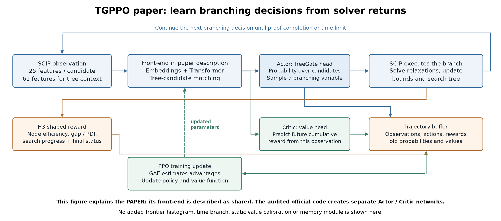
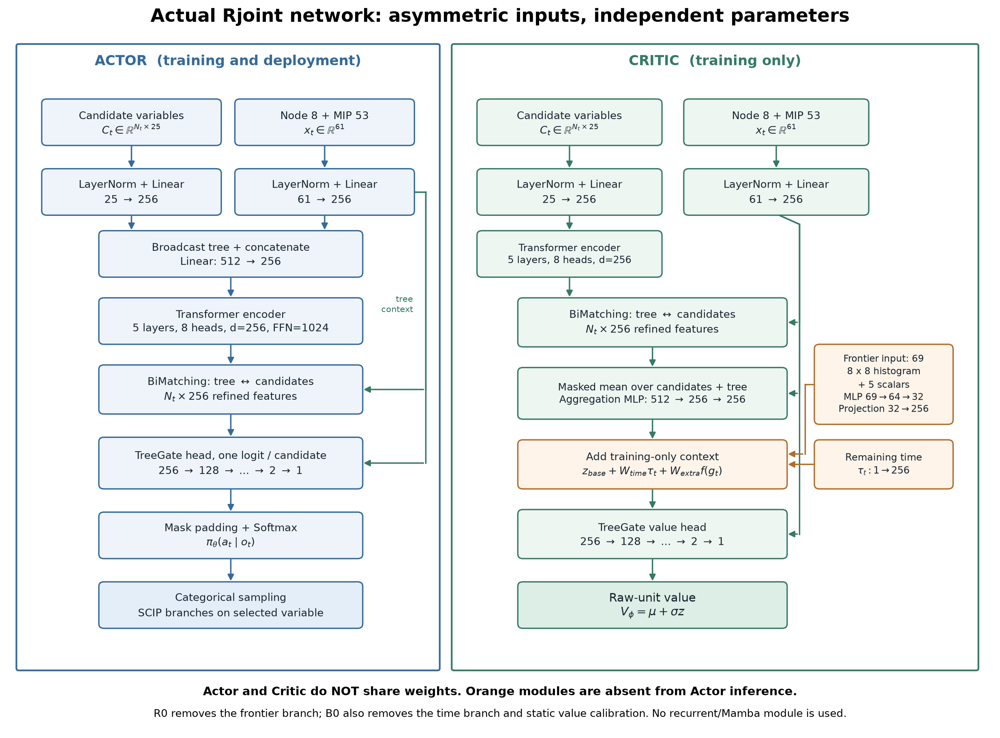
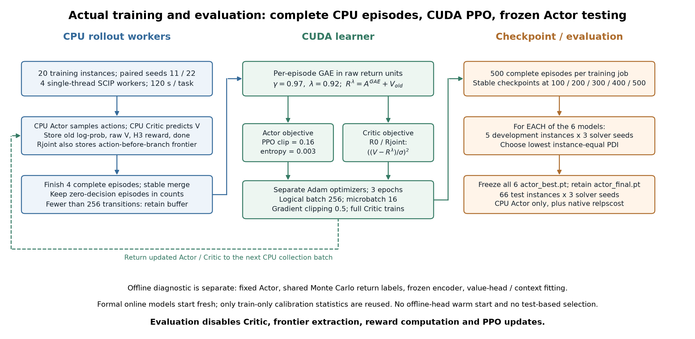
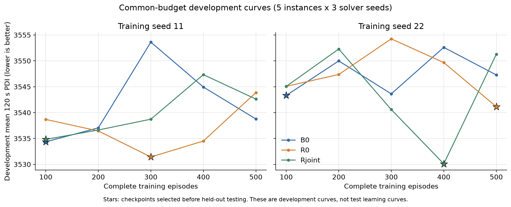
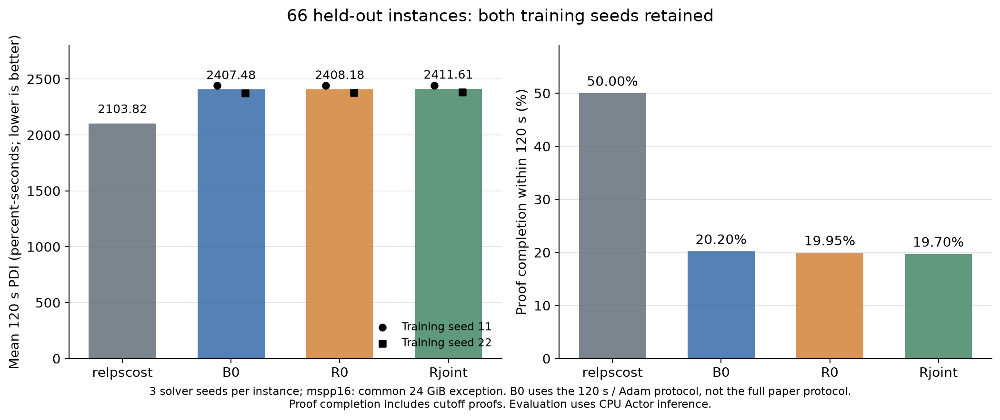
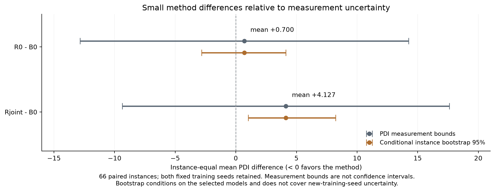

# 本周工作汇报：异构 MILP 学习分支的价值估计与实验验证

汇报周期：2026 年 10 月 19 日—10 月 23 日  
本周主题：TGPPO 论文方法、训练期搜索信息改进及实验验证

本周以 TGPPO 为基线，研究学习分支策略的价值估计与实际求解表现。为便于理解，先从求解器中的分支选择讲起，说明 TGPPO 的输入、网络和训练方法，再介绍本周在此基础上的改进、实验与反思。

## 一、先理解 TGPPO：它学习什么，怎样学

### 1.1 求解器为什么需要选择分支变量

混合整数线性规划（MILP）要求一部分变量取整数。求解器通常先求解暂时放松整数要求的线性规划（LP）；若 LP 解中的某个整数变量取了小数，例如 $x=2.4$，就可以把当前问题分成 $x\leq2$ 和 $x\geq3$ 两个子问题。不断重复这一过程，就形成分支定界（Branch-and-Bound，B&B）搜索树。

每个节点是一个子问题。以最小化为例，求解器利用 LP 下界和当前最好整数解的目标值，排除不可能改进答案的区域。找到可行解后，还需要证明其他未处理区域不会给出更好的答案。不同变量都可能用于分支，选择哪个变量，会影响两个子问题的难度、后续搜索树规模，以及证明最优需要的时间。**学习分支的任务，就是在每次需要分支时，从当前候选变量中选出一个变量；可行性检查、界计算和搜索终止仍由求解器负责。**

原生 relpscost 是需要面对的强基线：它利用历史伪成本，并在可靠性不足时进行必要的强分支试探。TGPPO 希望通过求解器交互学习一个可跨异构实例使用的选择策略。[TGPPO 原文，第 3—4 节](https://arxiv.org/html/2511.12986v1)

### 1.2 TGPPO 给网络看哪些信息

TGPPO 沿用搜索状态参数化思路，把不同 MILP 实例都转换成相同类型的特征。设当前有 $N_t$ 个候选变量，输入分为三部分：

| 输入 | 维度 | 直观作用 |
| --- | --- | --- |
| 候选变量特征 | 每个候选 25 维，整体为 $N_t\times25$ | 描述每个待选变量的求解统计 |
| 当前节点特征 | 8 维 | 描述当前处理的子问题 |
| MIP 搜索摘要 | 53 维 | 描述当前整体搜索进展与树统计 |

后两部分合成 61 维树状态。候选数量随决策变化，网络需要为当前每个候选输出一个选择概率。这些输入是对求解过程的压缩观测 $o_t$，并不是整个求解器的全部内部状态。[TGPPO 第 4.1 节](https://arxiv.org/html/2511.12986v1#S4.SS1)

### 1.3 网络由 Actor 和 Critic 分工完成

**Actor（策略网络）负责选择变量。** 候选和树状态先映射成向量，Transformer 建模当前候选之间的关系，双向匹配模块融合树上下文，TreeGate 根据树状态调节候选表示，最后经 Softmax 得到候选概率分布，再采样分支变量。这里的 Transformer 处理当前候选集合；它不等同于跨分支步骤维护的时序记忆。

**Critic（价值网络）负责预测未来累计奖励。** 它把当前状态表示汇总为一个标量，估计从这里继续按当前策略求解，后面大致会获得多少回报。这个预测参与训练信号的构造，帮助 Actor 判断采样动作的后续结果是否好于预期。

$$
\pi_\theta(a_t\mid o_t)\quad\text{输出各候选的概率},\qquad
V_\phi(o_t)\quad\text{估计未来累计奖励}.
$$

**图 1：TGPPO 论文方法的解释性示意。** 求解器提供观测，Actor 产生动作，Critic 提供价值估计；求解结果形成奖励与轨迹，PPO 据此更新网络。该图对应论文的共享前端描述，尚未加入本周的搜索直方图等模块。[SVG](./weekly_20261023/tgppo_paper_overview.svg) · [PDF](./weekly_20261023/tgppo_paper_overview.pdf)

需要区分论文描述与实际代码：论文文字及图 1 将前端画为共享编码、随后分出两个输出头；本次核对的官方实现分别实例化 Actor 和 Critic，参数不共享。本周实验沿用后者。因此，后文介绍的实际网络图会将两套编码器分开，不能把这种已有实现方式视为本周新增贡献。[论文结构说明](https://arxiv.org/html/2511.12986v1#S4.SS1) · [本地代码核对记录](./阶段1_调研与设计说明_TGPPO_2026-10-21.md)

### 1.4 它通过求解回报训练，而不是直接给每个变量专家标签

TGPPO 的训练循环可以分成五步：

1. **运行当前策略。** Actor 在 SCIP 的候选变量中采样动作，求解器执行分支并继续搜索，形成一条 episode；一条 episode 对应一次完整的限时求解任务。
2. **记录奖励和轨迹。** 保存观测、动作、旧动作概率、Critic 价值及奖励。H3 奖励综合节点效率、搜索节奏、gap/PDI 和界值进展，并根据最终求解状态给终止反馈；原生基线用于构造相对量。
3. **估计优势。** GAE 将多步奖励与 Critic 预测结合，估计已采样动作相对当前预期的好坏。优势提供策略更新方向，价值目标用于训练 Critic。
4. **执行 PPO 更新。** Actor 调整动作概率，PPO 的裁剪目标抑制过大的策略更新；Critic 学习预测回报。两者相互配合，但价值误差下降是否能改善策略，仍需实验验证。
5. **用更新后的策略继续求解。** 反复进行交互与优化，最后加载训练好的 Actor 选择分支变量。

其中，PPO 是策略更新算法，GAE 是优势估计方法；它们不是 TGPPO 新提出的算法。TGPPO 将这些机制与搜索状态、树门控网络及求解奖励结合，用于异构 MILP 的在线学习分支。[PPO](https://arxiv.org/abs/1707.06347) · [GAE](https://arxiv.org/abs/1506.02438) · [TGPPO 第 4 节](https://arxiv.org/html/2511.12986v1#S4)

论文主实验使用 25 个训练实例和 66 个测试实例，先通过嵌套交叉验证选择超参数，再训练 500 个完整 episode；单次求解上限为 3600 秒，采用 AdamW。评价同时考察搜索节点数与 PDI。PDI 可以理解为“求解过程中上下界差距随时间积累了多少”，越早改善界值、越早完成证明，通常越有利。论文采用关闭原始启发式、提供已知最优 cutoff 的受控设置，其结果不等于完整默认求解器中的加速保证。[TGPPO 第 4.3—5 节](https://arxiv.org/html/2511.12986v1#S5)

### 1.5 本周从 TGPPO 的哪个环节切入

理解上述流程后，本周的切口就比较清楚：**Actor 的变量选择能力依赖训练信号，而优势估计又依赖 Critic；可以考察给 Critic 更多动作前搜索信息，能否改善最终学出的策略。**

TGPPO 已有的 61 维输入是搜索摘要。两个搜索状态即使这些摘要相近，仍可能包含不同的待处理节点分布，未来回报也可能不同。本周据此提出额外搜索前沿输入，但先保持 Actor 不变，以便检验价值估计这一环节。这个推理给出了研究动机，并不预先保证“信息更多 → Critic 更好 → 求解更快”；后文的实验正是检验这条链是否成立。

## 二、从上周的整体设想到本周的具体问题

上周提出的整体流程是“轻量记忆策略生成轨迹 → 扩展搜索信息辅助价值估计 → 关键状态的动作续跑比较 → 校准学习信号 → PPO 更新 → Actor-only 部署”。其中包含多个尚待验证的环节。本周没有把这些模块一次性叠加，而是先检验一个基础假设：

> 在当前观测已经包含候选特征和树状态摘要的情况下，补充搜索前沿的联合结构，是否仍能提供足够的价值预测增益，并转化为实际求解收益？

| 上周设想的组成部分 | 本周实际完成情况 | 本周结果能回答的范围 |
| --- | --- | --- |
| 额外搜索状态辅助价值估计 | 已实现开放节点联合直方图、Critic 分支及离线/在线验证 | 新增摘要在当前训练协议下是否有预测和求解收益 |
| 训练期信息与部署策略分离 | 已实现 Critic 扩展输入；最终测试只运行 Actor | 扩展信息不增加最终 Actor 的输入和网络规模 |
| 记忆 Actor 与 Memory-State Critic | 未接入本轮 PPO | 不能判断记忆策略是否有效 |
| 同一搜索状态下的动作续跑与预算分配 | 未实现 | 不能声称改善了反事实动作比较或解决了长程信用分配 |
| 图 MILP 的原图结构、LNS 或连接割分离 | 未开展专项实验 | 本周结论限于现有异构 MILP 学习分支协议 |

这一收窄有两个原因。首先，若同时改变 Actor、Critic、奖励和采样方式，很难解释结果来自哪里。其次，根据前述论文与代码核对，官方实现已经有独立网络，不能把“拆开两套网络”当作新增贡献。本周实际研究增量是：**保持 Actor 的输入和结构不变，仅在训练期向 Critic 提供开放节点的界值—深度联合分布，并检验它是否改善价值预测与最终求解。**

## 三、方法设计：为什么考察搜索前沿的联合信息

### 3.1 研究动机及论文依据

分支动作决定的不只是当前 LP 子问题的下一步，也会改变后续搜索树。在异构 MILP 上，局部候选特征相似，不意味着后续求解代价相似。[TreeGate](https://arxiv.org/abs/2002.05120) 通过参数化搜索树状态来支持跨实例学习；[TGPPO](https://arxiv.org/html/2511.12986v1) 进一步利用 PPO 从求解回报学习策略。这两项工作为“搜索上下文值得进入学习模型”提供了依据。

但已有 61 维状态已经包含界值、深度等搜索统计，不能把这些量重新命名就作为新信息。本周关注的是摘要可能遗漏的**界值与深度之间的对应关系**：具有较好下界的开放节点，主要集中在浅层还是深层？两种状态即使具有相同的边际分布，后续搜索难度也可能不同。

这一动机与 [BBMDP](https://arxiv.org/html/2510.19348) 对完整 B&B 搜索状态的讨论一致：当前节点不足以描述全局搜索过程，其他开放节点及搜索状态也会影响未来。不过，本周的直方图仍只是部分摘要，既没有表示完整树拓扑，也没有保留所有求解器内部状态，**不能因此声称观测已经满足完整 Markov 状态条件**。

另一个依据是 [Asymmetric Actor–Critic](https://arxiv.org/abs/1710.06542)：训练时 Critic 可以读取部署策略不使用的额外信息。本周借鉴的是这种训练与部署的信息分工，研究假设则是这些额外信息在 MILP 中是否真正有用；非对称训练范式本身并非本工作的创新。

### 3.2 搜索前沿的构造

在动作发生前，从 SCIP 复制全部开放节点的内部 lower bound 与深度，包括 leaves、children、siblings，不包括当前 focus 节点，并检查总数与求解器记录一致。

对于有限界值，在当前集合内作 min-max 归一化；深度除以当前开放集合的最大深度。两轴各划分 8 个等宽区间，得到归一化联合计数矩阵：

$$
H_{ij}=\frac{1}{N_{\mathrm{finite}}}
\sum_{n\in\mathcal O_{\mathrm{finite}}}
\mathbf 1[\widetilde b_n\in B_i,\;\widetilde d_n\in D_j],
\qquad H\in\mathbb R^{8\times8}.
$$

空集合、界值退化和深度退化均显式处理。SCIP 的正负无穷界不放入普通直方图，而用附加标量区分。实际输入为 64 维展开直方图，加上五个标量：开放节点数的 `log1p`、空集合标志、有限界比例、正无穷比例、负无穷比例，共 **69 维**。所有信息都在当前动作前获得，不使用未来求解结果作输入。

为了区分“增加边际统计”和“保留联合关联”，构造同形状对照：

$$
p_i=\sum_jH_{ij},\qquad q_j=\sum_iH_{ij},\qquad
H^{\mathrm{prod}}_{ij}=p_iq_j.
$$

Rjoint 使用 $H$，Rprod 使用 $H^{\mathrm{prod}}$；二者均为 64 维，并使用相同的附加标量和网络。Rprod 保留两轴的边际分布，但抹去二者的关联。

例如，简化到两个分箱，$H_A=\left[\begin{smallmatrix}0.5&0\\0&0.5\end{smallmatrix}\right]$ 与 $H_B=\left[\begin{smallmatrix}0&0.5\\0.5&0\end{smallmatrix}\right]$ 的行和、列和相同，联合分布却不同。这个例子只说明表示能够区分某类关系，不是某个可达 MILP 搜索状态或求解收益的实验证明。真实固定轨迹中，按有样本实例等权，训练侧约 85.0%、开发侧约 97.9% 的决策确实存在非零联合—边际差别；这证明输入有差别，尚不证明差别有预测价值。

### 3.3 实际网络结构

本周模型可写为：

$$
\pi_\theta(a_t\mid o_t),\qquad
V_\phi(o_t,\tau_t,g_t),
$$

其中，$o_t$ 包含候选变量特征和原树状态，$\tau_t=\mathrm{clip}(1-t/120,0,1)$ 为剩余时间，$g_t$ 为新增搜索摘要。**本轮没有策略记忆 $h_t$，也没有 Mamba 模块。**

**图 2：实际 Rjoint 网络。** 蓝色是训练与部署共用的 Actor，绿色是只用于训练的 Critic，橙色是新增训练上下文。图按本周服务器代码绘制，不将两套编码器画成共享前端；省略 batch 维度，$N_t$ 表示当前候选数。[SVG](./weekly_20261023/network_architecture.svg) · [PDF](./weekly_20261023/network_architecture.pdf)

Actor 的处理过程是：每个候选的 25 维特征先经 LayerNorm 和线性层映射为 256 维；当前节点 8 维与全局搜索摘要 53 维拼接为 61 维，独立映射为 256 维。树向量广播到候选集合，与候选向量拼接，经 `512→256` 线性层后，进入 **5 层、8 头 Transformer**。随后通过 BiMatching（树状态与候选集合的双向匹配）融合信息，再由树状态控制的 TreeGate 头输出每个候选的 logit；屏蔽 padding 后经 Softmax 得到动作分布，并按给定随机种子进行分类采样。

Critic 使用自己的候选和树编码器。其候选表示先经过 Transformer，再与树向量进行 BiMatching；对有效候选作 masked mean，与树向量拼接，经 `512→256→256` 聚合网络得到状态向量。与 Actor 不同，Critic 的候选输入没有在 Transformer 前执行 Actor 那一步树—候选拼接。

在 Critic 聚合向量上加入剩余时间投影，以及搜索摘要分支：

$$
z_t=z_t^{\mathrm{base}}+W_{\mathrm{time}}\tau_t+
W_{\mathrm{extra}}\,\mathrm{MLP}(g_t).
$$

搜索分支为 `69→64→32` 的 ReLU MLP，再投影为 256 维。融合后保留原 TreeGate 价值头；门控仍由原树嵌入产生。主 MSE 配置下，最后的标量 $u_t$ 解码为原回报单位 $V_t=\mu+\sigma u_t$。

| 网络配置 | 参数量 | 与其他组的差别 |
| --- | ---: | --- |
| Actor，各组相同 | 4,738,895 | 不接收剩余时间或新增前沿摘要 |
| B0 原 Critic | 4,804,687 | 原输入、原价值输出设置 |
| R0 Critic | 4,804,943 | 加剩余时间；使用共同静态价值校准 |
| Rcap / Rprod / Rjoint Critic | 各 4,819,695 | 相同规模的新增分支，输入内容不同 |

新增信息分支只增加训练成本，最终部署不调用该分支。这里的“部署不增加成本”仅指**没有新增模块的部署成本**，并不表示原 Actor 本身推理免费。

## 四、模型如何训练

### 4.1 先建立可解释的比较底座

本周先核对并修复 GAE 的终止掩码、跨 episode 边界、真实超时状态、奖励与实际时限的一致性，以及评估阶段误调用 Critic 等问题。Actor 采样与 PPO 概率重算统一采用关闭 dropout 的模式，Critic 优化时保留 dropout 0.05；两套网络和优化器始终独立。

这类处理决定实验是否可信，但不属于方法创新。本周也没有重写官方 H3 奖励来追求正结果。奖励沿用代码口径，并明确记录其与论文附录的差异。[修复与验证记录](./阶段2_正确性修复与验收报告_TGPPO_2026-10-21.md)

### 4.2 离线阶段：相同轨迹、相同标签，先检查信息价值

离线阶段固定同一个已经完成 4 个 episode 训练的 B0 Actor，在既定 25 个训练/开发实例上各采集 solver seeds 0/1，共得到 **50 条有效轨迹、46,001 条决策样本**。按实例划分为 20 个训练、5 个开发；其中两个实例没有分支决策，因此实际预测覆盖 19 个训练和 4 个开发实例。零决策任务保留，不替换实例。

每个状态的标签是同一条完整有限任务轨迹上的经验折扣回报：

$$
G_t=\sum_{k=t}^{T-1}\gamma^{k-t}r_k,\qquad \gamma=0.97.
$$

标签不依赖某个候选 Critic 自己的预测或 GAE。离线冻结共同的基础编码器，缓存表示，只拟合价值头、时间投影和各组新增分支，从而隔离输入因素，并降低反复求解的成本。

| 离线组别 | Critic 增量 | 要检验或控制的因素 |
| --- | --- | --- |
| R0 | 原信息＋共同剩余时间 | 基础价值预测参照 |
| Rcap | 同容量分支，只读取原树状态及填充 | 是否只是网络容量增加 |
| Rprod | 联合直方图的边际外积＋相同标量 | 新增边际分布的作用 |
| Rjoint | 完整联合直方图＋相同标量 | 额外联合关联的作用 |

每组比较 MSE 和 HL-Gauss 两种损失，各使用拟合种子 11/22/33，形成 24 个模型。加入 HL-Gauss 的依据是 [Stop Regressing](https://arxiv.org/html/2403.03950v1) 的平滑分类价值学习，以及 [BBMDP 第 4.3 节](https://arxiv.org/html/2510.19348#S4.SS3) 的直接 MILP 消融。不过，它们支持“值得比较”，不保证对当前 H3 回报和 PPO 同样有效。HL-Gauss 的输出回报分箱，与 Critic 输入的界值—深度直方图是两个不同对象。

首轮各拟合 500 次更新后发现共同欠拟合，于是对所有离线组统一校准。只用训练实例统计，固定 $\mu=-13.166823$、$\sigma=8.840327$；标准化回报目标，并将输出解码回原单位，最后线性层零初始化使各组从同一训练均值开始。学习率和 5,000 次更新的选择仅使用训练侧的整轨迹划分，没有利用开发标签选参数。每个模型最终使用相同 5,000 次更新、batch 256。

这种尺度适配与 [PopArt](https://arxiv.org/abs/1602.07714) 关注的价值尺度问题相关，但本轮仅使用**静态训练侧归一化**，不是自适应 PopArt。校准同时改变初始化、尺度及拟合步数，不能把校准前后的全部变化单独归因于归一化。

### 4.3 在线阶段：CPU 采完整轨迹，CUDA 执行 PPO

**图 3：实际训练与评估流程。** 离线诊断与正式在线训练分开；正式模型从配对的新初始化开始，不加载离线拟合头，仅 R0/Rjoint 复用固定的训练侧校准统计。[SVG](./weekly_20261023/training_workflow.svg) · [PDF](./weekly_20261023/training_workflow.pdf)

**第一步，准备共同训练任务及原生归一化数据。** 从 25 个公开实例中固定 20/5 的训练/开发划分，66 个测试实例保留。服务器原生 relpscost 先在 25 个实例、三个求解器种子上运行 75 次，为 H3 奖励提供匹配的原生参照。`normalization/baselines.json` 用于奖励中的相对节点、gap、PDI 等量，不是最终测试集成绩或简单的计时基准。

**第二步，使用当前策略采集四个完整 episode。** 每个作业有四个单线程 CPU SCIP worker。Actor 在 CPU 上根据当前观测采样动作，Critic 在 CPU 上计算旧价值；Rjoint 同时采集动作前的前沿信息。保存状态、动作、H3 奖励、旧动作对数概率、旧价值和终止标志。每个 episode 最多搜索 120 秒；零决策 episode 仍计入完整任务数。

H3 使用相对原生基线的节点效率、搜索节奏、gap/PDI 及界值进展，并在终止时给出按状态区分的反馈；它是复合塑形奖励，**不是最终平均 PDI 的等价逐步分解**。本周统一实际时限为 120 秒，保留官方代码公式，不同时研究新的奖励设计。

**第三步，在每条 episode 内计算 GAE 和价值目标。** 对本轮定义的完整 120 秒有限任务，任务结束后不再 bootstrap；watchdog 杀死或异常退出不冒充正常终止。按照 [GAE](https://arxiv.org/abs/1506.02438)，计算：

$$
\delta_t=r_t+\gamma(1-d_t)V_{\mathrm{old},t+1}-V_{\mathrm{old},t},
$$

$$
\widehat A_t=\delta_t+\gamma\lambda(1-d_t)\widehat A_{t+1},\qquad
\widehat R_t^{\lambda}=\widehat A_t+V_{\mathrm{old},t},
\quad \gamma=0.97,\ \lambda=0.92.
$$

在线的 Critic 目标 $\widehat R_t^{\lambda}$ 是 GAE 构造的目标，与离线阶段用于公平预测比较的 Monte Carlo 标签 $G_t$ 区分。计算 GAE 的价值和目标都保留原回报单位；Actor 使用的优势再在本轮样本内标准化。

**第四步，使用 CUDA 分别更新 Actor 和 Critic。** PPO 的概率比为 $\rho_t(\theta)=\pi_\theta(a_t\mid o_t)/\pi_{\mathrm{old}}(a_t\mid o_t)$，Actor 最小化：

$$
L_{\pi}=-\mathbb E_t\!\left[
\min\{\rho_t\widetilde A_t,
\mathrm{clip}(\rho_t,1-\epsilon,1+\epsilon)\widetilde A_t\}
\right]-\beta\mathbb E_t[\mathcal H(\pi_\theta)],
\quad \epsilon=0.16,\ \beta=0.003.
$$

R0/Rjoint 的 Critic 损失为：

$$
L_V=\mathbb E_t\left[
\left(\frac{V_\phi(o_t,\tau_t,g_t)-\widehat R_t^{\lambda}}{\sigma}\right)^2
\right].
$$

B0 使用原尺度 MSE；R0/Rjoint 仅在价值损失内部标准化，不缩放真实奖励或将标准化值直接送入 GAE。两套网络各用 Adam，学习率分别为 $2.4\times10^{-4}$ 和 $1.2\times10^{-4}$，每轮 3 个 epoch，梯度范数裁剪 0.5。逻辑 minibatch 为 256；为控制 V100 显存，按 16 条 microbatch 累积梯度，不截断候选集合，不改变外层优化步含义。在线完整训练 Critic 编码器，与离线冻结编码器的诊断不同。PPO 目标沿用 [原始 PPO 方法](https://arxiv.org/abs/1707.06347)，新增部分是 Critic 的信息与价值适配。

**第五步，重复采集与更新，保留完整恢复状态。** 若四个 episode 累计不足 256 条 transition，就保留样本并继续采集，不伪造一次更新。每个训练作业完成 500 个完整 episode，每 100 保存稳定检查点，并保存 `latest.pt`。恢复状态包括 Actor、Critic、两套优化器、随机状态、CUDA RNG、轨迹缓存和进度。本轮各组种子 11 完成 125 轮有效 PPO 更新，种子 22 完成 123 轮，最终无待消费缓存。

### 4.4 在线组别、预算和选模规则

服务器正式训练为 **B0、R0、Rjoint × 训练种子 11/22，共六个作业**。同一种子配对初始化、任务顺序与随机流，Actor 结构相同。各作业均为 500 episode、120 秒单任务上限和四任务批更新；实际有效 transition 数、优化步及耗时仍随策略运行而变化。因此，这是共同 episode 预算比较，**不是精确相等的 CPU/GPU 计算量比较**。

| 在线组别 | 实际含义 | 可以比较什么 |
| --- | --- | --- |
| B0 | 必要修复后的原架构、原 Critic 输入与输出设置 | 本轮共同短时协议下的原方法参照 |
| R0 | B0 基础上加入剩余时间及静态价值校准 | 时间上下文与价值适配的组合变化 |
| Rjoint | R0 基础上增加联合前沿分支 | 扩展信息与相应容量/训练成本的组合变化 |

**本轮在线矩阵没有 Rprod，也没有同容量 Rcap。**离线虽然有这些对照，在线仍不能单独归因“联合关联信息”的收益。B0→R0 也不只改变一个信息量。报告保留这些边界，而不把三组统称为严格单因素消融。

对每个训练种子，分别在 100/200/300/400/500 检查点上评估相同五个开发实例与 solver seeds 0/1/2，选择实例等权平均 120 秒 PDI 最低者；精确并列时选更早检查点。共 450 次开发求解。六份选择在测试前统一冻结，每个模型保留 `actor_best.pt` 和 `actor_final.pt`，最终测试只使用前者，不挑选一个训练种子报告。

需要强调：论文主训练采用 3600 秒单任务、AdamW，并在完整 episode 后更新；本轮是 **120 秒、Adam、四任务批更新**。虽然均为 500 episode，求解和更新协议并不相同，不能称为论文全规模性能复现，也不与论文表格的绝对数值直接横比。[TGPPO 第 5 节](https://arxiv.org/html/2511.12986v1#S5)

## 五、实验结果：预测改善没有转化为求解收益

离线部分来自本周迁移前保留的报告与逐实例记录；在线部分来自服务器新六作业。二者对应不同阶段、硬件和数据生成策略，用于检验不同环节，不将跨机器的绝对耗时或弱 Actor 与充分训练 Actor 的成绩混为同一对照。

### 5.1 首轮失败首先暴露了共同价值拟合问题

首轮 500 次更新后，原信息组 R0 的开发 MSE 为 271.292，Rjoint 为 271.256，几乎相同；而仅预测训练均值的常数参照为 **50.613**。检查发现，真实经验回报覆盖约 -28.349 至 10.620，MSE 模型预测却集中在约 0.212 至 0.407。

**图 4：共同欠拟合。** MSE 预测接近正的常数，明显没有适配以负值为主的经验回报。这个现象对应当时权重和拟合配置，不代表原网络永远不能学习负回报。

统一校准后，R0 的训练 MSE 从约 257.400 降到 **20.594**，低于训练均值常数的 78.151；其开发 MSE 降到 57.894。说明此前的主要问题包含共同价值拟合适配不足，不能将校准前的小幅组间差异用于判定信息价值。

**图 5：校准前后的变化。** 改变同时包含输出尺度、初始化及从 500 增至 5,000 次更新。大幅下降属于共同训练适配，不能全部记为联合信息的收益。

### 5.2 校准后的离线信息收益仍然有限

下表均为原回报尺度的 MSE，按实例等权，再平均三个拟合种子。

| Critic | MSE 拟合：训练误差 | MSE 拟合：开发误差 | HL-Gauss 拟合：开发误差 |
| --- | ---: | ---: | ---: |
| R0 | 20.594 | 57.894 | 66.234 |
| Rcap | 20.804 | 59.255 | 65.592 |
| Rprod | 20.579 | 52.802 | 57.456 |
| Rjoint | **20.028** | **50.392** | 57.849 |
| 训练均值常数 | 78.151 | 50.613 | 50.613 |

**图 6：训练侧能学到回报关系。** 各主 MSE 组均优于训练均值常数，说明可以在一个有效拟合底座上讨论输入差异。

**图 7：开发侧的收益和不确定性。** 误差线是三个拟合种子的范围，不是置信区间；只有四个开发实例有决策标签。

Rjoint 相对 R0 的开发 MSE 下降约 **12.96%**，相对同容量 Rcap 下降约 14.96%；但相对常数预测仅低 **0.44%**。与更直接的边际信息组 Rprod 相比，平均低约 **4.57%**，只在 2/3 拟合种子上更低，实例配对 bootstrap 区间约为 [-6.77, 1.26]，包含 0。HL-Gauss 下 Rjoint 又比 Rprod 略差，且各组开发预测整体不如 MSE 主线。因此，在线继续统一使用 MSE，没有为不同组选择有利损失。

这一结果最多说明新增信息在固定数据上出现探索性的预测优势，**尚未证明联合关联带来稳定的实例外增益**。46,001 条样本集中在少数实例，不能等同于 46,001 个独立泛化样本；同一状态的一次经验回报也不能消除后续策略随机性。

### 5.3 在线开发选模：不存在稳定的随训练量改善

**图 8：每个训练种子独立选模。** 星号是测试前确定的检查点。曲线是开发集表现，不是对测试集反复选择里程碑后的结果。

| 方法 | 训练种子 | 选中 episode | 开发集 PDI ↓ | 测试集 PDI ↓ |
| --- | ---: | ---: | ---: | ---: |
| B0 | 11 | 100 | 3534.356598 | 2441.770818 |
| B0 | 22 | 100 | 3543.314184 | 2373.194928 |
| R0 | 11 | 300 | 3531.428676 | 2439.941323 |
| R0 | 22 | 500 | 3541.148418 | 2376.424788 |
| Rjoint | 11 | 100 | 3534.824852 | 2441.048686 |
| Rjoint | 22 | 400 | 3530.101591 | 2382.171413 |

两个训练种子的开发选中模型均值分别为 B0 3538.835391、R0 3536.288547、Rjoint 3532.463221。Rjoint 开发分数的微小优势没有在测试集上保持。多个模型选中较早检查点，且曲线波动，说明本轮训练没有呈现稳定的开发指标改善；它不能单独证明训练完全无效，也不支持继续训练就必然能改善的推断。

### 5.4 最终测试：三组学习策略接近，原生基线更好

最终评估为六份冻结 Actor 和一份原生 relpscost，各运行 **66 个实例 × solver seeds 0/1/2**，共 **1386 条有效记录**。学习组先在每实例内平均求解器种子和两个训练种子，再对 66 个实例等权汇总。本轮仅使用包内保留的 66 实例，没有额外独立兼容评测集，也没有未见问题族的专项泛化实验。

| 方法 | 平均 PDI ↓ | 相对 B0 的 PDI 变化 | 平均 PAR-2 / 秒 ↓ | 120 秒内证明完成率 ↑ |
| --- | ---: | ---: | ---: | ---: |
| 原生 relpscost | **2103.821260** | **-12.6132%** | **145.409** | **50.00%（99/198）** |
| B0 | 2407.482873 | 0 | 198.805 | 20.20%（80/396） |
| R0 | 2408.183055 | +0.0291% | 199.061 | 19.95%（79/396） |
| Rjoint | 2411.610050 | +0.1714% | 199.413 | 19.70%（78/396） |

**图 9：完整测试主结果。** 每组学习方法都保留两个训练种子；图中黑色标记展示各训练种子的平均 PDI。

PDI 是固定 120 秒内百分比 gap 对时间的积分，单位为“百分比·秒”，越低越好，不只是程序运行时间。PAR-2 对 120 秒内证明完成者取实际 SCIP 时间，其余记为 240 秒。证明完成率包含 verified cutoff 下的证明，不能改称“找到最优可行解比例”。

结果有三层含义。第一，R0/Rjoint 没有超过 B0 的整体平均值；种子 11 上二者略优，种子 22 上略差，方向不一致。第二，原生 relpscost 的平均 PDI 比 B0 低 12.61%，证明完成率也更高，表明本轮学习策略距离强原生规则仍有明显差距。第三，这只是当前受控、短时协议的结论：各组均关闭原始启发式并使用已核实的最优 cutoff，不能推广成完整默认 SCIP 的性能结论。

搜索节点数没有作为单独的成功依据。在固定墙钟时限下，较低的节点数也可能是推理开销导致搜索推进更慢；只有结合 PDI、证明完成率和全部回调耗时，才能解释节点统计。

### 5.5 小差异、测量界限和种子波动

| 与 B0 比较 | 平均 PDI 差值 | PDI 测量差值保守范围 | 条件实例 bootstrap 95% 区间 |
| --- | ---: | --- | --- |
| R0 − B0 | +0.7002 | [-12.8470, +14.2474] | [-2.8212, +4.1183] |
| Rjoint − B0 | +4.1272 | [-9.3571, +17.6114] | [+1.0183, +8.2219] |

**图 10：测量界限与统计区间分别呈现。** 负差值表示改进。灰色来自 SCIP 停止时间可能超过 120 秒时的 PDI 保守测量界限，不是统计置信区间；橙色是对 PDI 中点作 20,000 次实例配对重采样的条件区间。

Rjoint 的中点 bootstrap 区间偏向 B0，但计入测量界限后平均差值仍可跨 0，并且只有两个训练种子、其变化方向相反。因此，不能把这 0.171% 写成稳健的显著退化，更不能写成提升。bootstrap 以 66 个实例为单位，条件于已经训练和选好的模型，没有估计新训练种子的总体不确定性。

逐实例中点比较也没有一致优势：R0 对 B0 为 36 个更低、1 个相同、29 个更高；Rjoint 为 23/1/42。R0 的“胜出实例数更多”并没有使整体均值更好，说明胜率和改善幅度需要一起看，不能只选择有利统计口径。

### 5.6 部署开销、实际成本与异常处理

最终部署使用 CPU Actor，不构造 Critic、不提取扩展前沿输入、不计算训练奖励，也不进行参数更新。正式训练的 PPO 更新才使用 V100；CPU 采样 worker 不初始化 CUDA。

| 方法 | 平均 Actor 推理 / 毫秒每分支 | Actor 占 worker 总墙时 | 完整分支回调占 optimize 墙时 |
| --- | ---: | ---: | ---: |
| B0 | 20.863 | 21.12% | 33.21% |
| R0 | 20.627 | 21.07% | 33.11% |
| Rjoint | 20.965 | 21.17% | 33.19% |

三个 Actor 的结构与调用成本接近，新增 Critic 输入没有带来部署模块，但原有神经策略的在线成本并不低。完整回调包含特征提取和 Actor 等子项，不能把嵌套计时再次相加。尚未进行 CPU/V100 推理的配对测试，不能从 CPU 延迟直接推出换 GPU 后就能加速求解。

| 已测成本范围 | 实际数值 | 口径 |
| --- | ---: | --- |
| 六个正式训练作业 | 43.005 GPU 占用小时 | 六作业训练进程墙时之和；各约 7.04—7.24 小时 |
| 训练采样 | 76.404 CPU 核时 | 有效 collection worker CPU 累计 |
| CUDA 更新区间 | 8.055 小时 | CUDA event 累计，不等于 GPU 利用率或计费时间 |
| 450 次开发选模 | 10.169 CPU 核时 | 有效 worker CPU |
| 1386 次最终测试 | 40.372 CPU 核时 | 含补跑的 0.978 CPU 核时 |

这些量不能直接相加；构建、桥接、先导、排队和失败启动另有成本，当前没有完整平台账单，上表不是项目全部花费。

测试中的唯一实例级故障是 `mspp16`：原七路每路已有 195 条有效结果，三个种子均因 worker 的 8 GiB 虚拟地址空间上限发生内存失败。保留原结果和 21 条失败记录后，只对该实例使用所有方法共同的 **24 GiB 单进程上限、单 worker、32 GiB 容器**，搜索仍为 120 秒。补跑 21 条全部有效，但均为 PDI 12000、未进入 Actor 分支回调，因此补齐覆盖而没有改变排名。其他 65 个实例保留原资源配置。

正式对照均使用 Xeon Gold 6148 及相同求解器/绑定版本；随机分到不同 CPU 的作业在预检阶段拒绝。不能通过混用不同 CPU 的 120 秒结果来换取更快提交。平台申请 GPU 是当时获得匹配 CPU 节点的调度方式，测试期间 GPU 并未承担推理。

## 六、总结与反思

### 6.1 方法设计有依据，但合理性不等于有效性

开放节点联合关系确实是现有边际摘要可能遗漏的信息，非对称训练也提供了将额外信息用于价值估计的合理方式。但“表示能区分更多状态”只是第一步，后续还需要证明这些差别与未来回报相关、能跨实例泛化、能改善优势估计，最后能改善部署策略。本周只在离线预测环节观察到有限的探索性优势，在线求解环节没有获得正结果，不能把逻辑动机当作实验结论。

### 6.2 回报预测更准，不等于动作评价更准

Critic 预测当前策略下的未来回报，并不直接比较“在同一状态选择另一个变量会怎样”。平均 MSE 下降可能主要来自更容易拟合的状态，而未改善关键决策上的优势符号或排序；PPO 对这些误差的敏感性又与整体 MSE 不同。当前实验没有测量可控反事实动作后果，因此不能声称已经改善了动作级信用分配。

上周参考的 [GiGPO](https://arxiv.org/abs/2505.10978) 和 [RTMC](https://arxiv.org/abs/2604.11037) 利用重复或共享中间状态下的多轨迹回报构造逐步比较，这与本周单轨迹经验回报拟合不同。在 MILP 中，当前 LP 或候选特征相同也不代表全局状态相同，其他开放节点、伪成本、割及随机状态都会影响后果。本周没有解决这些状态恢复与动作比较问题。

### 6.3 不能把负结果简单归咎于预算，也不能据此否定所有后续设想

120 秒与论文 3600 秒的时域不同；20 个训练实例也不足以充分覆盖异构结构。离线数据又来自弱固定策略，联合摘要可能存在信息损失，固定价值校准也可能随策略变化出现分布偏移。它们是结果解释中的限制或可能原因，尚未被实验分别证实，不能选一个作为已确定的失败原因，也不能用“加大训练就会成功”回避负结果。

另一方面，本轮没有接入 [Mamba-Branching](https://proceedings.iclr.cc/paper_files/paper/2026/file/b2f56a345fe0ce337df3bdfb31e2b350-Paper-Conference.pdf) 的记忆策略，也没有实现 [Memory-State Critic](https://arxiv.org/html/2610.03830v2) 所讨论的策略记忆条件价值。本周结果不能否定这些未测模块。Memory-State 的理论还依赖完整环境状态等条件，不能将其保证直接套在联合直方图摘要上。

### 6.4 更早使用便宜而有区分力的判断标准

常数预测参照帮助识别了共同欠拟合，Rcap/Rprod 对照帮助区分容量、边际与关联，最终原生 relpscost 揭示了实际求解差距。这些检查比只观察训练损失是否下降更有判断力。离线阶段联合组仅略优于常数、关联对照不稳定，本应被视为较弱的推进证据；在线试验给出了进一步检验，但不应在缺少机制证据时继续叠加模块以寻求正结果。

另一个反思是先明确结果的实际价值与成本。训练期省下部署模块，并不意味着整套方法在求解器中足够便宜；本轮原 Actor 的推理和特征处理已占据可观时间。[TGPPO 的局限与展望](https://arxiv.org/html/2511.12986v1#S6) 同样强调完整求解器交互、系统计时和回报设计仍需检验。最终评价必须覆盖从特征提取到动作返回的完整调用，而不是只比较网络前向、节点数或拟合误差。

本周形成的阶段性认识是：**已经实现并检验了一个逻辑上有依据的训练期信息增强方案，但在当前可复查协议下，它没有达到改善实际求解的目标。**后续决策应重新评估研究问题的价值、可检验性和投入产出，区分已被实验削弱的假设与尚未检验的设想，不把继续扩展当前方案视为既定结论。

## 实验材料与论文索引

上述论文均用于说明具体设计依据或适用边界，没有将其他领域或其他求解协议的论文结果当作本方法的有效性证据。与本周直接相关的完整标题如下：

| 文献 | 本报告使用的位置 |
| --- | --- |
| Zarpellon et al. *Parameterizing Branch-and-Bound Search Trees to Learn Branching Policies*. AAAI 2021. [原文](https://arxiv.org/abs/2002.05120) | 异构实例的搜索状态表示 |
| Ben Mhamed et al. *Learning Branching Policies for MILPs with Proximal Policy Optimization*. AAAI 2026. [原文](https://arxiv.org/html/2511.12986v1) | 复现底座、训练协议与部署局限 |
| Pinto et al. *Asymmetric Actor Critic for Image-Based Robot Learning*. [原文](https://arxiv.org/abs/1710.06542) | 训练期 Critic 与部署 Actor 的信息分工 |
| Strang et al. *A Markov Decision Process for Variable Selection in Branch & Bound*. [原文](https://arxiv.org/html/2510.19348) | 全树状态与分类价值损失消融 |
| Farebrother et al. *Stop Regressing: Training Value Functions via Classification for Scalable Deep RL*. [原文](https://arxiv.org/html/2403.03950v1) | HL-Gauss 离线损失对照 |
| van Hasselt et al. *Learning values across many orders of magnitude*. NeurIPS 2016. [原文](https://arxiv.org/abs/1602.07714) | 价值尺度适配动机，本轮不是自适应 PopArt |
| Schulman et al. *High-Dimensional Continuous Control Using Generalized Advantage Estimation*. [原文](https://arxiv.org/abs/1506.02438)；*Proximal Policy Optimization Algorithms*. [原文](https://arxiv.org/abs/1707.06347) | GAE 目标、PPO 更新 |
| Zhang et al. *Towards Better Branching Policies: Leveraging the Sequential Nature of Branch-and-Bound Tree*. ICLR 2026. [原文](https://proceedings.iclr.cc/paper_files/paper/2026/file/b2f56a345fe0ce337df3bdfb31e2b350-Paper-Conference.pdf) | 记忆策略的前置工作，本轮未实现 |
| Louette et al. *Memory-State Critic for Asymmetric Actor-Critic with Application to Vision-Based Pursuit-Evasion*. arXiv v2, 2026-10-12. [原文](https://arxiv.org/html/2610.03830v2) | 记忆条件价值及理论适用条件，本轮未实现 |
| Feng et al. *Group-in-Group Policy Optimization for LLM Agent Training*. [原文](https://arxiv.org/abs/2505.10978)；Wang et al. *RTMC: Step-Level Credit Assignment via Rollout Trees*. [原文](https://arxiv.org/abs/2604.11037) | 状态级回报比较的前置工作，本轮未实现 |

可核查实验材料：

- [初始调研与设计](./阶段1_调研与设计说明_TGPPO_2026-10-21.md)、[首轮离线结果](./阶段4_搜索信息Critic离线验证与验收报告_TGPPO_2026-10-21.md)、[统一校准结果](./阶段4补充_统一Critic校准与验收报告_TGPPO_2026-10-21.md)。
- [六模型完整结果报告](./阶段5_服务器六作业结果与验收报告_TGPPO_2026-10-23.md)、[六模型冻结选模](../tgppo/runs/server6-20261022/post-training-20261023/frozen_selection.json)。
- [逐实例配对表](../tgppo/runs/server6-20261022/stage5-results-20261023/paired_instances.csv)、[配对不确定性表](../tgppo/runs/server6-20261022/stage5-results-20261023/paired_uncertainty.csv)、[全部任务与来源 SHA](../tgppo/runs/server6-20261022/stage5-results-20261023/per_task_with_sources.csv)、[保留的失败记录](../tgppo/runs/server6-20261022/stage5-results-20261023/preserved_failures.csv)。
- 网络图对应代码：[Actor](../tgppo/experiments/server-20261022/code/project/policy/actor.py)、[Critic](../tgppo/experiments/server-20261022/code/project/policy/critic.py)、[新增分支](../tgppo/experiments/server-20261022/code/project/policy/search_critic.py)、[校准](../tgppo/experiments/server-20261022/code/project/policy/calibrated_critic.py)、[GAE/PPO](../tgppo/experiments/server-20261022/code/project/agent/agent.py)、[在线价值损失](../tgppo/experiments/server-20261022/code/project/online.py)。

本文仅整理已有工作与结果，并新增文档示意图和基于既有配对表的图表；没有修改原实验代码、重选模型或启动新一轮训练与测试。
