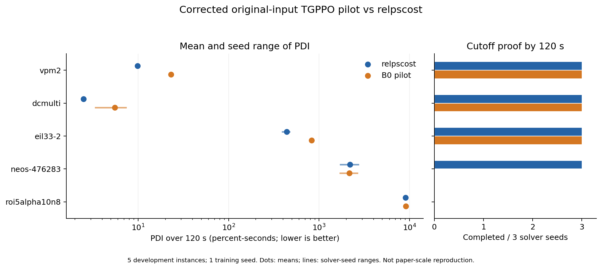

# 阶段 3：缩预算 B0 基线与验收报告

日期：2026-10-21。状态：**用户已验收通过；阶段 4 未启动。** 本阶段由用户“通过，进入阶段3”明确授权。验收记录：2026-10-21 用户“阶段3工作审核通过，接下来你建议做什么”。验收确认工程闭环与现有结果，不代表论文性能复现成功。

## 1. 交付结论

完成 75 条 120 秒原生归一化记录、原始输入 TGPPO 的训练/保存/恢复闭环，以及 15 次开发验证。最终原生和开发任务全部有效，25 项检查通过，原始仓库与网络、奖励公式、求解设置文件保持不变。

**当前交付模型仅包含首批 4 个训练 episode 的一次完整 PPO 更新：770 条转移，3 epochs，12 次小批量优化。** 共采集了 8 个 episode、16,333 条转移；第二批 15,563 条转移的完整更新未完成，全部保存在独立轨迹和 checkpoint 中，部分优化结果没有混入交付模型。未达到论文训练规模，也没有证据说明模型已经充分训练。

本次开发结果中，B0 的平均 PDI 为 **2420.07**，relpscost 为 **2344.67**；越低越好，B0 的点估计高约 **3.2%**。cutoff 证明完成数为 **9/15 对 12/15**。这支持“工程基线已建立，当前少量训练模型尚未取得整体优势”，不能写成论文效果已复现。

总审计结果：[verification.json](./stage3/verification.json)。本文件中“检查通过”指阶段 3 的工程验收条件，不表示训练充分或方法性能更优。

## 2. 原生基线与开发结果

冻结的 25 个训练来源实例（20 训练、5 开发）分别运行求解器种子 0/1/2，共 75 个原生任务：53 个完成 cutoff 证明，22 个达到时限，失败 0 个。归一化数据严格核对实例哈希、时限、种子、求解设置和 cutoff 来源。

开发集使用固定最终有效 checkpoint，训练种子 11，求解器种子 0/1/2；未按开发结果挑模型。每例先平均三个求解器种子，再对五个实例等权汇总：

| 开发实例 | relpscost PDI | B0 PDI | relpscost 证明完成 | B0 证明完成 |
|---|---:|---:|---:|---:|
| vpm2 | 9.89 | 23.14 | 3/3 | 3/3 |
| dcmulti | 2.50 | 5.51 | 3/3 | 3/3 |
| eil33-2 | 438.18 | 830.22 | 3/3 | 3/3 |
| neos-476283 | 2199.99 | 2159.55 | 3/3 | 0/3 |
| roi5alpha10n8 | 9072.81 | 9081.92 | 0/3 | 0/3 |
| **实例等权平均 / 合计** | **2344.67** | **2420.07** | **12/15** | **9/15** |

PDI 单位为百分比差距×秒；主表使用共同 120 秒时域的估计值，保留测量区间。全部 90 个正式原生/开发任务的最大区间宽度为 18.4658，占完整范围 12000 的 0.154%；平均宽度为 0.83982。完整上下界和配对差见 [development_paired.csv](./stage3/development_paired.csv)，不是将超时积分当作 0。

PAR-2（120 秒内未完成证明记 240 秒）为 relpscost **73.94 秒**、B0 **117.54 秒**。neos-476283 上 B0 的平均 PDI 略低，但没有完成证明，不能据此称为整体求解加速。

roi5alpha10n8 三个开发任务中，B0 的 Actor 分支次数均为 0：本轮时限主要用于根节点求解，不能把它的 PDI 差异归因于神经分支动作。该实例仍保留在预先冻结的五实例主表中，没有替换或删除；后续离线 Critic 检验也必须报告它没有决策样本的覆盖限制。

以实例为单位作 10,000 次 bootstrap，B0−relpscost 的平均 PDI 差为 +75.39，探索性 95% 百分位区间为 **[-19.79, 237.65]**。仅五个实例、一个训练种子，不能据此声称显著输赢，也不能估计训练种子方差。没有失败任务，因此失败按最坏 PDI=12000 计的敏感性均值与主表相同。



图中点为三个求解器种子的均值，线为种子范围，横轴使用对数刻度；不是置信区间。[SVG 导出](./stage3/development_comparison.svg)

## 3. 训练、内存返修与停止原因

模型从训练种子 11 新初始化，不沿用阶段 2 的短运行权重。Actor/Critic 仍为两个独立网络，共享参数对象 0，参数量分别为 4,738,895 和 4,804,687。使用原始 25/8/53 维输入、256 隐藏维、5 层、8 头、batch=256、每次 3 epochs，其他已选超参数不变。

首批训练实例为 lseu、stein27、misc03、pp08aCUTS；分别产生 285、347、0、138 条转移。四个 episode 均完成 cutoff 证明；misc03 在预处理结束，保留空 episode，不伪造动作。

首批完整更新的 Actor 参数变化 L2 范数为 1.47922，初始 importance ratio 与 1 的最大误差为 `2.3842e-7`，平均 Actor loss 为 0.034463，Critic MSE 为 10.7532。权重均有限，完整优化器、随机状态和进度随 checkpoint 保存。

第二批为 neos20、l152lav、sp150x300d、neos21，共 15,563 条转移，最大候选数 268。原有整批 padding 造成 learner 峰值约 25.4 GiB，在 32 GiB 地址空间保护下分配失败。错误见 [learning_error.json](../tgppo/runs/stage3/pilot/learning_error.json)；第一批完整 checkpoint 保持有效，没有保存失败更新后的参数作为正式模型。

进行了阶段内必要返修：在每个原逻辑 minibatch 内按候选长度分组，每组最多 16 个样本，裁去纯 padding，按组样本占比累积梯度，最后仍只裁剪一次梯度、执行一次 optimizer step。**没有裁剪候选、减少样本、改变目标/clip 或增加 optimizer step。** 关闭 dropout 的检查中，累积梯度和损失与整批结果一致；真实 Critic 仍保留训练 dropout=0.05，其随机掩码排列不保证逐元素一致，不能宣称两种训练路径位级相同。

从失败前已保存的完整轨迹、权重、优化器和 RNG 恢复后，分块运行的 learner 峰值降为 **2.9 GiB**；至少完成 15 次真实逻辑 minibatch 更新用于吞吐核查，没有再次发生内存失败。

但该批次需要 183 次逻辑更新才能完成 3 epochs。观察到约 12.2 秒 CPU/次，守卫决策时预计尚需 2055.5 秒 CPU，而授权预算只剩约 898.2 秒。因此主动收紧软 CPU 限制，走正常停止与回退路径，**提前停止，并未耗尽原 0.5 核时上限**。这批部分更新不计入最终模型，也未因为效果输赢删样本。[预测与实际软限制记录](../tgppo/runs/stage3/pilot-repaired/forecast_budget_guard.json)

交付的最终模型是先前第一批完整更新的相同 checkpoint（修复目录中的副本，策略版本 1）。模型选择发生在任何开发结果产生前。[selected_checkpoint.json](../tgppo/runs/stage3/selected_checkpoint.json)

这说明：分块适配解决了本次内存问题，CPU 更新吞吐仍限制训练充分性。原计划“最多 10 episode”是上限，不应写成已经完成 10 条有效训练，更不能把 16,333 条采集转移全部算作交付模型的训练量。

## 4. PDI 核查与统计差异

原定制 getter 直接返回内部累计值，可能缺少末段；统计打印在 `infeasible` 时也不会刷新。因此在独立目录构建同版本 PySCIPOpt，只增加只读积分 snapshot，读取原生累计积分、最后更新时间及之前的百分比 gap。SCIP 共享库、已安装绑定及已验收阶段 2 环境没有被覆盖。[只读接口补丁](./stage3/metrics-binding.patch)

停止时刻的完整积分按原生递推补齐。提前完成已核实 cutoff 证明则在 120 秒前的剩余区间延拓为 0；略超时则提供严格上下界和中点估计。预处理证明可能让公开 dual bound 仍是无穷哨兵：raw 值照存，零延拓依据是已核实的 cutoff 证明证书，不虚构有限 raw bound。详见 [执行记录与 PDI 口径](./阶段3_执行记录与PDI口径_TGPPO_2026-10-21.md)。原生公式依据 [SCIP 6.0.1 源码](https://www.scipopt.org/doc-6.0.1/html/stat_8c_source.php)。

训练 H3 继续读取原始 getter，奖励文件逐字节不变，版本为 `upstream_h3_t120`；报告用的积分补齐不回写统计，不借此更换训练奖励。三个字段层次分开：`primalDualIntegral` 为原 getter 值，`pdi_native_complete_at_stop` 为补齐末段的积分，`pdi_horizon_*` 为共同 120 秒的评价区间。

首轮指标采集因此中止并重跑：13 个已完成、4 个中止、58 个尚未启动任务都留档，不混入最终 75 条数据，也没有当作任务不存在。[首轮审计任务表](../tgppo/runs/stage3/native-audit-v1/audit_all_jobs.json)

只读扩展前后，lseu、stein27 在固定 150 节点预算下得到相同的节点、状态、上下界和 gap。最终 25 项检查包含 GAE、轨迹边界、模型/RNG/优化器恢复、Actor-only、积分末段、真实超时、worker 故障和梯度累积。[检查日志](./stage3/tests-final.log)

## 5. 实际预算与后续吞吐

| 工作 | 计入的 CPU 核时 | 约定上限/来源 |
|---|---:|---|
| 75 条正式原生数据＋首轮归档及保守余量 | 1.3907 | 2.5 |
| B0 采集、失败更新、分块返修及保存恢复 | 0.2515 | 0.5 |
| 15 次开发验证 | 0.2993 | 原方案验证/工程余量 |

原生及训练均在约定上限内；没有为完成大批次擅自增加预算。训练总计 905.39 秒 CPU，其中 worker 469.80 秒，learner（含失败和返修）435.60 秒；不重复加入 children CPU。编译、单元检查和产物整理属于工程开销，未伪称为模型训练成本。

四个单线程 worker 固定使用逻辑 CPU `[0,1,2,3]`，它们实际对应两个物理核。各方法保持同样绑定；没有按 16 个逻辑 CPU 开满进程。采集和开发 worker 的地址空间上限为 8 GiB，learner 为 32 GiB；内存失败会入记录，不采用候选截断或动作回退。

开发验证总 Critic 时间为 0，权重文件哈希前后不变。以 eil33-2 为例，平均完整 callback 为 61.56 秒，占约 97.93 秒 SCIP 求解时间的明显部分；原 Actor 的部署开销仍需计算，不能因为 Critic 已关闭便声称神经方法没有成本。

读取、模型加载、optimize、特征、Actor、Critic、分支及整个 callback 分别记录。`worker_wall_seconds` 包含 worker 函数内的模型加载和读取，未单列 spawn/import 墙钟；其 CPU 已含在 `RUSAGE_SELF`。该字段不称作完整进程墙钟。

按本次较大批次估算，一轮 15,563 转移的 3 epochs 约需 **0.62 CPU 核时**，加采集约 **0.13 核时**；若后续负载相近，2 核时/运行可能仅支持约两轮完整更新，不能承诺跑满 50 episode。不同实例的吞吐差异很大，后续必须报告有效更新与实际预算，不能仅比较 episode 数。

## 6. 可复查材料与复跑

| 材料 | 位置 |
|---|---|
| 冻结配置、种子、实例哈希 | [execution_config.json](./stage3/execution_config.json) |
| 75 条原生归一化数据 | [baselines.json](../tgppo/runs/stage3/native/baselines.json) |
| 逐原生/开发任务表 | [all_solver_runs.csv](./stage3/all_solver_runs.csv) |
| 15 条逐种子配对 / 五实例汇总 | [development_paired.csv](./stage3/development_paired.csv) / [development_by_instance.csv](./stage3/development_by_instance.csv) |
| 实际训练更新 | [pilot/updates.json](../tgppo/runs/stage3/pilot/updates.json) |
| 轨迹规模与候选数 | [trajectory_statistics.csv](./stage3/trajectory_statistics.csv) |
| 最终有效模型 | [pilot-repaired/latest.pt](../tgppo/runs/stage3/pilot-repaired/latest.pt) |
| 第二批失败前的完整可恢复状态 | [collected-batch-01.pt](../tgppo/runs/stage3/pilot/collected-batch-01.pt) |
| 原生 / 原训练 / 返修 / 开发日志 | [native.log](./stage3/native.log) / [pilot.log](./stage3/pilot.log) / [pilot-repair.log](./stage3/pilot-repair.log) / [evaluation.log](./stage3/evaluation.log) |
| 官方提交到本阶段的完整代码补丁 | [stage3.patch](./stage3/stage3.patch) |
| 相对已验收阶段 2 的差异 | [stage3_from_stage2.patch](./stage3/stage3_from_stage2.patch) |
| 代码、依赖扩展和产物哈希 | [artifact_hashes.json](./stage3/artifact_hashes.json) |

完整复跑会占用实际预算，必须使用尚不存在的目录：

```bash
bash /root/research/docs/stage3/reproduce.sh /root/research/tgppo/runs/stage3-review-new
```

复跑会保留整批内存失败记录，再从已保存轨迹进行分块返修；吞吐预测守卫可提前结束不可能在剩余预算内完成的更新。实际种子轨迹数量可能随墙钟截断变化，不能要求每次得到相同节点数。

仅检查已有产物，无需重新训练：

```bash
source /root/research/tgppo/activate.sh
export PYTHONPATH=/root/research/tgppo/experiments/stage3/metrics_binding/src:/root/research/tgppo/experiments/stage3/code
python /root/research/docs/stage3/summarize.py
```

完整训练 checkpoint 保存模型结构、两个网络/优化器、RNG、策略版本、完整 episode 缓存与进度；通过 `project.runtime.load_agent()` 恢复，不依赖原版调参入口。Actor-only 评估通过 `load_actor()` 读取已存结构，不实例化 Critic 或虚设优化器。

## 7. 复现边界与下一阶段建议

| 项目 | 原论文/原计划规模 | 本阶段实际 |
|---|---|---|
| 架构及训练流程 | TGPPO Actor、Critic、PPO、H3 | 原架构和 H3 文件保留，必要修复共用 |
| 求解时限 | 原论文 3600 秒 | 120 秒有限时域 cutoff 任务 |
| 训练规模 | 原论文 500 episode；本阶段上限 10 | 8 条采集，交付模型完整使用前 4 条 |
| 训练重复 | 主在线计划 3 个训练种子 | 仅先导种子 11 |
| 评估 | 原论文正式 66 实例、多种子 | 5 开发实例 × 3 求解器种子；正式 66 实例未用 |
| 结论 | 论文效果复现 | 工程基线和资源证据；当前 B0 未取得整体优势 |

阶段 4 建议按冻结设计先验证信息价值：以当前同一个 B0 Actor 冻结采样，R0/Rcap/Rprod/Rjoint 共用轨迹和经验回报标签，MSE/HL-Gauss 做离线对照。最多 50 条 120 秒轨迹，采样上界约 1.67 CPU 核时，编码缓存和拟合共用 4 CPU 核时上限；GPU 仅按已验收范围用于离线纯张量拟合。roi5alpha10n8 的零决策覆盖要如实报告，不临时换实例。

后续所有在线组应共用分块梯度适配，按相同训练预算、有效更新和候选覆盖比较。不能拿完整训练的新增 Critic 与本阶段四条 episode 的 B0 相比，就把差异称为搜索信息收益。是否能在既定资源内完成九组在线主矩阵，应在阶段 4 交付时再确认，不自动更改预算、在线损失或使用 GPU 在线训练。

搜索信息直方图、新 Critic、HL-Gauss 拟合和九组在线对照均未启动。**阶段 3 已获用户验收；本次仅记录验收并提出下一步建议，尚未启动阶段 4。**
