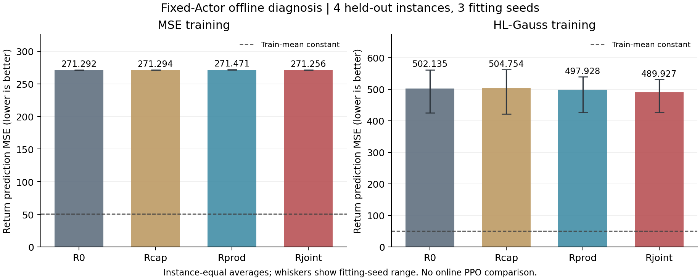
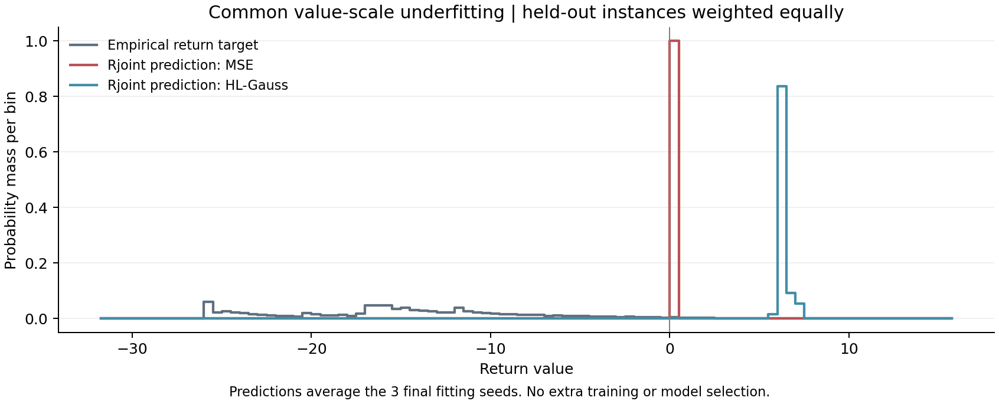

# 阶段 4：搜索信息 Critic 离线验证与验收报告

日期：2026-10-21。授权：用户“进入阶段4”。状态：**已交付，等待验收；阶段 5 未启动。**

## 先说结论

**搜索信息采集到 Critic 离线拟合、保存和恢复的流程已跑通，但本轮尚不能证明新增联合信息有效。共同的价值拟合存在明显欠拟合，应先校准，再做在线对照。**

- 50/50 条固定 Actor 轨迹有效，共 46,001 个决策样本；完成全部 24 次预定拟合，每次固定 500 次更新。35 项检查通过，全部 24 个拟合模型恢复与原状态到预测的链路核对通过。
- 主 MSE 对照中，联合组开发误差为 **271.256**，原信息组为 **271.292**，仅下降 **0.013%**。训练均值常数预测的误差为 **50.613**，明显优于所有神经组。
- 问题不只出现在开发集：原信息组训练误差约 257.400，联合组约 257.346，训练均值常数在训练侧的误差为 78.151。**所有组连训练侧回报尺度都未拟合好，当前比较不足以裁定信息价值。**

本阶段没有增加 Actor 的训练量：仍使用阶段 3 完整训练 4 个 episode 的同一个模型。没有重现论文性能，没有执行新增 Critic 的在线 PPO，也没有新的求解加速结论。

## 1. 实际预测结果

下表全是同一原始回报尺度的开发集平方误差 MSE，越小越好；列标题表示训练时使用的损失。先按实例等权，再对三个拟合种子平均。

| 组别 | MSE 训练后的预测误差 | HL-Gauss 训练后的预测误差 |
|---|---:|---:|
| R0：原信息＋共同剩余时间 | 271.292 | 502.135 |
| Rcap：同容量、只读原树状态 | 271.294 | 504.754 |
| Rprod：新增边际统计 | 271.471 | 497.928 |
| Rjoint：新增联合分布 | 271.256 | 489.927 |
| 仅预测训练均值的常数参照 | 50.613 | 50.613 |

常数值 -13.1668 仅从训练实例等权统计，未使用开发标签。它是无需学习输入关系的诊断参照，不能称作求解策略。

MSE：联合组比边际组低约 0.079%，三个拟合种子中只有两个的开发均值更低。HL-Gauss：联合组比原信息组低约 2.431%，但三个拟合种子中只有一个更低；相对边际组约低 1.607%，同样只有一个种子更低。**HL-Gauss 在本轮整体不如 MSE；不能因为它是文献中的有效方法，就假定当前实现和预算下必然有优势。**

[逐实例预测表](./stage4/per_instance_prediction.csv)、[种子范围与汇总](./stage4/prediction_summary.csv)、[配对比较](./stage4/paired_comparison.csv)保留完整结果。配对表中的实例 bootstrap 仅作描述，只有 4 个有效开发实例，且存在共同欠拟合，不能据某个区间不含零宣称机制已验证。



## 2. 找到的具体瓶颈

真实经验回报覆盖 **-28.349 至 10.620**，大部分决策样本的回报为负。全部 MSE 组和拟合种子的实际预测却只覆盖约 **0.212 至 0.407**，接近正的常数。

进一步读取已训练权重，原树门控价值头在末端先经过二维 LayerNorm、ReLU 和 sigmoid 门控，再接最终线性层。在**本轮训练后的权重**下，可以给其输出求一个与输入无关的保守区间。所有 MSE 头区间的并集约为 **0.212 至 0.983**；约 **99.7% 的开发决策标签**在各自当前头的区间外。这解释了为何改变输入也难以显著减少当前的大误差。

这个区间是当前权重的限制；继续学习或统一处理回报尺度后，区间可以变化，**不能解释为论文架构永远无法拟合负回报**。诊断未进行额外训练，也没有使用开发标签调参。[范围推导与检查代码](./stage4/value_scale_diagnostics.py)、[24 个头的诊断表](./stage4/value_scale_diagnostics.csv)。

当前证据支持：继承 B0 价值头、学习率 0.00012、固定 500 次更新的这套诊断配置没有充分适配本轮回报尺度。不能把小幅误差差别称为有效研究增量，也不能据此否定联合信息。



## 3. 新信息、对照和数据是否可信

新接口复制完整开放集合 leaves＋children＋siblings 的内部 lower bound 和深度；不含当前 focus，不返回节点指针。每次都核对总数与 SCIP 一致。最小化与等价最大化实例的内部界、只读采集前后原生搜索结果均通过检查。

原 Actor、原 Critic、网络模块、H3 奖励及求解设置文件与上游逐字节一致；新 Critic 使用独立模块。状态在动作前提取，branchVar 成功后确认决策索引，导出及缓存时与动作、候选数、完整 episode 逐条核对。

联合分布与边际外积在真实状态中有区别：按有样本实例等权，训练侧约 **85.0%**、开发侧约 **97.9%** 的决策存在非零关联差别。这只说明输入包含不同信息。各实例比例与退化情况见[信息区分度和覆盖表](./stage4/coverage_and_information.csv)。

四组共用同一 Actor、同一轨迹、同一经验折扣回报标签、同一冻结 B0 编码和同一拟合索引。共同剩余时间投影及新增分支位置已在[执行记录](./阶段4_执行记录与验收口径_TGPPO_2026-10-21.md)说明；新增投影零初始化，MSE 各组起点与 B0 值一致。

| MSE 组别 | 总参数 | 本轮可训练参数 |
|---|---:|---:|
| R0 | 4,804,943 | 241,571 |
| Rcap / Rprod / Rjoint 各组 | 4,819,695 | 256,323 |

HL-Gauss 各组比对应 MSE 组多 189 个参数，最后输出 64 个 logits；信息组在同一种损失内严格匹配。[完整参数表](./stage4/parameters.csv)。回报支持区间沿用 [-36,52]，标签超界比例为 0，没有重新选箱或改范围。

预定 20 个训练实例中 19 个有决策样本；5 个开发实例中 4 个有样本。misc03 和 roi5alpha10n8 的各两次任务均无分支决策，保留运行记录，不伪造预测标签、不替换实例。正式 66 个测试实例未使用。[50 次采集明细](./stage4/collection.csv)。

## 4. 实际成本与保留的返修记录

| 项目 | 实测成本 |
|---|---:|
| 50 次采样 worker CPU | 4046.18 秒，约 1.124 核时 |
| 采样父进程 CPU | 5.69 秒 |
| 编码缓存 CPU，含启动 | 382.42 秒 |
| 24 次拟合 CPU，含启动 | 77.77 秒 |
| 缓存＋拟合＋失败重试 CPU | 462.22 秒，约 0.128 核时，低于 4 核时上限 |
| GPU 拟合训练事件累计区间 | 69.00 秒 |
| 24 次拟合进程执行墙钟 | 76.65 秒，不含进程启动 |
| 搜索信息提取 | 11.07 秒累计；约 0.241 毫秒/决策 |
| 提取占采集分支回调总耗时 | 0.818% |

缓存只在 CPU 上运行；GPU 仅用于缓存后的纯张量拟合，没有用于在线 PPO。提取开销是训练采集测量，不能据此声称部署求解加速。编译、桥接、测试、审计、绘图和只读诊断另属工程工作，不混入拟合成本。

正式采样 50 次全部有效，24 次拟合全部完成。另有两项工程返修：首次节点上限桥接被有限任务校验拒绝；首次缓存校验的参考 Critic 未切 eval 导致 dropout 不一致。均保留原始日志，后一项失败启动约 2.04 秒 CPU 已计入离线上限。没有删除正式失败任务来美化覆盖率，也没有看到输赢后追加训练步数。

## 5. 交付索引与复查

- [验收审计](./stage4/verification.json)：15 项审计条件全部通过；[35 项检查日志](./stage4/tests-final.log)、[真实桥接检查](../tgppo/runs/stage4/bridge/verification.json)、[24 个模型恢复误差](./stage4/restoration.json)。这些证明工程和比较协议正确，不表示预测有效。
- [数值汇总](./stage4/summary.json)、[逐实例图](./stage4/per_instance_comparison.png)、[固定配置](./stage4/execution_config.json)、[拟合曲线](./stage4/learning_curves.csv)。
- [完整上游补丁](./stage4/stage4.patch)、[相对阶段 3 的增量](./stage4/stage4_from_stage3.patch)、[只读绑定增量](./stage4/search-binding.patch)、[源码核查来源](./stage4/source_verification.json)。
- [工作区说明](../tgppo/experiments/stage4/STAGE4.md)、[复运行脚本](./stage4/reproduce.sh)、[产物哈希](./stage4/artifact_hashes.json)。原始数据、缓存、24 个可恢复适配头及采样索引保存在 `tgppo/runs/stage4/`；适配头引用同一 B0 检查点。

独立复跑须指定新目录，避免覆盖本轮证据，且会重新占用采样预算：

```bash
bash /root/research/docs/stage4/reproduce.sh /absolute/new/stage4-run
```

工程状态上，本阶段已完成批准范围；研究判断上，信息价值尚未得到有效验证。现有样本来自弱 Actor、只有 4 个有效开发实例、每状态一个经验回报样本、基础编码器冻结，结论限于本次诊断条件。

## 6. 下一步建议：先补价值拟合校准，再决定在线规模

**建议先完成阶段 4 的一轮统一校准，暂不直接启动九组在线 PPO。** 先针对训练侧回报尺度、价值头初始化、学习率与拟合步数形成共同修订方案，说明与原实现的差异，并重新冻结后对所有组重跑。至少先确认训练侧能拟合回报，再评价开发侧是否有信息增益。

这项校准应作为各组共同的拟合适配，单列记录，不能计为联合信息收益。扩大在线训练仍须同时扩大基线与改进，按共同更新进度和计算成本评价；不能拿充分训练的新方法与阶段 3 的四条 episode 模型比较。

校准可复用当前共用轨迹和冻结编码，无需先重新采样；修订选择只看训练侧拟合检查。由于开发结果已经查看，修订后复用开发集仍属探索性验证，正式测试集继续保留。

上述是下一步建议。本轮已按冻结的 500 次更新停止，没有擅自使用剩余预算加训、改变损失或启动阶段 5。**等待用户验收本阶段并决定是否批准统一校准。**
