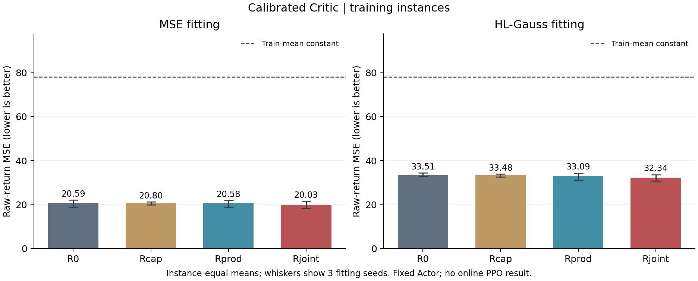
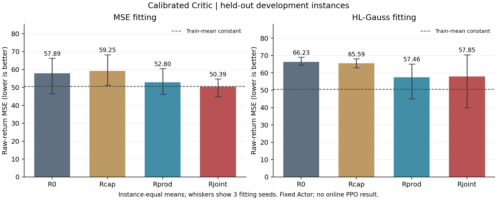
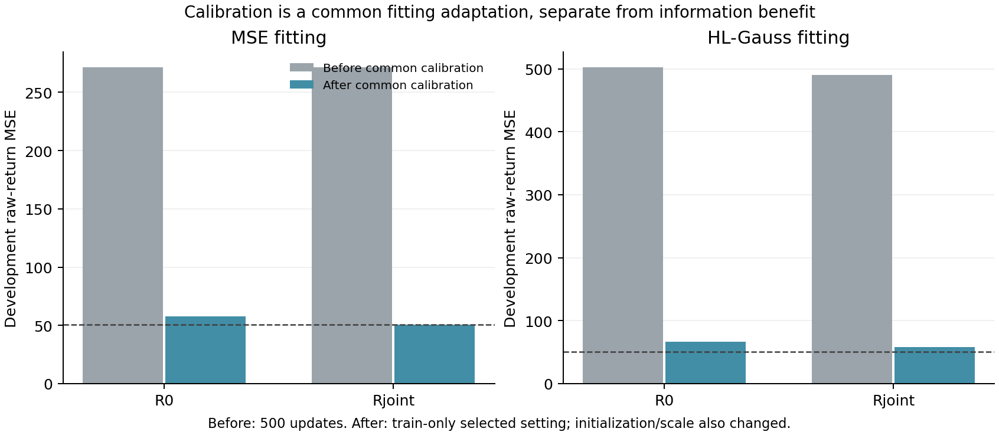

# 阶段 4 补充交付：统一 Critic 校准与验收报告

日期：2026-10-21。授权：用户“先统一校准各组 Critic 的拟合，再开展在线 PPO 对照。”状态：**校准已交付，等待验收；在线 PPO 尚未启动。** 继续遵守每阶段验收后再修改下一阶段的约定。

## 先说人话结论

**Critic 已经能学习训练回报，原先“预测卡在 0.2 附近”的共同拟合问题明显缓解。可以接续做有预算上限的在线 PPO 检验，但还不能宣称联合关联信息有效，更没有求解加速结论。**

- 原信息组 MSE 训练误差从约 257.400 降到 **20.594**；训练均值常数为 **78.151**。其余主 MSE 组训练误差约 20—21，全部通过预先写明的拟合检查。
- 开发集上，原信息组为 **57.894**，联合组为 **50.392**，联合组平均低约 **13.0%**。但常数预测为 **50.613**，联合组仅优于它约 **0.44%**，跨实例泛化仍然偏弱。
- 联合组相对边际组平均低约 **4.6%**，仅 2/3 拟合种子、3/4 实例更低，实例 bootstrap 区间包含零。**新增关联信息的稳定收益仍未证实。**

本轮只训练 Critic 输出头和新增分支，Actor 仍是阶段 3 完整训练 4 个 episode 的固定模型；没有增加 Actor 的 PPO 更新，没有复现论文性能。

## 1. 统一做了哪些校准

保留原 TreeGate 价值头拓扑、LayerNorm、门控、冻结编码器、搜索信息分支和融合位置。原 Actor、Critic、网络模块、H3、求解设置源码仍与上游一致；校准采用新子类，旧阶段 4 的代码和结果保留。

MSE 使用训练实例等权统计的 **μ=-13.166823、σ=8.840327**。损失学习 `(G-μ)/σ`，每次价值输出都反变换为 `μ+σz`；真实奖励、经验回报和评价单位不变。最终线性层权重和偏置置零，让四组从同一训练均值开始。

HL-Gauss 保留原 64 箱、[-36,52] 和 sigma=0.75 箱宽；最终权重置零，偏置取训练侧目标概率均值的对数，概率下限 1e-6。所有组从相同的训练侧分布开始，没有使用开发标签初始化。

这两项都是共同的拟合适配，**不能计为联合信息创新**。尺度归一化参考 [PopArt 原文](https://arxiv.org/html/1602.07714v2)的研究动机，但本轮是静态归一化，不实现自适应 PopArt；分类目标沿用 [HL-Gauss 原文](https://arxiv.org/html/2403.03950v1)。初始化的具体选择及边界见[校准方案](./阶段4补充_统一Critic校准方案_TGPPO_2026-10-21.md)。

## 2. 设置如何选定，如何控制公平性

只用 19 个有决策样本的训练实例：求解器种子 0 的整条轨迹拟合，种子 1 的整条轨迹作内部验证。在 R0、拟合种子 11 上比较学习率 0.00012/0.001 和 2,000/5,000 更新两个候选终点，没有用开发集选择。

两种损失都选中 **学习率 0.00012＋5,000 更新**：MSE 内部验证误差 45.390，HL-Gauss 为 46.880，常数参照为 83.772。学习率 0.001 虽然训练误差更低，内部验证误差更高，因此没有选用。[8 个候选记录](./stage4_calibration/pilot_candidates.csv)、[冻结选择及哈希](../tgppo/runs/stage4-calibration/selection.json)。

选择先落盘，再对四组×两种损失×三个拟合种子完整重跑，共 24 个模型。每个模型 5,000 更新、batch=256；同一种子各组使用完全相同的训练实例等权采样索引。最终 μ/σ 和概率先验重新使用全部训练轨迹统计。各组统一最终检查点，没有开发最优挑选。

校准不增加可训练参数：MSE 的 R0 为 241,571 个，Rcap/Rprod/Rjoint 各为 256,323 个；HL-Gauss 对应各多 189 个。[参数表](./stage4_calibration/parameters.csv)。

## 3. 全部结果

下表都在原始回报尺度计算平方误差，越小越好。先按实例等权，再对三个拟合种子平均。

| 组别 | MSE 训练：训练误差 | MSE 训练：开发误差 | HL-Gauss：开发误差 |
|---|---:|---:|---:|
| R0：原信息＋共同时间 | 20.594 | 57.894 | 66.234 |
| Rcap：同容量、原树状态 | 20.804 | 59.255 | 65.592 |
| Rprod：边际统计 | 20.579 | 52.802 | 57.456 |
| Rjoint：联合分布 | 20.028 | 50.392 | 57.849 |
| 训练均值常数参照 | 78.151 | 50.613 | 50.613 |

全部主 MSE 组的平均训练误差均低于常数的 80%，每个组/种子的训练误差均低于常数，预定校准检查通过。HL-Gauss 各组平均训练误差约 32.3—33.5，也已学到训练侧关系；其开发预测仍整体不如 MSE 主线，不切换在线损失。





主 MSE 联合组相对原信息组平均低 12.96%，2/3 拟合种子、3/4 实例更好；相对同容量 Rcap 低 14.96%，3/3 种子更好。相对 Rprod 低 4.57%，实例配对差的 bootstrap 95% 区间约 [-6.77,1.26]，未显示稳定关联增益。HL-Gauss 联合组反而比 Rprod 平均高约 0.68%。

[逐实例表](./stage4_calibration/per_instance_prediction.csv)、[种子范围和均值](./stage4_calibration/prediction_summary.csv)、[配对比较](./stage4_calibration/paired_comparison.csv)保留全部结果。三个拟合种子不是三个独立 MILP 数据集，只有四个有样本的开发实例，不能据某个区间排除零就作广泛泛化断言。

## 4. 与上一轮相比，哪些收益属于校准

原信息组开发误差从 271.292 降到 57.894；联合组从 271.256 降到 50.392。这个大幅下降同时包含共同的输出尺度、初始化和从 500 增加到 5,000 更新的作用，未分别消融，**不能把全部下降归因于归一化，更不能归因于联合信息。**

信息收益只能比较校准后的组间差别。当前联合组比原信息组有初步优势，但与边际组差别不稳定，且联合组仅略优于常数预测。当前更准确的判断是：**训练拟合已明显改善，开发泛化仍弱，值得用在线闭环继续检验。**



缓存仍是同一批 50 条轨迹、46,001 个样本。misc03 和 roi5alpha10n8 没有决策样本，训练覆盖 19 个实例，开发覆盖 4 个；原有任务记录不删除、不替换。开发结果此前已查看，本轮仍属探索性验证；正式 66 个测试实例继续保留。

## 5. 检查、成本与可恢复产物

41 项检查通过，包括训练侧统计、四组共同初值、原单位解码、梯度和恢复。45 项最终审计通过；全部 24 个适配头在 CPU 恢复后，与保存的 GPU 预测及原始观测到价值的链路相符。[检查日志](./stage4_calibration/tests-final.log)、[最终审计](./stage4_calibration/verification.json)、[恢复误差](./stage4_calibration/restoration.csv)。

旧阶段 4 的 292 项产物哈希全部未变，[保留检查](./stage4_calibration/previous_artifact_preservation.json)。本轮缓存和 B0 Actor 检查点哈希也未改变，无重新采样或隐藏删除。主模型全部完成固定 5,000 更新，未因输赢给某个组追加步数。

| 成本 | 实测 |
|---|---:|
| 4 次 R0 先导 CPU，含启动 | 114.11 秒 |
| 24 次正式拟合 CPU，含启动 | 707.57 秒 |
| 本轮新增拟合 CPU 合计 | 821.69 秒，约 0.228 核时 |
| 连同原阶段 4 缓存/拟合/失败的共享 CPU | 1283.91 秒，约 0.357 核时，低于 4 核时上限 |
| 正式矩阵 GPU 训练事件累计区间 | 697.49 秒 |
| 正式矩阵执行墙钟，不含进程启动 | 709.03 秒 |

GPU 仅用于离线缓存张量拟合。先导进程总执行墙钟为 113.07 秒，未单独分解其 GPU 事件时间，不把正式矩阵事件值当作全部 GPU 成本。测试、审计、作图、编程属于工程工作，另于拟合成本。

新代码：[calibrated_critic.py](../tgppo/experiments/stage4-calibration/code/project/policy/calibrated_critic.py)、[选择和训练入口](../tgppo/experiments/stage4-calibration/code/calibrate.py)。[完整补丁](./stage4_calibration/calibration.patch)、[相对阶段 4 的增量](./stage4_calibration/calibration_from_stage4.patch)、[冻结协议](./stage4_calibration/protocol.json)、[工作区说明](../tgppo/experiments/stage4-calibration/STAGE4_CALIBRATION.md)、[产物哈希](./stage4_calibration/artifact_hashes.json)。模型、优化器状态、μ/σ、概率先验及共同采样索引位于 `tgppo/runs/stage4-calibration/`。

需要独立复跑时使用新目录，会重新消耗拟合资源，不重新跑 SCIP：

```bash
bash /root/research/docs/stage4_calibration/reproduce.sh /absolute/new/calibration-run
```

## 6. 接下来做什么

建议接续[阶段 5 在线 PPO 范围](./阶段5_在线PPO对照接续方案_校准后_TGPPO_2026-10-21.md)：三组共用校准和原尺度 GAE；先通过完整在线更新与恢复检查，再按冻结预算做配对对照，最终只运行 Actor 求解。

阶段 3 估计 2 CPU 核时可能只有约两轮完整 PPO 更新，不能承诺主矩阵能跑满 50 个 episode。后续同时记录有效更新数与预算，线上主线仍用 CPU；新增 GPU 在线学习器或更大训练量另作共同修订。

**本轮完成的是 Critic 拟合校准和离线预测验证，不是论文性能复现。按用户逐阶段验收要求，停在本次交付，等待验收后进入阶段 5。**
