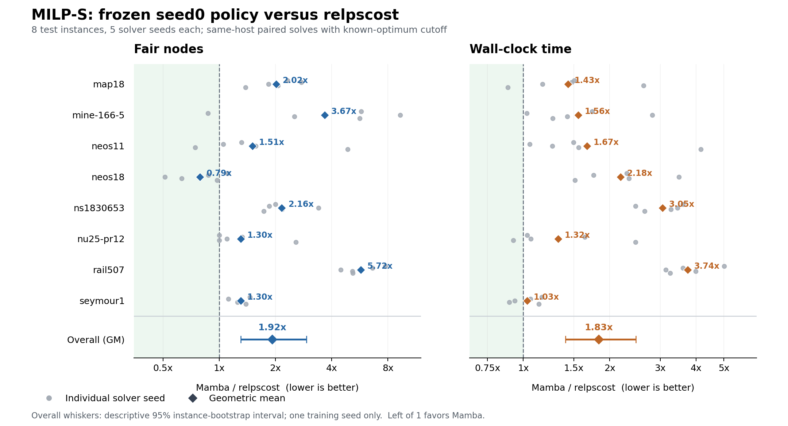

# MILP-S seed0 正式评测结果

核查日期：2026-10-29（北京时间）。正式采集、CL/IL训练、验证集选模、冻结测试及汇总闭环已完成。本轮覆盖主方法Mamba与relpscost，不包含TreeGate、T-BranT等神经对照，也只有1个训练种子。

**结果：当前冻结模型在MILP-S上整体弱于relpscost。公平节点数增加92.1%，求解耗时增加83.1%；论文在该小数据集上同样报告relpscost优于Mamba，但本轮相对差距更大。不能据此宣称复现了论文的神经方法最优结论。**

## 完整性与协议

- 共8个测试实例×5个solver seed=40对、80次求解，4分片均passed，各10对；403项检查通过，120个已提交结果文件SHA256通过，汇总内容逐条匹配提交记录。没有未提交、失败、重试或超时。
- 全部任务绑定相同的冻结selection SHA256：`d9615596fb7c2e49d4381025dccfded90411f72102f2b9b29be59b290649a3bf`。最终IL checkpoint为第50轮，其中包含配套embedding及Mamba；训练前CL选择第44轮。未根据测试指标更换checkpoint或训练参数。
- 全部节点为A100-SXM4-40GB + Xeon Platinum8358，CPU配额4.01核、内存约16GiB；每对relpscost和Mamba在同一主机串行运行。SCIP8.0.4、独立Conda、特征25/8/53、根部relpscost、24步历史、已知最优cutoff及全部primal heuristics关闭；配置与冻结源码哈希一致。
- 按时间戳，4分片实际依次运行，没有重叠。北京时间15:04:42—17:50:29，共约2小时46分钟；这不影响同机配对指标，但本轮没有获得4GPU并行的墙钟收益。

## 总体结果

以下均为40次求解的普通几何均值；所有比值均为Mamba/relpscost，越小越好。5个solver seed是每个实例的重复，不是5个训练种子。

| 指标 | relpscost | Mamba | 比值 | 变化 |
| --- | ---: | ---: | ---: | ---: |
| 节点数 | 518.63 | 1571.38 | 3.030 | +203.0% |
| 公平节点数 | 887.64 | 1704.76 | 1.921 | +92.1% |
| 墙钟耗时（秒） | 43.91 | 80.42 | 1.831 | +83.1% |
| SCIP耗时（秒） | 43.91 | 80.42 | 1.831 | +83.1% |
| SCIP原生PDI（辅助） | 483.37 | 609.68 | 1.261 | +26.1% |

Mamba在公平节点数上为6胜/2平/32负，在耗时上为4胜/0平/36负。按每实例5种子的几何均值比较，8个实例全部耗时更长，7个实例公平节点数更多。

## 逐实例结果

[PDF矢量图](paired-performance.pdf)；[SVG矢量图](paired-performance.svg)。灰点是各solver seed，比值小于1才有利于Mamba；菱形是几何均值，整体误差线为实例分组bootstrap描述性区间。

每行先在该实例的5个solver seed上取几何均值。

| 实例 | 基线公平节点 | Mamba公平节点 | 公平节点比 | 基线秒 | Mamba秒 | 耗时比 |
| --- | ---: | ---: | ---: | ---: | ---: | ---: |
| map18 | 432.4 | 872.2 | 2.017 | 142.70 | 204.31 | 1.432 |
| mine-166-5 | 459.4 | 1685.5 | 3.669 | 21.32 | 33.15 | 1.555 |
| neos11 | 2493.3 | 3765.2 | 1.510 | 116.04 | 193.48 | 1.667 |
| neos18 | 2759.4 | 2177.0 | 0.789 | 16.02 | 34.99 | 2.184 |
| ns1830653 | 5664.1 | 12254.6 | 2.164 | 109.48 | 334.29 | 3.053 |
| nu25-pr12 | 52.0 | 67.7 | 1.302 | 4.39 | 5.81 | 1.325 |
| rail507 | 777.4 | 4447.3 | 5.721 | 115.60 | 432.69 | 3.743 |
| seymour1 | 1232.3 | 1604.9 | 1.302 | 44.03 | 45.39 | 1.031 |

- rail507是主要薄弱实例：公平节点约5.72倍、耗时3.74倍，5个种子均更差。mine-166-5公平节点约3.67倍；ns1830653耗时约3.05倍。劣势覆盖多个实例，不是一个异常点造成。
- neos18公平节点减少21.1%，但耗时增加118.4%；更少节点没有转化成时间收益。神经推理和每节点LP代价都可能影响耗时；原日志没有分项计时，无法量化各自贡献。
- seymour1耗时最接近基线（+3.1%），原生PDI低7.9%，但公平节点仍多30.2%。
- nu25-pr12的seed0和seed3没有成功选择任何神经分支，仍保留在正式汇总；seed3的小幅时间胜出不能归因于Mamba。仅作敏感性分析去掉这2对后，公平节点比仍为1.988、耗时比1.893，结论不变；正式主结果不删样本。

## cutoff、状态和PDI的含义

**80次求解均为`infeasible`、`solutions=0`、`nodes_left=0`、`cutoff_proof_without_incumbent=true`。** 本次提供了公开已知最优目标值作为cutoff：这些状态说明搜索结束且没有找到满足该严格改进限制的解，不表示原始MILP无可行解。它们也不证明本次搜索实际找到了最优可行解。日志中的primal_bound=cutoff和gap=0不能作为观察到incumbent的证据。

因此本轮衡量的是已知最优cutoff条件下的搜索/证明效率，而不是未知最优值场景中的找解能力。没有超时或工作进程失败，状态不需要改写成optimal。原生PDI从SCIP内部统计直接读取；在全部无incumbent的cutoff实验中仅作辅助，不能作为找到更好可行解的证据，也不直接与论文MILP-L困难实例的PDI相比。

## 与论文比较

[本地论文原文](../../../../sources/paper.pdf)的Table1（印刷页7）及5.1.3/5.2给出MILP-S结果与相同cutoff协议。

| MILP-S几何均值 | 论文relpscost | 论文Mamba | 本轮relpscost | 本轮Mamba |
| --- | ---: | ---: | ---: | ---: |
| 节点数 | 730.21 | 2068.83 | 518.63 | 1571.38 |
| 公平节点数 | 1227.25 | 2091.54 | 887.64 | 1704.76 |
| 墙钟耗时（秒） | 82.51 | 111.78 | 43.91 | 80.42 |

| 相对同轮relpscost的比值 | 论文 | 本轮 |
| --- | ---: | ---: |
| 节点数 | 2.833 | 3.030 |
| 公平节点数 | 1.704 | 1.921 |
| 墙钟耗时（秒） | 1.355 | 1.831 |

论文在MILP-S上并未声称Mamba超过relpscost；其主要优势是优于TreeGate/T-BranT等其他神经分支方法。本轮与论文的relpscost对比方向一致，但相对公平节点和耗时差距更大；尚无其他神经方法对照，无法验证神经SOTA主张。

本轮Mamba绝对节点数和时间小于论文数值，但本轮relpscost同样更低。论文使用Gold5218和A100-PCIe40GB，本轮使用Platinum8358和A100-SXM4，不能把绝对耗时降低当作超越论文。即使按同轮基线归一化，仍存在实现、求解器及训练随机性等差异，不能当作严格同硬件复测。

已记录的复现细节包括：公开数据重新采集；SCIP8定制特征绑定独立移植；修复padding、启发式关闭遗漏与标签类型；IL按论文窗口内求和/跨窗口平均而非上游状态均值；CL使用全部293,346个有效状态而非上游200,000 cap；CL50/IL50、派生种子及验证选模属于明示补充选择；训练从V100迁到A100并采用数值门禁通过的微批8。上述是审计差异，现有结果不能确定哪一项造成性能差距。

## 不确定性与后续

统计单位为8个实例，另有每实例5个求解器种子重复。按实例整组重抽样20,000次，公平节点比的描述性95%区间约[1.304, 2.937]，耗时比约[1.401, 2.467]。这不包含训练种子方差，也不支持扩展到全部MILP的普遍结论；完整方法与其他辅助统计保留在analysis.json。

本轮可以作为“单训练种子、主方法对relpscost”的正式复现基线归档。若后续目标是验证论文的神经对照优势，需增加同协议TreeGate/T-BranT等对照和独立训练种子；新增实验应另建目录、冻结协议，并在训练/验证侧做调试。不能反复用这8个测试实例挑epoch或调参数，再把同一测试结果当独立泛化证据。本次没有启动新增训练或求解作业。

## 材料

- `analysis.json`：完整检查、40对原始记录、逐实例/总体指标、论文对照和统计方法。
- `solver_runs.csv`：80行求解记录，含原生状态、bound、cutoff、主机和指标。
- `paired_ratios.csv`：40行配对比值。
- `per_instance.csv`：逐实例各指标几何均值和胜平负。
- `plot_results.py`：只读取analysis.json重绘图表；绘图依赖位于独立的/tmp临时venv，未改变训练Conda环境。
- `manifest.json`：本报告及关键输入的SHA256。
- 原始提交及日志位于`../../evaluation/`；原始汇总为`../../evaluation/summary.json`。
