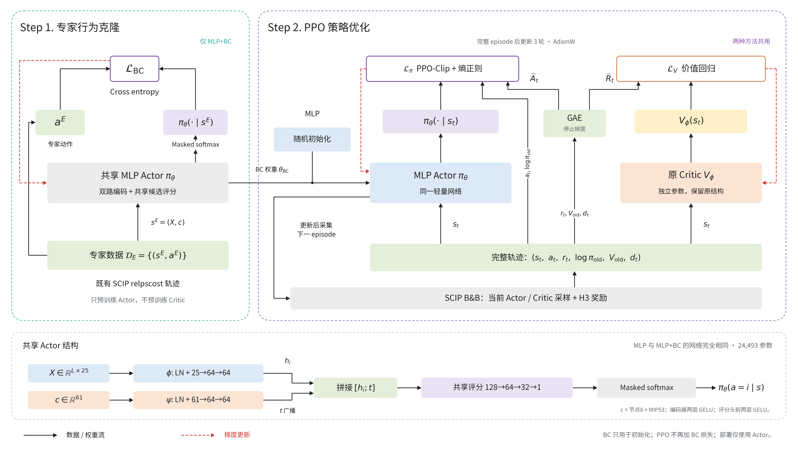

# 轻量Actor与专家初始化：方法详解与汇报讲稿

日期：2026-11-13。建议主讲12–15分钟，附录用于问答。对应本目录12页幻灯片。

**一句话介绍：我们保留TGPPO的廉价状态特征和PPO框架，把重Actor替换为树上下文条件化的共享MLP，再用relpscost专家行为克隆提供初始化；在固定100 episode的完整66实例评测中，轻量结构降低了CPU决策成本并改善了相对自复现B0的PDI，BC进一步增加证明完成覆盖，但平均PDI存在取舍。**

这是一项架构替换与训练初始化的增量研究。共享MLP、行为克隆和PPO本身都不是新发明；目前证据也不支持宣称已超过原生relpscost、完整复现论文性能或证明跨种子稳定泛化。

## 1．先把比较对象说清楚

| 名称 | Actor | 初始化与训练 | 在本轮中的作用 |
|---|---|---|---|
| 旧B0 | 原TGPPO式Transformer、BiMatching、TreeGate评分链 | 随机初始化，PPO更新时Actor为eval | 历史更新模式参照 |
| 新B0 / B0_new | 同一原Actor架构 | 随机初始化，采样eval、PPO更新train | 本次方法解释的主要自复现基线 |
| MLP | 本项目实现的轻量Actor | 随机初始化后PPO | 测量Actor结构替换的整体增量 |
| MLP＋BC | 与MLP完全相同 | 先BC初始化Actor，再PPO | 相对MLP测量专家初始化增量 |
| relpscost | SCIP原生可靠伪成本分支规则 | 不训练神经网络 | 原生强参照与既有专家标签来源 |

“原TGPPO”在结构讲解时指论文及公开实现的Actor机制；**实验表里的B0是本地自复现的固定100 episode模型，不是作者正式权重或论文最终性能。** 论文最终训练为500完整episode；本轮只是独立固定100检查点评测。新旧B0平均PDI和证明率几乎相同，因此轻量结构的本轮收益也不是只依赖旧B0的eval更新模式。

新B0与MLP比较时，MLP代码虽沿用旧入口的eval设置，但该Actor没有Dropout或BatchNorm等训练模式相关模块；此前有限CPU更新等价核验支持其不受这一模式切换影响。这里仍不声称不同硬件的训练逐位相同。

## 2．TGPPO原Actor做了什么，为什么考虑替换

每次SCIP需要选择分支变量时，输入是当前候选集合以及搜索状态：

$$
\begin{aligned}
X&\in\mathbb{R}^{L\times25},\quad n\in\mathbb{R}^{8},\quad m\in\mathbb{R}^{53},\\
c&=[n;m]\in\mathbb{R}^{61}.
\end{aligned}
$$

原Actor先把候选和树上下文分别投影到256维，拼接后再融合；之后经过5层、8头Transformer，建模候选交互；通过BiMatching再次融合树信息，最后由TreeGate门控评分链逐级压缩为每候选的标量logit，再softmax产生动作分布。原Actor共有4,738,895个参数。

这一设计有其表达能力优势：能够建模候选间关系并由树状态调节评分。但分支是被CPU求解器反复调用的串行决策，单次小开销会累积；候选数增加时，自注意力还包含二次于L的计算项。本轮真实CPU评测中新B0的Actor决策路径均摊为56.64ms/调用。

早期本地诊断还观察到评分链候选响应弱等现象，但只改末端8→1、重置评分头及CR捷径没有稳定传导为求解收益。因此本方法选择替换整条Actor链，而不是继续把一个窄层当作已确认的唯一根因。**不能据此指控作者正式模型必然失效。**

依据：原结构和超参数见[TGPPO §4.1、§5.3](https://arxiv.org/html/2511.12986v1)；具体连接与参数数量以本地源码为准。

建议口头表述：“我的目标是把可学习排序放进一个能承受高频CPU调用的Actor里，同时保留候选身份与搜索上下文这两个关键结构约束。”

## 3．结构改进一：用双路非线性编码和共享候选评分替换整条重Actor

### 3.1 精确网络

候选编码器对每一行使用相同参数：

$$
\begin{aligned}
u_i&=\operatorname{GELU}\bigl(W_{x,1}\operatorname{LN}_{25}(x_i)+b_{x,1}\bigr),\\
h_i&=\phi(x_i)=\operatorname{GELU}\bigl(W_{x,2}u_i+b_{x,2}\bigr)\in\mathbb{R}^{64}.
\end{aligned}
$$

树上下文编码器只需在当前状态上计算一次：

$$
\begin{aligned}
t&=\psi(c)\in\mathbb{R}^{64},\\
\psi:\quad&\operatorname{LN}(61)\to\operatorname{Linear}(61,64)\to\operatorname{GELU}\\
&\to\operatorname{Linear}(64,64)\to\operatorname{GELU}.
\end{aligned}
$$

将同一个t广播到所有候选，与各自hᵢ拼接；共享评分头为：

$$
z_i=\rho([h_i;t]),\qquad \rho:128\to64\to32\to1,
$$

其中前两层Linear后各接GELU，最后Linear直接产生标量。padding位置设为−∞后，在合法候选轴上softmax：

$$
\pi_\theta(a=i\mid X,c)=\frac{\exp(z_i)}{\sum_{j\in\mathcal{C}}\exp(z_j)}.
$$

测试沿用冻结策略的Categorical动作采样。网络图中的不同高度概率条是结构示意，不是某次真实状态的实测概率。

| 部分 | 精确结构 | 参数量 |
|---|---|---:|
| 候选编码 | LN25→25→64→64，两个GELU | 5,874 |
| 树编码 | LN61→61→64→64，两个GELU | 8,250 |
| 共享评分头 | 128→64→32→1，前两层GELU | 10,369 |
| 合计 | 同一个Actor用于任意合法候选数L | **24,493** |

相对原Actor参数减少99.48%，约为原来的1/193.48。

### 3.2 每个设计的直觉、依据和取舍

| 设计 | 直觉／依据 | 本轮能够确认什么 | 仍不能确认什么 |
|---|---|---|---|
| 按候选共享φ和ρ | 候选顺序没有语义；同一评分函数应适用于不同实例和候选数 | 源码满足排列等变和动态L；不依赖候选位置编码 | 排列等变本来就是原TGPPO的原则，不能作为新增发明 |
| 保留树上下文条件化 | 同一候选特征在不同搜索阶段可能应有不同偏好 | t经过非线性评分头影响每个候选logit | 树特征已来自TreeGate/TGPPO，不是新特征贡献 |
| 两路64维非线性编码 | 在保留局部语义的同时控制模型容量与CPU计算 | Actor参数和决策路径成本显著降低 | 更小容量是否单独改善泛化，未做容量匹配对照 |
| 删除Transformer和BiMatching | 避免高频调用中的重交互，保留最必要的条件化排序 | 同预算下整条结构替换获得PDI及证明率改善 | 没有分别消融，不能把全部收益归给删除注意力 |
| 128→64→32→1直接读出 | 让候选区分通过较短非线性路径到达logit；避免原窄压缩链中的低维归一化 | 新评分路径可以接受BC/PPO训练；没有评分头LayerNorm | 尚未证明某一个LayerNorm就是原模型的唯一根因 |

固定宽度下，该Actor对候选轴的主要计算随L线性增长。它没有显式候选两两交互；候选之间在softmax归一化时竞争。因此复杂候选关系可能表达不足，属于为部署成本作出的实际取舍。

交换候选顺序时，h与z按相同顺序交换，树上下文t不变，softmax也按相同顺序交换，所以 $\pi(PX,c)=P\pi(X,c)$。这借鉴集合网络的共享参数原则。[Deep Sets](https://arxiv.org/abs/1703.06114)提供相关理论背景；**当前MLP没有sum/mean/max集合汇聚，不应直接称为完整DeepSets模型。** [TreeGate](https://ojs.aaai.org/index.php/AAAI/article/view/16512)支持保留搜索树条件化的动机。

## 4．训练改进二：用专家BC初始化同一轻量Actor

MLP＋BC和MLP的推理模型完全相同。BC增加的是训练前的初始化过程，不增加部署时的教师模型、特征或计算分支。

训练图参照用户提供的 Mamba-Branching 图的分区与连线风格重新绘制，内容依据当前实现：MLP 跳过 BC，直接以随机初始化进入 PPO；MLP+BC 只迁移选中的 Actor 权重，并使用新的 PPO 优化器。黑色表示数据／权重流，红色虚线表示梯度；GAE 使用轨迹中存储的旧价值，目标停止梯度，Actor／Critic 参数独立。[SVG](figures/06_mlp_mlpbc_training_mamba_style.svg)｜[PDF](figures/06_mlp_mlpbc_training_mamba_style.pdf)｜[可编辑 PPT](figures/06_mlp_mlpbc_training_mamba_style.pptx)。

当前B0→MLP→MLP＋BC是顺序增量对照，不是完整“结构×BC”2×2：本轮没有同协议B0＋BC这一臂，因此只能估计BC在MLP上的条件增量，不能证明两者存在正协同或BC对所有Actor都独立有效。

### 4.1 专家是什么

复用Mamba-Branching研究目录里此前合法采集并审计过的**SCIP8 relpscost原生决策**。标签是每个状态中专家实际选择的候选相对索引，数据包含25维候选特征和61维节点/MIP状态。

这不是作者Mamba模型的隐表示，也不是强分支标签，不是软概率蒸馏，更不是对比学习。引用[Gasse et al. 2019](https://proceedings.neurips.cc/paper/2019/file/d14c2267d848abeb81fd590f371d39bd-Paper.pdf)的依据是“通过交叉熵模仿专家动作可用于分支策略训练”，不能把该论文使用的强分支专家移植成我们数据的实际来源。

### 4.2 数据如何选

- 12个BC拟合实例、1,468个状态；另3个BC内部留出实例、288个状态。
- 留出实例为pp08aCUTS、swath1、neos648910，都属于当前25个PPO训练实例，不是66测试集。
- 合法专家范围共15实例；沿用已有审计保守划分，没有重新纳入曾为开发实例的4个对象。
- 源数据共60份轨迹，solver seeds0–3、random-prefix=0；对拟合每份最多取32状态，留出每份最多24状态。
- 只使用候选数2–256的完整状态；超过256的状态整条排除，未截取部分候选后重新制造标签。
- 特征公式与顺序已核查，但SCIP8与当前SCIP6、cutoff和两项计数语义存在分布差异。因此它是离线专家迁移数据，不能冒充当前PPO的on-policy轨迹。

### 4.3 怎么训练

先均匀抽取实例，再从该实例抽取状态，以免长轨迹或容易产生大量分支的实例独占训练；用专家动作交叉熵：

$$
\mathcal{L}_{\mathrm{BC}}(\theta)=-\mathbb{E}_{I\sim U(\mathcal{I}),\,s\sim D_I}\bigl[\log\pi_\theta(a^E\mid s)\bigr].
$$

BC采用Adam、学习率0.001、batch16，固定完成1000步预算。按0/100/200/400/600/800/1000里程碑上的内部留出实例宏平均归一化NLL选初始化，归一化仅用于选模统计：$-\log\pi(a^E\mid s)/\log L$。**训练损失本身是普通交叉熵，不是归一化NLL。**

两个训练种子11/22都选回第100步权重，因此“1000步BC”描述完成的训练预算，“选第100步”描述实际进入PPO的初始化。没有按66测试集选BC步数。

BC是额外的1000步预训练预算，两种子实际记录约9–10秒。相同100 PPO episode不等于总学习计算严格相同；复用历史专家数据降低新增成本，也不代表专家数据采集历史成本为零。

| BC内部留出，选中初始化 | seed11 | seed22 |
|---|---:|---:|
| 归一化NLL | 0.8331 | 0.8425 |
| 专家动作一致率 | 39.93% | 38.54% |
| 均匀动作参考 | 8.35% | 8.35% |

这些结果说明轻量网络能学到可迁移到BC内部留出实例的专家偏好。它不是测试求解收益，也不是PPO已带来额外收益的证据。

### 4.4 为什么还接PPO

直觉是先减少完全随机探索，让Actor从有信息的排序开始，再用实际求解轨迹和H3奖励调整。BC对动作标签负责，PPO对自身轨迹回报负责。BC只初始化Actor；Critic保留原网络和独立初始化，进入PPO时使用全新AdamW状态，不把BC的Adam动量混入PPO。

这是一种合理的训练策略，**当前三个条件没有BC-only的同协议对照，不能据此宣称“PPO在BC之上有了多少收益”。** 当前MLP＋BC也没有持续专家约束：PPO期间只用原PPO目标，不继续追加BC损失，不含对比预训练。

## 5．哪些保持原方法，哪些属于复现协议

沿用原25/8/53维特征、H3奖励、Critic结构、Actor/Critic独立参数、clip0.16、entropy0.003、gamma0.97、GAE lambda0.92、Actor lr2.4e−4、Critic lr1.2e−4、逻辑mini-batch256和每有效episode后3轮更新。PPO使用AdamW；微批8只用于累计逻辑梯度，不将它写成mini-batch8。

PPO计划500完整episode，按种子构造25实例×solver seeds0–4的125组合排列，四个循环覆盖全部500；当前拿固定100检查点评测，前100只覆盖该循环的100组合，不能称已经完成500或全四循环。单次求解3600秒，SCIP轨迹采样在CPU，GPU用于参数更新，部署只加载CPU Actor。

标准GAE、episode边界、恢复一致性、train/eval模式和求解接口正确性属于共享复现协议或工程修复，不是本方法创新。没有重新执行论文的超参数嵌套搜索，也没有作者正式权重；不把这一轮直接等同作者实验原样复刻。

## 6．最新完整66结果：主表与两个独立增量

四模型固定训练seed11、episode100；solver seed0；66测试实例，各方法3600秒，同CPU/主机/软件环境，4模型＋relpscost共330项全部有效。每个实例四模型均实际调用Actor。

这些66实例曾在旧协议下被查看，有历史测试暴露；本轮固定100检查点未按测试结果选择，但不能将其宣传成完全未见保留集上的最终确认。

**证明率指已知最优cutoff受控设置下、时限内完成证明证书的比例；不写成从零发现最优解的比例。** PDI按固定3600秒窗口统计；平均值、几何均值和逐实例表现不能相互替代。

| 方法 | 平均PDI↓ | 证明完成数／率↑ | Actor决策路径ms↓ | 平均optimize墙时s↓ |
|---|---:|---:|---:|---:|
| relpscost | 10942.99 | 60/66，90.91% | — | 630.05 |
| 旧B0 | 27395.37 | 31/66，46.97% | 56.58 | 2169.95 |
| 新B0 | 27399.94 | 31/66，46.97% | 56.64 | 2170.56 |
| MLP | **22098.60** | 36/66，54.55% | 2.77 | 2105.56 |
| MLP＋BC | 22709.29 | **43/66，65.15%** | 2.76 | 1858.72 |

### 结构整体：新B0 → MLP

- 平均PDI降低19.35%；证明数31→36，证明率增加7.58个百分点。
- Actor决策路径耗时降低约95.11%，约快20.43倍；参数减少99.48%。
- 平均optimize墙时只降低约2.99%，不能说求解加快20倍。
- 44个实例的PDI测量区间支持改善，19个支持退步，3个区间重叠；测量区间不是统计置信区间。
- 大PDI实例对净改善贡献较大；ns1830653与neos-4722843-widden两个实例贡献约76.1%的净总PDI改善。不能仅据总均值宣称异构实例普遍改善。
- 节点的shift100几何均值由约6643升至10144，不能称“收益来自普遍缩小搜索树”。

### BC初始化：MLP → MLP＋BC

- 证明数36→43：新增8个证明完成、损失1个，净增7个；证明率提高10.61个百分点。
- 算术平均PDI增加2.76%。33个实例的测量区间支持改善、32个支持退步、1个重叠，尾部幅度不对称导致均值取舍。
- 网络结构和决策路径耗时基本相同，收益不能归因于又增加了一个更快的Actor。
- 相对新B0，组合方法的PDI仍降低17.12%，证明率增加18.18个百分点，平均optimize墙时降低约14.37%。

### 为什么“多证明了7个”不等于“PDI一定更低”

证明是截止时刻的证书事件，PDI是整段搜索过程的gap面积。真实例子ns1830653：MLP的PDI为1282.45但未证明完成，MLP＋BC的PDI为80679.28却证明完成。两个指标评价的是不同方面；没有真实gap时间序列时不捏造一条曲线来解释。

对BC平均PDI的退步，大贡献例子包括neos-4722843-widden（BC−MLP约＋118225）和ns1830653（约＋79397）；也有app1-2（约−84745）等改善。应保留所有实例，不能删掉退步对象来给BC制造正主指标。

## 7．当前为什么会更好：按证据强弱回答

**已确认的直接解释：** 结构里确实删去了大部分参数和重交互算子，真实CPU Actor决策路径显著更便宜。这一结构整体在本轮固定预算里也获得更低PDI与更高证明率；BC确实能拟合内部留出专家偏好，随后组合方法取得更广的证明完成覆盖。

**合理但待验证的机制：** 简洁共享评分可能更容易优化、更少丢失候选区分；较低决策开销可能让相同3600秒内分配更多时间给LP和树搜索；BC可能改善初始动作排序与探索起点。这些都与观察一致，但尚未被独立因果实验逐项证实。

**当前不能回答的部分：** 结构替换同时改变函数族、容量、归一化、门控与计算成本，因此不是“只删注意力”的单变量实验；MLP＋BC与MLP的比较隔离的是BC初始化，不能分离PPO本身相对BC-only的价值；不同策略访问的节点、候选规模不同，56.64ms/2.77ms是各自真实轨迹上的调用加权均值，不是完全相同状态上的纯算子微基准。

另外，当前所有学习方法整体仍落后relpscost：MLP与MLP＋BC的平均PDI分别约为原生2.02和2.08倍，证明数36/43对原生60。结果支持相对自复现TGPPO式B0的改进，尚不支持对最强原生参照的优势。

## 8．计时口径纠正

此前README曾将56ms/2.77ms写为“前向均值”，不够准确。本轮源码的计时从`ActorPolicy.act()`开始，包括输入tensor转换/检查、网络计算、Categorical动作及log_prob；不包括SCIP特征提取、Critic或实际branch操作。这里统一改为**Actor决策路径耗时**。

这有实际部署意义，但仍不是纯forward，也不是整个branch callback；各策略候选规模和搜索路径不同，同状态加速需另有固定状态微基准，不能只拿本表给出纯算子因果结论。

## 9．老师可能追问的回答

**“所以只是把Transformer换成MLP？”**

结构主改动确实是整条Actor替换，技术积木不新。需要讲清楚为什么保留树条件化、排列等变与候选身份，为什么采用短评分路径，以及在CPU求解中的成本—质量结果。现阶段是有效候选与实证设计；要形成更强方法贡献，需要后续稳定性和机制消融，而不是给普通MLP换一个新名字。

**“树状态和廉价特征也是你改的？”**

不是。它们来自TreeGate/TGPPO，本次是在轻量化时保留这些归纳偏置；当前没有新增特征、完整图编码或历史模块。

**“没有候选间交互，会不会表达不足？”**

会，这是明确取舍。固定树上下文c与候选i/j自身特征后，$\log(\pi_i/\pi_j)=z_i-z_j$，与其他候选的表示无直接关系；变化的树上下文可提供部分全局信息，但不能替代显式交互。当前成本与求解结果支持这一简洁基线，尚不支持声称表达能力优于Transformer。

**“BC后是不是还在用专家？”**

只有离线预训练用到标签。PPO阶段不继续加专家损失；部署也不调用专家。当前没有对比学习。专家标签是relpscost，不是strong branching。

**“BC既然学专家，为什么还不如原生专家？”**

学生只拟合少量旧域状态上的动作，不可能自动精确复制专家在所有未见状态上的逻辑；还存在SCIP版本和状态分布差异，之后PPO的H3目标也不等于直接最小化PDI。这个差距是当前事实，不能用假设消除。

**“PPO真的起作用了吗？”**

本轮没有相同3600秒协议下的BC-only全66对照，因此无法定量断言PPO在BC之上的独立收益。我们完成了真实PPO训练，但“发生更新”和“PPO带来额外求解收益”是两个问题。旧120秒开发曲线不移植为本轮因果结论。

**“20倍速度，为何总求解只快一点？”**

加速的是Actor决策路径。整个求解还包括特征、LP、预处理和树管理，并且策略改变了搜索轨迹。MLP平均optimize只改善约2.99%，组合方法约14.37%；不能按Actor倍数推端到端倍数。

**“能否直接说比论文TGPPO好？”**

应说“在我们的固定100 episode、同机受控协议下，相对TGPPO架构自复现基线有所改善”。作者正式权重未验证，500训练尚未完成，当前仅一个训练种子和一个solver种子的完整66结果，不能跨协议声称超过作者论文指标。

## 10．后续最小必要工作

1. 完成已经约定的500 episode与两个训练种子，保持原协议；解决设备与调度故障不计作方法贡献。
2. 冻结检查点后按既定solver种子覆盖评测，不用66测试集挑最优中途权重。
3. 若要解释“BC后PPO为什么有效”，补同协议BC-only对照；若要解释结构哪个细节有效，再选择一个最小内部消融。当前这些是建议，不在本次汇报准备中自动启动。
4. 对BC保留PDI与证明率双目标报告，记录哪些异构实例退步；在跨种子稳定前不宣称全面优越。

## 11．图应该怎么讲

- **图01详细网络**：先沿蓝色候选支路走，再沿橙色树上下文支路走；解释树向量广播、拼接、共享评分，最后说明softmax的候选竞争。不要把输入矩阵的列误认为候选数。
- **图02结构对照**：指出整条重Actor被替换，强调哪些保留；低维归一化是设计动机，不是唯一根因结论。
- **图03训练流程**：橙色是只发生一次的离线BC，绿色是循环PPO，蓝色是Actor-only部署；MLP直接从随机初始化进入绿色区域。
- **图04结果**：先看MLP对新B0，再看BC对MLP，最后看原生参照。三个问题不混在一个“效果好”的结论里。
- **图05指标取舍**：用真实ns1830653解释端点证明与全过程gap面积的差异，不画虚构收敛轨迹。

## 12．图形参考与证据入口

图形重新按本地源码绘制；参考[Set Transformer Fig.1](https://proceedings.mlr.press/v97/lee19d/lee19d.pdf)的模块分图、[Gasse et al. Fig.2](https://proceedings.neurips.cc/paper/2019/file/d14c2267d848abeb81fd590f371d39bd-Paper.pdf)的张量流与维度、[TGPPO Fig.1](https://arxiv.org/html/2511.12986v1)的solver–policy闭环。没有复制其模型结构来冒充本项目实现。

数据、精确源码与生成物哈希见[SOURCES_AND_EVIDENCE.md](SOURCES_AND_EVIDENCE.md)和[DELIVERY_AUDIT.json](DELIVERY_AUDIT.json)。
