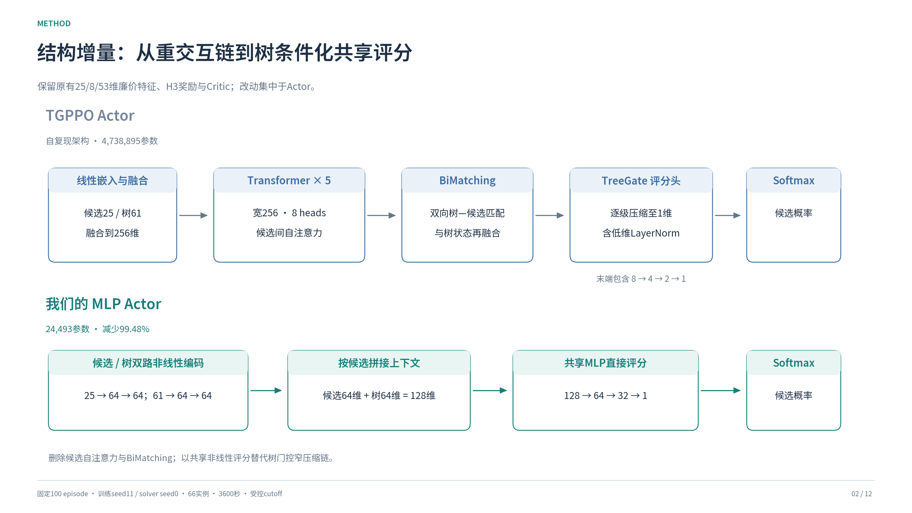
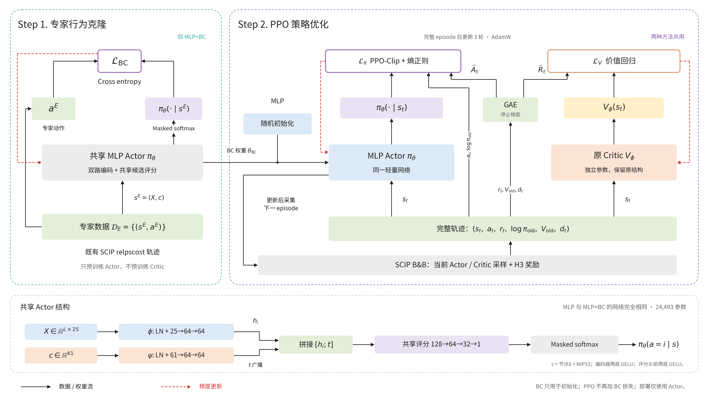

# 面向异构 MILP 的轻量化学习分支策略

组会汇报｜截至 2026-11-13｜建议汇报 8–10 分钟

> **本周主线：** 承接上周的轻量 Actor 研究，将训练目标和主要设置对齐到 TGPPO 论文，重新训练 B0、MLP、MLP+BC；目前部分模型达到 200 多轮，但尚未完成 500 轮。固定 100 轮的全 66 实例评测已完成，固定 200 轮评测已启动。本周重点介绍**为什么这样改 Actor，以及当前证据支持什么**。

## 1. 从上周的初步验证，转向论文配置下的重训

上周已发现：原 Actor 的 CPU 决策成本较高，本地评分链还有候选响应偏弱的现象。因此选取“轻量 Actor＋专家初始化”作为研究主线；评分头修补、候选残差 CR、持续专家监督等路线未得到稳定收益，暂不继续。

但上周实验使用较短的求解与训练预算，不能直接对标论文最终方法。本周先补齐这部分实验基础。

| 项目 | 上周初步实验 | 本周重新训练的设置 |
|---|---|---|
| PPO 训练实例 | 20 个训练＋5 个开发 | 论文全部 25 个训练实例 |
| 训练 solver 随机种子 | 0–2 | 0–4，共 125 个实例／种子组合 |
| 训练目标 | 100 个完整 episode | **500 个完整 episode**，四轮覆盖 125 个组合 |
| 单次训练／评测求解时限 | 120 秒 | **3600 秒** |
| 优化器与更新 | Adam；每收集 4 个 episode 后更新 | **AdamW；每个完整 episode 后更新 3 轮** |
| 原 Actor 的训练模式 | 更新时也使用 eval | 新 B0 采样时 eval、更新时 train |

同时核对标准 GAE、episode 边界、随机流和断点续训。**这些属于对照协议与实现正确性，不作为方法创新。** 本轮按“论文正文＋标准 GAE”实施；论文与公开代码在更新组织上存在差异，且未重新执行论文的超参数搜索，因此表述为“主要协议对齐”，不称已经原样复现作者最终实验。

## 2. 当前训练到哪里，为什么耗时这么长

### 训练进度

以下为本次整理时的已完成进度，目标均为 500；B0 指更新模式已对齐的新 B0。

| 方法 | 训练 seed 11 | 训练 seed 22 |
|---|---:|---:|
| B0 | 164 / 500 | 218 / 500 |
| MLP | 284 / 500 | 172 / 500 |
| MLP+BC | 284 / 500 | 271 / 500 |

**目前是训练尚未完成，而不是已经训练收敛。** 评测读取事先冻结的整百轮权重，不读取持续变化的 latest，也不依据测试结果挑选最优轮次。

### 耗时主要来自完整求解，而不是 GPU 算力不足

1. **一个 episode 是一次完整的分支定界求解。** 单次上限从 120 秒提高到 3600 秒，难实例可能占满一小时；PPO 要等本次轨迹完成、更新后才能继续下一轮，不能简单把后续 episode 全部并行采样。
2. **采样和原生归一化依赖 CPU。** 采样进程的 Actor、Critic 和 SCIP 都在 CPU 上；新任务／新环境还可能先进行一次原生 relpscost 求解，建立奖励归一化参照。早期相同 87 轮的记录中，CPU 采样及采样前准备约占 **89%–93%**，PPO 更新仅约占 **7%–10%**。其中准备时间含缓存等待，不能全部解释成 CPU 运算。
3. **Actor 变轻，不代表整个训练网络都变轻。** 原重型 Critic 保留；MLP 类任务后来转到 CPU 续训以避开 GPU 闲置回收，长轨迹的更新仍然有成本。
4. **集群中断增加了日历时间与重跑成本。** 已记录 GPU 闲置回收风险、ECC 错误、挂载故障和外部终止；模型和优化器可以恢复，但未完成的 SCIP 搜索树不能随检查点恢复，部分实例需要重新求解。

因此，换更快 GPU 无法消除主要瓶颈；也不能把论文的 40 核节点与当前 4 核作业直接理解为单个 episode 有 10 倍速度差。我们保持 3600 秒协议，没有为了赶进度缩短求解任务。

## 3. 主要方法：相对原 TGPPO 改了什么，为什么合理

### 3.1 MLP：整体替换 Actor，保留树状态条件化

| 模块 | 原 TGPPO 式 B0 | 我们的 MLP |
|---|---|---|
| 输入特征 | 候选 25 维；节点 8 维＋MIP 53 维 | **完全保留相同输入** |
| 候选表示 | 投影到 256 维，经过 5 层、8 头 Transformer | 每个候选使用同一个编码器：**25→64→64** |
| 树状态表示 | 61 维树状态投影后，参与匹配与门控 | 独立编码：**61→64→64**，在当前节点只算一次 |
| 融合与评分 | BiMatching＋TreeGate 深评分链，逐级压缩至标量 | 候选与树表示拼接为 128 维，共享评分头 **128→64→32→1** |
| 动作输出 | 对合法候选做 softmax | 保持相同方式，输出候选选择概率 |
| Actor 参数量 | 4,738,895 | **24,493，减少 99.48%** |

两个编码器使用输入 LayerNorm 和两层 Linear＋GELU；共享评分头前两层使用 GELU，最后一层直接输出分数。**不是只把 Transformer 层数调少，而是替换整条 Actor 表示与评分路径。** 原 Critic、H3 奖励和 PPO 框架保留。

这套结构的设计理由有三点：

- **降低逐节点部署成本。** 分支策略由 CPU 求解器高频调用，删除多层自注意力和匹配模块，可把更多墙时留给实际搜索；固定宽度下，候选轴计算主要随候选数线性增长。
- **保留搜索上下文。** 同一变量在不同搜索阶段可能需要不同偏好，因此保留树状态编码，而不是只凭候选自身特征打分。树表示广播给全部候选，避免重复编码。
- **保留候选身份和顺序无关性。** 每个候选的自身表示直接进入评分头，且所有候选共享参数。候选顺序改变时，输出按相同顺序改变，能处理不同实例的候选数量。

取舍也很明确：MLP 没有显式建模候选两两关系，表达能力可能受限。当前实验支持这个轻量结构的成本与效果组合，**尚不能将全部收益单独归因于删除注意力，或认定原论文某个层必然有问题。**

### 3.2 MLP+BC：网络不变，用专家偏好初始化

**MLP：随机初始化 → PPO。**  
**MLP+BC：已有 relpscost 专家数据 → 行为克隆（BC）初始化 → 同样的 PPO。**

图中黑色实线表示数据／权重流，红色虚线表示梯度更新。左侧 BC 仅属于 MLP+BC；MLP 从随机初始化直接进入右侧 PPO。下方展开两者相同的双路编码和共享评分网络。[矢量 PDF](mlp_methods_20261113/figures/06_mlp_mlpbc_training_mamba_style.pdf)｜[可编辑 PPT](mlp_methods_20261113/figures/06_mlp_mlpbc_training_mamba_style.pptx)。

复用 12 个实例、1,468 个专家状态拟合，另 3 个实例、288 个状态用于内部选模；这些来源均在当前训练实例范围内，不使用 66 个测试实例做 BC 拟合或选模。以专家选择的候选变量为监督标签，使用交叉熵训练；完成 1000 步预算，两个种子均由内部验证选中第 100 步初始化，再使用新的 PPO 优化器训练。

**直觉：** 用成熟分支规则提供初始排序，减少从完全随机策略开始的探索成本，再由 PPO 根据实际求解回报调整。选中初始化在 BC 内部留出实例上的专家动作一致率约 39%，均匀动作参考约 8%，说明网络能够学到这批专家偏好。

BC 不增加推理模块，部署网络和 MLP 完全相同；PPO 阶段不再追加专家损失，也没有对比学习。**能模仿专家，不等于完整求解一定更好**，最终仍看 PDI 和证明完成情况。

## 4. 冻结模型评测：哪些结果已经完成

### 4.1 已完成：固定 100 episode，完整 66 实例

训练 seed 11、solver seed 0；每项求解最多 3600 秒。四份模型（含旧 B0 参照）＋原生 relpscost，共 **330 项全部有效**。下表重点展示新 B0 与两种方法。

| 方法 | 平均 PDI ↓ | 证明完成数／率 ↑ | Actor 决策路径 ms/调用 ↓ | 平均求解墙时 s ↓ |
|---|---:|---:|---:|---:|
| relpscost | 10942.99 | 60/66，90.91% | — | 630.05 |
| 新 B0 | 27399.94 | 31/66，46.97% | 56.64 | 2170.56 |
| **MLP** | **22098.60** | 36/66，54.55% | **2.77** | 2105.56 |
| **MLP+BC** | 22709.29 | **43/66，65.15%** | 2.76 | **1858.72** |

PDI 衡量固定窗口内的 gap 累积面积，越低越好；证明率指已知最优 cutoff 受控设置下完成证明的比例。Actor 计时包含输入处理、网络和动作采样，不是纯 forward，更不是整个求解器耗时。

**结构增量：MLP 对新 B0。** 平均 PDI 降低 **19.35%**，证明数增加 **5 个**，Actor 决策路径约快 **20.43 倍**；平均求解墙时只下降约 **2.99%**。说明轻量结构显著减少部署成本，并在本轮获得实际求解收益，但不能说总求解快了 20 倍。

**初始化增量：MLP+BC 对 MLP。** 证明数净增 **7 个**，但平均 PDI 增加 **2.76%**。BC 扩大了证明完成覆盖，并没有改善所有指标。组合方法相对新 B0，PDI 仍降低 **17.12%**，证明率提高 **18.18 个百分点**。

这些是单个训练种子和单个 solver 种子的中途结果；少数大 PDI 实例对均值影响较大，且所有学习方法整体仍落后 relpscost。**目前可主张相对同协议自复现 B0 的阶段性改进，不能主张已经超过作者最终模型或跨种子稳定泛化。** 上周 120 秒与本周 3600 秒的绝对指标不直接比较。

### 4.2 已冻结并启动：固定 200 episode

当前已有新 B0-seed22、MLP-seed11、MLP+BC-seed11／22 四份 200 轮权重，已冻结并提交四个 CPU 作业评测完整 66 实例，另配同环境 relpscost。**本次整理时结果尚未收齐，不提前报告总体排名。**

其中 seed11 可以比较 MLP 与 MLP+BC；seed22 可以比较新 B0 与组合方法。由于新 B0-seed11、MLP-seed22尚未达到 200，不能把现有四份权重当作完整的跨种子结构消融。200 轮是预定中途里程碑，也不是已完成论文 500 轮训练。

## 5. 本周结论与下一步

本周的主要工作，是把上周的短预算探索推进到**论文主要协议下的重新训练和冻结评测**；方法重点是两个清楚的增量：**用共享树条件化 MLP 替换重 Actor，以及用专家 BC 改善初始化。** 前者已有明显成本收益和本轮求解收益，后者体现为证明率与平均 PDI 的取舍。

下一步先收齐 200 轮结果，检查同种子配对和逐实例表现；需要补齐结构与随机性证据时，再恢复缺失条件。500 轮仍是最终协议目标，是否继续投入由中途证据和资源预算决定，不把未完成训练描述成已收敛，也不根据 66 测试集挑最佳检查点。暂不增加新的网络模块或监督方案。

> **汇报收尾：** 我的改进不是新增昂贵特征，而是在保留 TGPPO 状态输入和 PPO 框架的前提下，把 Actor 改为更适合高频 CPU 分支决策的树条件化共享 MLP，再单独验证专家初始化。当前 100 轮完整评测支持轻量结构的效率与阶段性求解收益；200 轮评测正在补充证据，完整 500 轮和跨种子稳定性仍待完成。

---

本稿沿用上周压缩包内《组会汇报材料_精简版.md》的研究主线、结构对照和结果解释方式，更新本周协议与进展。核对入口：[100 轮完整结果](../research/docs/methods/tgppo_paper100_test66_20261110/README.md)｜[200 轮评测范围](../research/docs/methods/tgppo_paper200_test66_20261113/PAPER_PROTOCOL_AND_SCOPE.md)｜[本稿数据快照](data/weekly_update_20261113_snapshot.json)。
