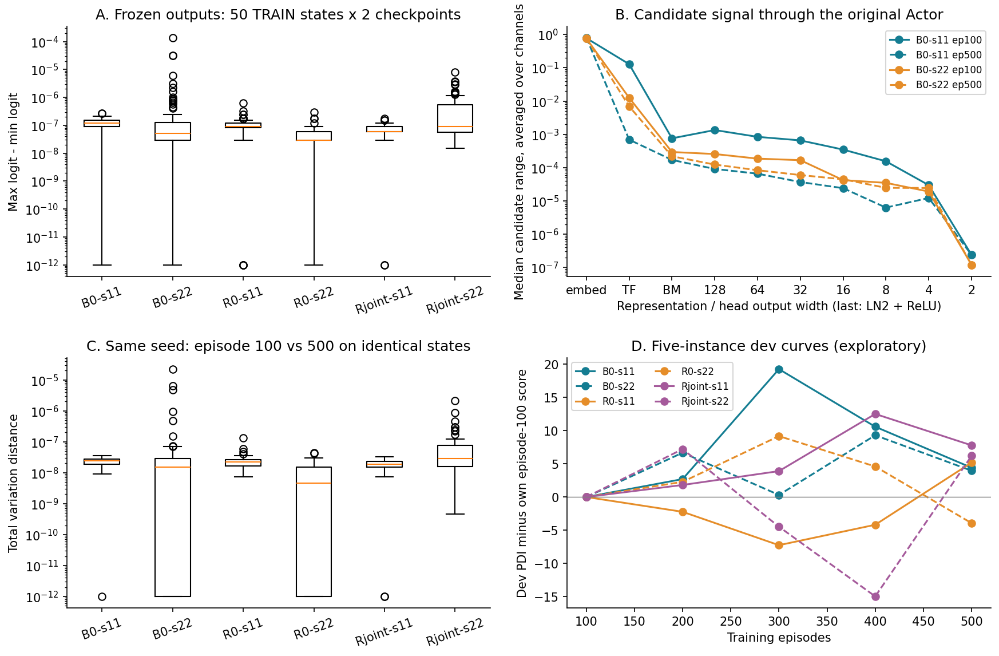
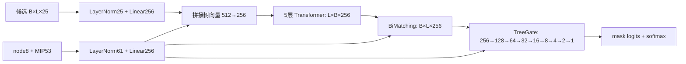

# PPO、H3 与 Actor 评分诊断

**首要发现（E1）：现有六路已训练 Actor 在共同观测上几乎均匀采样，episode 100 到 500 的策略分布变化极小。** 这是新完成的冻结权重离线诊断；它比“clip=0”更直接。候选区分为什么消失、修复后能否改善 PDI，仍需分开验证（E3）。

## 1. 数据、方法和限制

固定集合由 B0-s11 最早 20 个训练 episode 的首/中/末决策去重构成；3 个实例没有决策，最终为 **17 个训练实例、50 个真实状态、候选数 2–695（中位 40.5）**。在查看模型输出前按此规则选择；全部属于已冻结 train 划分，没有开发/测试状态。每份模型使用相同候选集合，不截断候选。来源、轨迹 SHA、行索引和归一化深度字段见[固定观测清单](fixed_observation_manifest.csv)。

比较 B0/R0/Rjoint × s11/s22 的 ep100 和 ep500，共 **12 份 checkpoint × 50 状态 = 600 次基础前向**。同种子内比较训练演化，不把不同种子差异当演化。初始 checkpoint **N/A**：只找到初始化摘要哈希，没有可归属该六路的初始权重；本轮未重建或伪造 init。数据是训练分布的冻结探索样本，50 个状态有实例内依赖，不当成 50 个独立统计重复，也不能据此证明所有未见状态都近均匀。

无 optimizer、无权重更新，模型保持 eval，但梯度检查开启 autograd；CPU Torch 1.13.1+cu117，与历史记录同 Torch 版本；CUDA 未初始化。脚本验证每次诊断前后 state_dict 逐 tensor 相等。见 [actor_offline.py](scripts/actor_offline.py)、[checkpoint SHA](diagnostic_checkpoint_hashes.csv)、[运行日志](logs/actor_offline.log)。

## 2. PPO 日志：clip=0 已复核，但不是“无学习”的证明

| 模型 | 有效更新 / 记录数 | optimizer steps | 有效更新中 clip 非零次数 | 记录的 initial ratio 最大误差 |
|---|---:|---:|---:|---:|
| B0-s11 | 125/125 | 3807 | 0 | 4.77e-7 |
| B0-s22 | 123/125 | 3786 | 0 | 1.05e-5 |
| R0-s11 | 125/125 | 3768 | 0 | 4.77e-7 |
| R0-s22 | 123/125 | 3714 | 0 | 3.81e-6 |
| Rjoint-s11 | 125/125 | 3741 | 0 | 4.77e-7 |
| Rjoint-s22 | 123/125 | 3723 | 0 | 5.48e-6 |

来源：[ppo_update_summary.csv](ppo_update_summary.csv)、[750 条更新记录摘录](ppo_updates.csv)。共 744 次有效更新、22,539 步优化。s22 不足 256 样本的两批延后消费，不是少完成 episode。

**E2：`clip_fraction` 计算没有发现“恒写零”的实现。** [agent.py](../../../tgppo/experiments/server-20261022/code/project/agent/agent.py) L150–233 对实际采样动作计算 `exp(new_log_prob-old_log_prob)`，累计 `abs(ratio-1)>.16` 的 microbatch 比例，再按 optimizer step 平均；任意已评估的超阈值样本应贡献正值。它不记录每次 optimizer step **之后**的新分布，也不检查未选动作。PPO 的剪裁比例为零，仍允许 surrogate、entropy 梯度与 Adam 更新。历史 checkpoint 的参数摘要确实变化。

**E1：旧策略一致性补查通过。** 将两份 B0 ep100 与紧随其后的 e100–103 轨迹相应 policy_version 对齐，在首/中/末状态重算采样动作概率，所有抽查 ratio=1（CPU float32）。证据：[old_policy_recompute.csv](old_policy_recompute.csv)。它只检验旧策略重算，不是历史更新后的 ratio 分布或 KL。

**证据缺口：** 历史各次 PPO 的 ratio p50/p95/max、近似 KL、梯度范数没有保存，仍为 N/A。下表的跨 checkpoint KL/ratio 不能冒充一次 PPO 更新内的量。下一轮若需更新内诊断，先在独立副本重放一小批保存轨迹并增加仪表，不能直接重训六路。

## 3. 输出变化：近均匀不是由单个汇总 0 推出来的

熵先将 float32 输出转换为 float64 并重新归一化，再计算 `H/log(L)`；KL/JS/TV 在完全相同状态和候选集合上比较。下表的 logit 分差合并同一路 ep100/500 各 50 状态，TV 比较同一路 100→500。

| 模型 | logit 分差中位数 | 最大 logit 分差 | TV 中位数 | TV 最大值 | 数值 top-1 更换率 |
|---|---:|---:|---:|---:|---:|
| B0-s11 | 1.19e-7 | 2.68e-7 | 2.38e-8 | 3.55e-8 | 84% |
| B0-s22 | 5.22e-8 | 1.39e-4 | 1.51e-8 | 2.22e-5 | 46% |
| R0-s11 | 8.94e-8 | 6.26e-7 | 2.20e-8 | 1.34e-7 | 74% |
| R0-s22 | 2.98e-8 | 2.98e-7 | 4.64e-9 | 4.47e-8 | 28% |
| Rjoint-s11 | 5.96e-8 | 1.79e-7 | 1.91e-8 | 3.19e-8 | 62% |
| Rjoint-s22 | 8.94e-8 | 8.02e-6 | 2.83e-8 | 2.13e-6 | 56% |

**E1：600 次输出的归一化熵均至少约 0.99999999968。** B0-s11 的 100→500 KL 最大约 3.83e-15；B0-s22 最大约 1.25e-9。各状态 JS、top-5 overlap、精确并列修正的 Spearman、前两名 margin、全候选跨 checkpoint ratio 均已落盘：[单模型分布](actor_checkpoint_metrics.csv)、[同种子变化](actor_checkpoint_comparison.csv)。浮点计算可使归一化熵略高于 1，偏差约 1e-16；不能把它解释成超均匀熵。

top-1 更换很多与“有意义的学习”并不矛盾也不等价：这里大量 logit 差接近 float32 精度，排序受微小数值差影响，**不能据 84% 更换宣称候选偏好明显改善**。没有专家排序或行动价值标签，本轮没有评价“实际最优分支排名”。

**E1：历史训练行为提供第二条证据。** 全部两路 B0 的 615,922 个实际采样动作，`abs(log_prob + log(L))` 中位数 6.36e-8、p95=2.33e-7、最大 0.00871。多数被选动作的概率接近 `1/L`，但最大偏离反驳“所有时间、所有状态都严格均匀”的绝对表述。这是被选动作的概率检查，不能由此还原每步完整熵或 KL。数据源为原始 pickle，汇总见 [existing_data_summary.json](existing_data_summary.json)。

## 4. 数据流与候选差异消失的位置

以下为实际 [actor.py](../../../tgppo/experiments/server-20261022/code/project/policy/actor.py) L16–80 与 [modules.py](../../../tgppo/experiments/server-20261022/code/project/policy/modules.py) L21–121 的 E2 机制。单状态 B=1，L 可变；Actor 参数 4,738,895。

Transformer 无候选位置编码；padding 在 encoder、BiMatching 两向 softmax、最终 logits 均处理。BiMatching 的 `E_t=Σα_i z_i` 为共享聚合，`E_c,i=β_i tree` 是每候选一个标量权重乘树向量；经过线性/ReLU/门控融合，没有完整 `z_i` 的直接候选残差。**这是可确认压缩（E2），不是其性能有害的证明。**

**E1：逐层 hook 实测差异。** 以 B0-s11 ep100 的 50 状态为例，“各通道候选 max-min 的平均值”在状态之间的中位数：

| 位置 | 中位候选差异 |
|---|---:|
| var embedding | 0.778 |
| Transformer | 0.128 |
| BiMatching | 7.57e-4 |
| head 输出宽 4 | 2.97e-5 |
| head 宽 2 的 Linear 输出、LN 前 | 5.83e-6 |
| 宽 2 的 LN+ReLU 后 | 2.38e-7 |

其它种子/ep500 同样呈末端缩小；完整结果见 [actor_activation_spread.csv](actor_activation_spread.csv)。不同层存在尺度和基变化，该指标只能定位信号收缩，不能凭层间数值比率认定丢失了多少任务信息。

**E2：最后一个非标量层确有 `Linear(4,2) → LayerNorm(2) → ReLU`，之后门控再 Linear(2,1)。** 对 LN 的两个输入 a,b，忽略仿射项，其输出为 `±(a-b)/sqrt((a-b)^2+4ε)`。当候选都落在同一符号区间且 `|a-b|` 较大，幅度变化被压缩，仿射层不会自动恢复已压缩的差异。B0-s11 ep100 各状态中，候选 `|a-b|` 的最小值落在 0.354–0.393，而 LN ε=1e-5，符合这个机制的条件；B0-s22 存在更靠近零的反例，不能称所有状态同等饱和。

**E3：BiMatching 压缩与末端 LN2 的组合可能造成学习响应弱。** 目前没有移除 LN、加残差或匹配参数的干预结果，不能把该层称为唯一根因，不能宣称修复必然提高 PDI。该机制在继承的上游源码中也存在；当前实验尚不能评价原论文作者训练的权重。

## 5. 等变性、敏感性和梯度

**E1：68 组 B0 受控检查**中，候选乱序后逆置输出最大误差 1.49e-8；追加 7 个 masked padding 后有效候选最大误差 2.24e-8，padding 概率全部为 0。本轮没有发现候选顺序或 mask 的明显错误。由于分布近均匀，单靠这项通过不能充分检验所有非均匀状态的等变性，也没有比较不同求解树访问顺序。证据：[invariance](actor_invariance_checks.csv)。

候选第 0 列在状态内乱序的干预使最终分布 TV 中位数 1.10e-8、最大 3.83e-8（E1）。这只是一个输入敏感性探针，变换后未必为可达的求解器状态，不能作为策略质量或因果收益证据；也不能推广为所有特征都无用。

**E1：36 次 B0 冻结模型反向**，目标为真实动作的 `-log π(a|s)`，不乘猜测优势、不更新权重。模块参数梯度 L2 中位数：var embedding 8.67e-10、Transformer 7.61e-9、BiMatching 2.53e-8、TreeGate 5.38e-7；本次这些模块各次梯度均非零。输入 score 梯度 L2 中位数 8.42e-10。证据：[梯度](actor_gradient_metrics.csv)、[敏感性](actor_sensitivity_checks.csv)。

结论是“当前样本上有可微路径，但动作分布对参数/输入的响应很弱”，**不是完全无梯度**。这些是诊断时的 score 梯度，不能冒充历史 PPO 总梯度；Adam 会重标定梯度，小绝对梯度不等价于小参数步长，仍需输出变化与有效更新一起解释。

## 6. H3：累计 PDI、目标与证据缺口

实际 [reward.py](../../../tgppo/experiments/server-20261022/code/project/reward/reward.py) L157–268 与本地上游逐字节一致（E2）。H1 用新增节点惩罚和终止 bonus；H2 用节点/pace/gap 改善与 PDI 增量；H3 使用难度权重并增加 bound/progress 项。

H3 有两个不同 PDI 路径，不能混写：

- `q_t` 中包含 `tanh(2*(prev_pdi-pdi)/P0)`。SCIP PDI 是累计 gap 面积，通常不减，因此这是**新增 gap 面积的非正惩罚**，不是“累计 PDI 下降的正奖励”。不能仅凭符号为负认定实现错误。
- 独立 `w_pdi` 项是 `tanh((P0-pdi)/P0)`，与基线总 PDI 比较的 level 项；它与增量惩罚不是同一公式。每步重复累计 level、node、pace 项，回报还受决策步数和折扣影响，数学上并不等于最小化最终墙时 PDI。

**E2：附录 A 的公式与保存代码有明确对齐缺口。** [附录 A 式(12)/(20)](https://arxiv.org/html/2511.12986v1#A1) 的 PDI 项写作相邻累计积分差，当前 H3 的 `w_pdi` 项却是 baseline-level 比较；增量差另混在 progress 中。附录 difficulty 写成带 σ 的表达式，当前实现为截断线性映射。这里只记录文字公式与代码差别，不替作者解决符号/定义歧义，也不改历史奖励。

**E1/E2：基线归一化存在明确检查点。** 60 个训练实例–solver seed 基线中 **37 个 gap=0**；`-tanh(.5*gap/(baseline_gap+1e-9))` 对正 gap 容易饱和为 -1。3 个基线 PDI<1，被代码 floor 到 1。前者是有数据支持的归一化机制风险，但没有每步 gap/分量日志，**不报告实际饱和比例**。来源：[reward_baseline_normalizers.csv](reward_baseline_normalizers.csv)。

**E1：全部 B0 1,000 条轨迹中，非终止总 reward 没有一次达到 ±1 的 clip 边界**；终止奖励另有状态 bonus，可超过 1（本轮范围约 -0.428–5.214），不能把终止 >1 误报为剪裁 bug。按 20 个训练实例分别先平均 return/PDI，再算相关，两个 B0 Pearson r≈+0.379/+0.388。实例难度、轨迹长度、跨 seed、奖励归一化均混杂，这个正相关仅为“总 return 不能替代 PDI”的警示，不是奖励方向错误的证明；这里的 total return 为未折扣的日志求和。见 [reward episode 表](b0_reward_episode_metrics.csv)。

**E1/E2：H3 读取的是 SCIP 原始累计量，评价另补 integral tail。** 对 3,000 个训练任务的终态，tail 绝对值 p95≈0.0267、最大 0.4507 百分比·秒；150 次 tail/complete>10% 全部来自没有 transition 的 misc03，未贡献 PPO reward。因此这些高相对比例不是本轮奖励训练失效的证据。绝对量也很小，不能据此声称 tail 是主要瓶颈；有决策时的逐步 getter 刷新滞后仍未量化。证据：[training_metadata_diagnostics.csv](training_metadata_diagnostics.csv)、[measurement.py](../../../tgppo/experiments/server-20261022/code/project/measurement.py)。

## 7. GAE、开发曲线和关口

**E2：GAE 按 episode 独立递推，done 屏蔽 bootstrap 与递推；有限 120 秒任务的 timelimit 为任务终止，不是采集器截断。** [agent.py](../../../tgppo/experiments/server-20261022/code/project/agent/agent.py) L111–145、[online.py](../../../tgppo/experiments/server-20261022/code/project/online.py) L22–29/L70–77 与 [brancher.py](../../../tgppo/experiments/server-20261022/code/project/brancher/brancher.py) L25–32/L94–101 支持此语义。B0 1,000 个 episode 的终止/截断/bootstrap 标志逐条核对通过，非空轨迹仅最后一条 done=true（E1）。不能再用已修复的跨 episode GAE bug 解释这些结果。

γ=.97、λ=.92，递推系数 .8924，约 6.09 步衰减到一半、40 步约 .0105（E2 数学性质）。但 TD 残差含 value，不能把这个长度当成策略全部有效规划深度；“长程信用失败”仍属 E3。

**E1：B0 两个种子都选 ep100，但曲线不是单调变差。** ep500 相对 ep100 开发平均 PDI 增加 4.415/3.967，五个里程碑全幅波动约 19.263/9.301。5 实例、共享机器时钟与近均匀输出使“过拟合/训练退化”解释尚不充分。图 D 和历史 [development_curves.csv](../../../tgppo/runs/server6-20261022/stage5-results-20261023/development_curves.csv) 保留全部种子，未依据测试重新选模。

**D1 关口判定：** 已发现需要先解释的弱候选区分现象（E1），优先定位评分链；奖励/信用与运行成本继续作为独立待证机制。暂不增加 HSTU、历史 Q/K/V 或其它网络层（E4：支持不足）。下一阶段具体干预仅见 [04](04_hypotheses_and_low_cost_validation.md)，本轮未执行。
