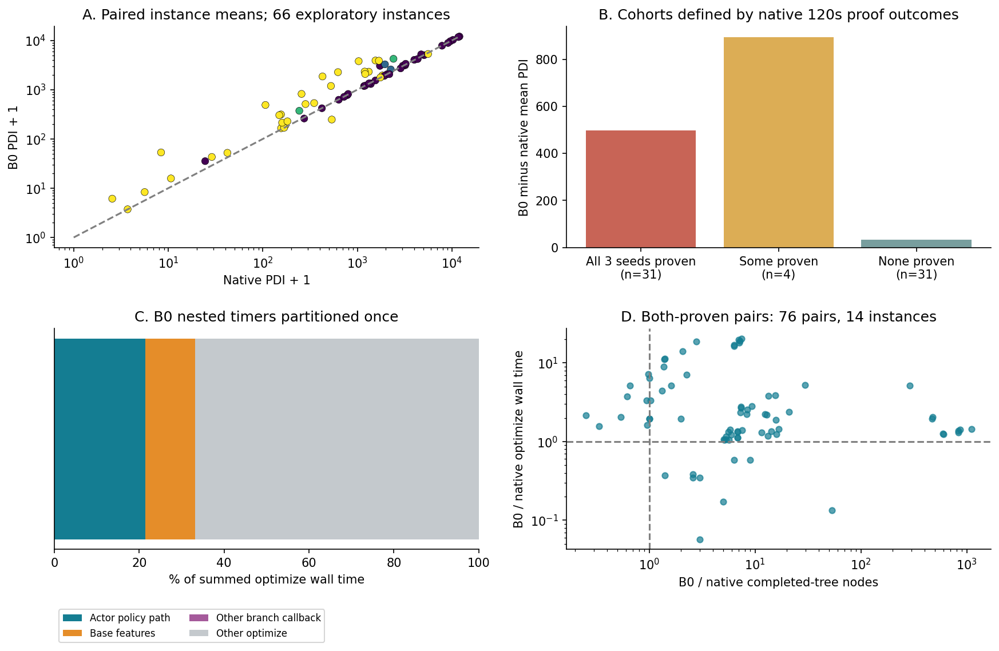
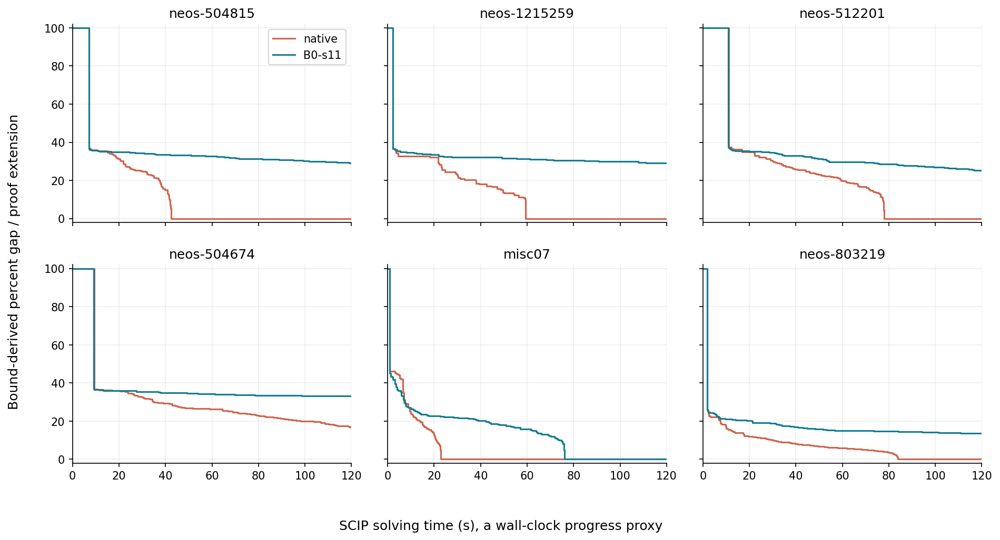

# 运行成本、求解质量与评价协议诊断

范围固定为历史 server6 的 **120 秒、known-optimal cutoff、关闭 heuristics、CPU Actor** 受控实验。新做的均为原始结果重算；本轮没有新 solve、延迟注入或 GPU 推理实验。

## 1. 整体差距与实例配对

**E1：原结果得到复核。** 按实例等权：先平均相同实例内三个 solver seeds，学习方法再等权平均两训练种子；没有把 1,386 条任务当独立实例。

| 方法 | 实例 / 任务 | 平均 PDI ↓ | PAR-2 秒 ↓ | 120 秒内证明完成率 |
|---|---:|---:|---:|---:|
| native relpscost | 66 / 198 | 2103.821 | 145.409 | 50.00% |
| B0 | 66 / 396 | 2407.483 | 198.805 | 20.20% |
| R0 | 66 / 396 | 2408.183 | 199.061 | 19.95% |
| Rjoint | 66 / 396 | 2411.610 | 199.413 | 19.70% |

native 平均 PDI 比 B0 低 303.662，降低 12.6132%（分母 B0）。按实例中点 native/B0 赢 44/21、平 1；计入原 PDI overshoot 界限后 native 明确优 42、B0 明确优 19、区间重叠 5。没有声称 native 每例更优。两训练种子的 R0/Rjoint 相对 B0 方向不一致，仍只支持“未证实稳定改善”。

历史条件实例 bootstrap 给 native−B0 的 95% 区间约 [-471.12,-159.33]；均值测量差区间约 [-314.76,-292.57]。两者含义不同，前者固定已选权重、后者为时间 overshoot 的确定性边界；本轮引用历史审计，不将它们合成新显著性结论。原始来源：[per_task_with_sources.csv](../../../tgppo/runs/server6-20261022/stage5-results-20261023/per_task_with_sources.csv)、[paired_uncertainty.csv](../../../tgppo/runs/server6-20261022/stage5-results-20261023/paired_uncertainty.csv)。

## 2. 差距集中在哪些实例

用 native 自身在 120 秒内的证明结果定义探索分层，不借用论文 3600 秒 easy/hard 标签：

| native 三个 seeds 的证明情况 | 实例数 | native 平均 PDI | B0 平均 PDI | B0−native | B0 中点赢 / 明确赢 |
|---|---:|---:|---:|---:|---:|
| 三次全部完成 | 31 | 693.560 | 1191.685 | +498.125 | 2 / 2 |
| 部分完成 | 4 | 1714.317 | 2609.199 | +894.881 | 0 / 0 |
| 均未完成 | 31 | 3564.341 | 3597.253 | +32.912 | 19 / 17 |

**E1：差距异质性明显。** 整体证明率差距不能用“学习策略在所有困难实例都更差”概括；在 native 三次都未证明的分层，B0 有较多实例 PDI 点估计更低，但均值仍略高。这不能证明同节点进度的质量更好，分层依赖 native 结果且为事后探索。

最大正差示例 `neos-504815` 的实例均值差 +2754.937，`neos-1215259` +2352.145。它们用于说明差距位置，未用来选新权重或调参。全 66 实例矩阵同时给出 PDI 区间、证明率、最终节点、`nodes/optimize second`、Actor/回调比例和状态计数：[per_instance_diagnostic_matrix.csv](per_instance_diagnostic_matrix.csv)、[分层表](difficulty_cohorts.csv)。

测试实例均未在 train 列表；问题家族统一标 `unknown`，未凭名称编造 MILP 类型。测试结果没有候选数日志，不能完成“按测试候选分位、原始深度或实例族”的分层。本轮固定观测仅保存归一化 depth 特征，不能反推出原始树深。

## 3. 计时定义：Actor 不是纯 forward

**E2：** [ActorPolicy.act](../../../tgppo/experiments/server-20261022/code/project/agent/agent.py) L51–58 的计时包含输入 tensor 转换/检查、网络前向、Categorical 构造、采样与标量返回；不是单独的 Transformer 或纯 forward。原 Actor 特征提取单独计在 `features`；[brancher.py](../../../tgppo/experiments/server-20261022/code/project/brancher/brancher.py) L34–92 的整回调包含二者。`optimize_wall_seconds` 是外部 perf_counter；worker wall 还包含加载/初始化/清理。Critic 和搜索扩展在部署中为零。

**E1：B0 396 次测试累计实际 Actor 分支 418,813 次。**

| 计时量 | 秒 | 相对 optimize wall | 解释 |
|---|---:|---:|---|
| Actor policy 路径 | 8737.878 | 21.384% | 20.863 ms/实际分支，按分支加权 |
| 基础特征 | 4810.800 | 11.773% | 原 Actor 输入特征及转换等 |
| 回调内其余部分 | 20.372 | 0.050% | 完整回调减去前两项；包含 branch 操作等 |
| 完整回调（上述小计） | 13569.050 | 33.207% | 不再与前三项相加 |
| optimize 总墙时 | 40862.578 | 100% | 其余约 66.793% |
| worker 总墙时 | 41368.691 | — | Actor/worker=21.122%，分母与上一列不同 |

来源：[deployment_cost.csv](../../../tgppo/runs/server6-20261022/stage5-results-20261023/deployment_cost.csv)。R0/Rjoint 同架构，平均 Actor 20.627/20.965 ms，完整回调约 33.11%/33.19%。这确认在线成本值得投入，但不是它解释全部 native 差距的证明。

**E1：已有计时只能生成“任务平均延迟的分布”。** 对 370 个有 Actor 调用的 B0 任务，`actor_seconds/branch_count` 的 p50=19.464 ms、p95=1150.180 ms、max=2444.943 ms。这不是每次 Actor 调用的 p95；少量调用、冷启动、候选规模和机器负载都可能影响任务均值（E3），当前没有足够粒度分离。不能把 p95 写成所有分支中 5% 超过 1.15 秒。

SCIP 源码 [set.c](../../../tgppo/setup/scip-6.0.1/src/scip/set.c) L460 默认 wall clock；当前入口未显式改该 clocktype。曲线用 SCIP solving time，与外部 optimize wall 有小差异，二者没有逐点同步，不能当成完全相同的时间轴。若未来做有成本调用链实验，还需核验实际运行参数和计时。

## 4. 搜索质量与成本能分到哪一步

**不能用“平均节点 B0 更少”推出策略更强。** 限时未证任务的最终节点是受成本与搜索路径共同影响的删失量：慢策略来不及处理节点同样会节点更少。`nodes/sec` 在这里是任务级处理速率，受不同 LP 难度与搜索路径影响，不是纯推理效率测量。

本轮进一步对同一实例、同一 solver seed 配对，仅保留 B0 与 native **都在 120 秒内完成证明**的任务，减少“树没搜完”的歧义（E1）：

- 76 个“训练种子×solver seed”配对，来自 14 个实例；native 记录在不同训练种子配对间会复用，76 不是独立实例数，不据此做独立样本检验。
- 有 **8 个配对、涉及 4 实例**出现“B0 完整证明节点少、optimize 墙时反而长”：`bell3a/bell5/binkar10_1/misc07`。
- 例如 bell3a、s11/solver1：B0 1355 节点、7.775 秒，native 2059 节点、1.511 秒；misc07、s22/solver1：B0 4230 节点、52.989 秒，native 7803 节点、25.836 秒。

来源：[both_proven_pairs.csv](both_proven_pairs.csv)。这些配对证实“节点效率与墙时可能背离”，不是对 Actor 成本的严格因果归因：不同节点的 LP 工作量、额外可靠伪成本探测、回调和共享硬件等同时变化；按双方完成筛选也有选择偏差。没有对相同访问节点或相同轨迹删去 Actor 成本，不能声称剩余时间一定会得到相同 gap 改善。

## 5. 已有 gap–time，缺少 gap–nodes

**E1：原结果的 `bounds_trace` 确实存在。** 为减少输出体量，选绝对 PDI 差最大的 6 实例以及 mspp16，导出七路方法的历史曲线：[gap_time_examples.csv](gap_time_examples.csv)。下图只显示前六实例的 native 与 B0-s11、solver0 以便阅读，是按差距选择的示例，不能代表所有实例或新增重复实验。

图中用原始 primal/dual 计算百分比 bound gap，初始未知区间为 100%；有效证明结束后向 120 秒延伸为 0。它是可视化近似：事件采样时刻不一定等于原生积分内部更新时间；官方比较仍采用原生 accumulator、tail 与 overshoot 区间，**不从该图重算/替换主 PDI**。

**缺口：** bounds_trace 无同步 processed-node 数；故真实 `gap vs nodes`、节点进度相同的质量比较为 N/A。也缺真实单回调延迟、特征/forward 子计时及每次调用候选数量。最低成本是在下一次获准的小范围诊断中，定点/限频记 `(SCIP time, external wall, nnodes, gap, L, depth, timer parts)`，不需要全量 66 实例重跑。

## 6. 无 Actor 任务与 mspp16

**E1：B0 有 26/396 次任务没有 Actor 调用**，涉及 mspp16、n3seq24、neos-4722843-widden、neos-950242、satellites1-25；这表示其中存在零调用任务，不表示后四实例全部 seeds 都为零。零调用不能算成网络快/慢或评分好/坏的证据。

mspp16 七路补跑共 21 次均为零节点、零 Actor、timelimit、PDI=12000；它给每方法实例均值贡献 12000/66=181.818，抬高绝对均值但两方法差为 0。剔除它的**敏感性分析**：B0=2259.906、native=1951.572，差 +308.333；不是用剔除结果替换正式主表。证明率下降也不能归因于此单实例；原始 21 条内存失败仍保留。

PDI 单位百分比·秒，不是秒；PAR-2 对未在时限内完成证明记 240 秒；`infeasible` 的已知最优 cutoff 证明不能当成原 MILP 不可行。120 秒分层不能冒充论文的 3600 秒 easy/hard；完整求解器交互未验证。

## 7. 可接受的当前归因

E1 已确认：有整体差距、有可观部署成本、有异质实例行为、有少节点但慢的完整证明配对。E3 尚待证明：成本能解释多少 PDI 差、评分链近均匀能解释多少、奖励与信用如何影响学习。当前证据支持先做评分链和成本的小验证，**不支持直接扩大模型或承诺 GPU/HSTU 收益**（E4）。
