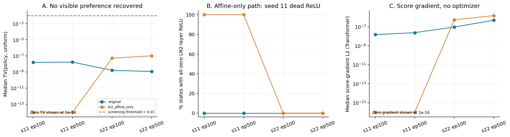
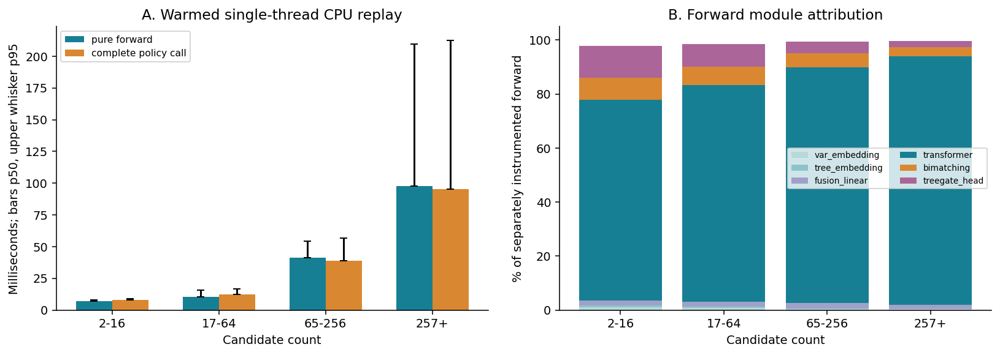

# 评分链局部验证与 CPU 微基准｜阶段交付

2026-11-02。第一阶段已获用户验收；本轮授权工作完成，**等待本阶段验收，停止后续实验**。

**主要结果：原 Actor 近均匀的现象在新的 164 个训练状态上仍存在；只绕过 LN2 标准化没有恢复候选偏好。** s11 的两份权重在该干预后末端 ReLU 全零；s22 虽有较小分布变化，仍低于预设工程观察阈值。不能据此称 LN2 是唯一根因，也不能宣称重新训练必然无效。

CPU 微基准测了 16 状态、1,280 次组件调用。纯前向是主要耗时，单独计时的 Transformer 按状态等权平均占 forward 83.50%。当前为 E5-2620 v3，历史实验为 Gold 6148；本机 replay 延迟不能替换历史部署均值或推导 PDI 收益。

- [完整报告、边界与下一步判断](REPORT.md)
- [用户授权及事先冻结的范围](AUTHORIZATION.md)
- [观测来源和轨迹 SHA](observation_manifest.csv)、[样本/实例覆盖](observation_coverage.csv)
- [局部对照结果](checkpoint_intervention_summary.csv)、[逐实例表](per_instance_intervention.csv)、[梯度](gradient_summary.csv)
- [CPU 分档计时](microbenchmark_summary.csv)、[原始单调用计时](microbenchmark_raw.csv)
- [预算账本](compute_budget.json)、[数值检查](validation.json)、[最终交付核验](delivery_validation.json)、[交付 SHA 清单](delivery_manifest.json)





图各有同名 SVG/PDF 可导出。当前结论支持继续收窄离线定位，不支持直接启动该绕过变体训练或引入 HSTU。

## 复现方式

从 `research/` 运行。**不要直接重新执行本目录任务：当前用户预算已实际记账。** 若另获一次相同范围授权，应将整个独立目录复制到一个新目录，保留脚本和 AUTHORIZATION 范围说明，清除的仅是该新目录中的派生产物，并建立新的授权/预算账本；绝不清理旧实验。复制后相对根路径层级须保持。

以下是本轮实际命令，供复核，不构成再次执行授权；各项由预算启动器固定单 CPU，设置 BLAS/OMP 和 Torch 单线程。路径 `docs/diagnostics/tgppo_20261102_local_validation` 在新一轮需换成新的独立目录。

```bash
python docs/diagnostics/tgppo_20261102_local_validation/scripts/budget_runner.py --tag local_validation --max-seconds 420 -- /home/duweiyue25/conda/envs/tgppo/bin/python -u docs/diagnostics/tgppo_20261102_local_validation/scripts/local_validation.py
python docs/diagnostics/tgppo_20261102_local_validation/scripts/budget_runner.py --tag cpu_microbenchmark --max-seconds 110 -- /home/duweiyue25/conda/envs/tgppo/bin/python -u docs/diagnostics/tgppo_20261102_local_validation/scripts/cpu_microbenchmark.py
python docs/diagnostics/tgppo_20261102_local_validation/scripts/budget_runner.py --tag summarize_checks --max-seconds 20 -- /usr/bin/python -u docs/diagnostics/tgppo_20261102_local_validation/scripts/summarize_checks.py
python docs/diagnostics/tgppo_20261102_local_validation/scripts/budget_runner.py --tag render_figures --max-seconds 30 -- /home/duweiyue25/conda/envs/rl4scip/bin/python -u docs/diagnostics/tgppo_20261102_local_validation/scripts/render_figures.py
python docs/diagnostics/tgppo_20261102_local_validation/scripts/budget_runner.py --tag final_checks --max-seconds 20 -- /usr/bin/python -u docs/diagnostics/tgppo_20261102_local_validation/scripts/final_checks.py
```

最终 manifest 需在预算启动器返回、账本落盘后生成；具体命令见 `scripts/finalize_manifest.py`。本目录保留固定观测快照 `observations.pkl`，仅供已有本地可信数据复核。

参数未更新、checkpoint/原源码/轨迹未覆盖，无 GPU 训练或新 SCIP 求解。所有统计为当前训练观测、现有权重与本机条件下的离线结果，不是新的求解性能结果。
