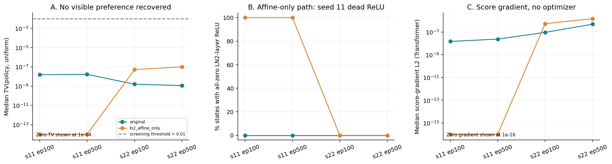
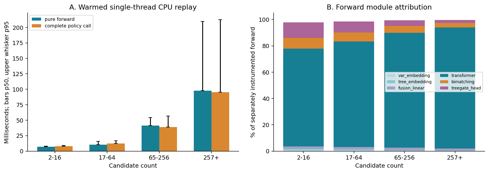

# 评分链局部验证与 CPU 微基准报告

日期：2026-11-02（北京时间）。本轮为第一阶段验收后的独立离线验证，**已完成，提交验收后停止**。[用户授权](AUTHORIZATION.md)限定单线程计算墙时不超过 600 秒；不训练、不新增 SCIP 求解、不改原基线。

**结论：本地原 Actor 近均匀输出在另一组训练状态上得到复核，但保留权重、仅绕过 LN2 标准化没有恢复可见的候选偏好。** s11 的干预触发末端 ReLU 全零；s22 的分布变化仍很小。这不支持把“去掉 LN2”作为现成修复，也没有证明 LN2 与性能无关。CPU 前向成本主要在 Transformer，但本机与历史求解实验的 CPU 不同。

证据分级沿用第一阶段：E1 已测事实；E2 源码/数学机制；E3 未验证的因果假设；E4 当前支持不足。

## 1. 范围、样本与对照

运行目录与旧基线独立。复制原 actor.py/modules.py，在 CPU 内存副本中做唯一干预：将末端 `LayerNorm(2)` 的 `(x-mean)/sqrt(var+eps)*gamma+beta` 换成 `x*gamma+beta`，保留原 gamma/beta、其余结构及全部参数值。两种路径 state_dict 的键和值相同，参数对象互不共享，均为 eval 模式；没有 optimizer step。具体入口：[local_validation.py](scripts/local_validation.py)、[独立源码副本](model_copy/)。

| 项目 | 实际执行（E1） |
|---|---|
| checkpoint | B0-s11/s22 × ep100/500，共 4 份 |
| 数据 | 每个训练种子 episode>=200 后按实例取首个非空轨迹，等距至多 5 个状态；总计 **17 个训练实例、164 个状态** |
| 样本均衡 | 16 实例各 10 状态，30n20b8 仅 4 状态；comp21-2idx、misc03、supportcase7 无可用决策，明确单列 |
| 候选数 | 2–695，中位 37.5，p95=468.7；没有截断候选，L=1 状态为 0 |
| 与前一阶段关系 | 与原 50 状态无重复；全部来自 train，无开发/测试状态；本轮所选来源轨迹 solver seed 均为 1 |
| 前向 | 164×4×2=**1,312 条基础分布记录**，656 个配对；另有等变性、敏感性和微基准前向，未混入这个计数 |
| 梯度与约束检查 | 每实例固定一个状态，17×4×2=136 次 score 反向；136 组重复/乱序/padding 检查 |

样本来源在评估 checkpoint 前冻结，见 [frozen_plan.json](frozen_plan.json)、[观测清单及 SHA](observation_manifest.csv)、[覆盖账本](observation_coverage.csv)。164 状态有实例内依赖，4 个 checkpoint 也有共同训练历史，不能作为 656 个独立样本做显著性检验。按实例的描述统计另见 [per_instance_intervention.csv](per_instance_intervention.csv)。

## 2. 候选偏好没有恢复

TV 定义为 `0.5*sum(abs(policy-uniform))`，范围 [0,1]；越接近 0 越均匀。计算时将有效候选概率转为 float64 并重新归一化。本轮预先将 TV≥0.01 作为“可见非均匀性”的工程观察阈值，**不是决策正确或求解有效的阈值**。

| checkpoint | 原路径 TV 中位数 | 绕过标准化后 TV 中位数 | 干预后 TV 最大值 | 干预后 ReLU 全零状态 |
|---|---:|---:|---:|---:|
| B0-s11 ep100 | 1.54e-8 | 0 | 0 | 164/164 |
| B0-s11 ep500 | 1.67e-8 | 0 | 0 | 164/164 |
| B0-s22 ep100 | 1.59e-9 | 5.18e-8 | 7.98e-6 | 0/164 |
| B0-s22 ep500 | 1.15e-9 | 1.00e-7 | 6.91e-5 | 0/164 |

**E1：四份原模型在新池中仍极近均匀；四份干预模型的全部 656 次输出中，没有一次达到 TV=0.01。** 按实例取中位数后，同样没有实例达到该阈值。s22 的最大单状态变化约为 6.91e-5，不能因相对原先数值增大很多就宣布形成了有效偏好。

完整熵、logit spread、前两名 margin、KL/JS、共同 logit 平移与概率变化分别保存在 [policy_metrics.csv](policy_metrics.csv)、[paired_intervention.csv](paired_intervention.csv)、[checkpoint 摘要](checkpoint_intervention_summary.csv)。记录 top-1 变化仅供检查，近并列数值下不解释成策略质量提高。

### 末端机制：压缩存在，但固定权重绕过会带来另一种退化

**E1/E2：原路径在 LN2 处仍有信号压缩。** 以 s11 ep100 为例，通道平均候选范围的状态中位数：BiMatching≈9.86e-4；宽 4 的头输出≈2.84e-5；LN2 输入≈5.54e-6；LN2 输出≈3.87e-7；ReLU 后≈2.38e-7。不同层有尺度/基变化，这只是定位指标，不代表任务信息损失比例。

对二通道差 `d=x0-x1`，标准化后的幅度为 `|d|/sqrt(d²+4eps)`。四份原模型的“候选幅度≥0.99 比例”的状态中位数均为 1，支持局部饱和机制；仍不能据此认定其是近均匀的唯一原因。

**E1：s11 绕过标准化后，原有权重与仿射项使末端两通道落在 ReLU 非正区间，全部候选归零。** 最后线性层只剩公共偏置，产生精确均匀的动作分布。对每实例一个状态的反向检查，embedding、Transformer、BiMatching 梯度均精确为 0。TreeGate 内共同偏置可能留下约 1e-7 的 float32 抵消残差，不能称为可用的候选学习信号。

**E1：s22 干预后的梯度仍非零，但输出几乎均匀。** Transformer score 梯度 L2 中位数：ep100 从 9.46e-8 变为 5.49e-7，ep500 从 4.94e-7 变为 1.51e-6。梯度放大没有转化为可见偏好。梯度目标为保存动作的 `-log pi(a|s)`，不是历史 PPO 总梯度，也没有优势加权或更新权重。详见 [score_gradients.csv](score_gradients.csv)、[gradient_summary.csv](gradient_summary.csv)。

因此需要区分：①当前原路径确有压缩；②固定权重绕过后可能落入新的激活死区；③从头训练另一种头是否更好仍未知。**本轮只回答了前两项，没有测试第三项。**

### 基础约束检查

136 组检查中，重复前向误差为 0；乱序后逆置最大概率误差 5.22e-8；追加 7 个 masked padding 后最大误差 1.12e-8；padding 概率和为 0，均在预设 1e-6 阈值内（E1）。因为分布接近均匀，这项通过不能单独证明在所有非均匀状态上等变性都充分成立。[原始检查](invariance_checks.csv)

候选第 0 特征列在状态内乱序的敏感性见 [sensitivity_checks.csv](sensitivity_checks.csv)。它不保证扰动后的状态可由 SCIP 到达，也不提供行动价值标签，不用于宣称策略更优。

## 3. CPU 微基准：前向是主要成本，Transformer 占大头

**当前硬件为 Xeon E5-2620 v3 @2.40GHz，固定逻辑 CPU 0，Torch intra/inter-op 均为 1。** 历史正式求解使用 Gold 6148；同为 2.40GHz 不代表性能相同。因此不将下表直接替换历史 Actor 20.863 ms/分支，也不将本机 replay 外推成历史 PDI 因果归因。

模型为原 B0-s11 ep100。按候选数分 4 档，每档固定 4 状态，总计 16 状态；每状态预热 3 次后，4 个组件各测 20 次，顺序在每轮打乱。共 1,280 条原始计时。ActorPolicy 类从原 agent.py 精确提取到独立文件后调用，无 Critic 或 SCIP 导入。[基准脚本](scripts/cpu_microbenchmark.py)、[提取副本](model_copy/policy_path.py)

| 候选数档（实际选中 L） | 输入转换/检查 p50 ms | 纯 forward p50 / p95 ms | 采样返回 p50 ms | 完整 policy 调用 p50 / p95 ms |
|---|---:|---:|---:|---:|
| 2–16（2/8/10/16） | 0.143 | 6.85 / 7.87 | 0.347 | 7.79 / 8.87 |
| 17–64（17/27/39/64） | 0.155 | 10.49 / 15.68 | 0.326 | 12.33 / 16.80 |
| 65–256（66/151/195/250） | 0.171 | 41.39 / 54.07 | 0.328 | 38.95 / 56.66 |
| 257+（259/318/472/695） | 0.207 | 97.77 / 209.47 | 0.330 | 95.46 / 212.71 |

来源：[原始单调用计时](microbenchmark_raw.csv)、[分档摘要](microbenchmark_summary.csv)、[状态选择](benchmark_selection.csv)。每档包含 4 种不同规模的状态，并非固定 L 的重复。不同组件是分开测量的分布，不能用两个 p50 相减计算开销；即使某档完整调用 p50 小于纯 forward p50，也不表示负开销。完整调用的**平均值**在各档均高于纯 forward 平均值。

本轮的 p95 是本机受控 replay 条件下的单调用分布，**不是历史在线 Actor p95**。模型加载单列；“该状态首次调用”单列于 [microbenchmark_first_calls.csv](microbenchmark_first_calls.csv)，它不等价于每次都启动全新进程的冷启动分布。共享节点负载、缓存、频率和状态选择仍有影响。

另做独立的 hook 分段计时，不混入上表。在 16 个状态上按状态等权平均，各模块占被计时 forward 的比例：Transformer **83.50%**（各状态 72.28%–94.37%）、BiMatching 5.85%、TreeGate 6.66%，其余为 embedding/fusion 和调度等。它是这些状态的前向成本归因，不是总体在线成本占比。[forward_module_times.csv](forward_module_times.csv)

**本轮没有重新测量 SCIP 原始特征提取。** 转换已保存数组的成本不能代替 `getCandsState/getMIPState/getNodeState` 的在线提取成本；没有 gap–nodes、PDI、证明率或新求解收益结果。历史特征开销仍只沿用原报告。

## 4. 对研究判断的影响

| 判断 | 本轮结果与边界 |
|---|---|
| 原 Actor 的候选偏好很弱 | **E1：得到另一组训练状态的支持。** 仍是当前训练权重/协议下的结果，来源 solver seed 覆盖有限 |
| 单独绕过 LN2 就可恢复已有模型 | **E4：本轮固定权重干预不支持。** s11 新增 ReLU 死区，s22 仍近均匀 |
| LN2 是唯一根因，或移除后重训一定无效 | **E3：两者均未验证。** 绕过失败不能排除重新训练的可能，也不能替代上游压缩定位 |
| CPU 前向值得优化 | **E1：本机微基准支持。** 主要是 Transformer；是否改善真实求解仍未知 |
| 现在扩大 Critic、加 HSTU、启动短训练 | **E4：本阶段没有给出足够新增依据。** 不越过验收关口 |

若下一阶段继续，优先问题应收窄为“LN2 上游剩余多少候选相关信号，以及在保持激活尺度时能否传到输出”。应先提出独立离线诊断，而非把当前绕过变体直接送去训练。当前没有实现新的残差、门控、奖励、预训练或求解实验。

## 5. 预算与完整性

主要受控计算：评分链验证 **116.62 秒**，CPU 微基准 **35.84 秒**，派生复核约 0.12 秒，绘图 **26.60 秒**；加最终核验后累计约 **180 秒**。轻量准备检查留 10 秒余量，仍显著低于 600 秒上限。计算记账含子进程导入、文件读取和失败尝试；文本编写/解释时间与实验计算时间分开。[精确账本](compute_budget.json)

39 个原运行 Python 文件和数据划分协议前后哈希相同；4 个 checkpoint、所用轨迹 SHA 核对不变；原始与干预副本在反向后参数值均未改变。复制源码与原件逐字节一致。CUDA 未初始化，`pyscipopt` 未导入，optimizer steps=0，新 solver tasks=0。检查结果见 [validation.json](validation.json)、[最终交付核验](delivery_validation.json)。

本轮没有安装或升级共享训练环境的依赖，绘图复用已有独立 rl4scip 环境。复现命令和文件索引见 [README](README.md)。**本阶段完成后停止，等待用户验收，不自动启动下一轮。**
