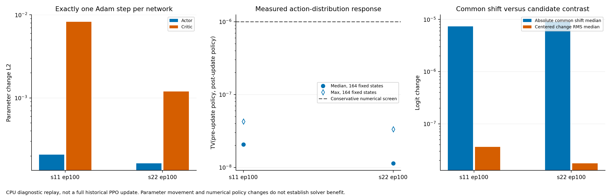

# 原 B0 单步 PPO 更新响应｜阶段交付

2026-11-02。本轮完成，**停止并等待验收**。

在两个 B0 ep100 的独立副本上恢复原 Adam 状态，使用各自同版本完整轨迹计算 GAE，各执行一次 Actor、一次 Critic 更新，共 4 次 step。CPU 单线程，计算上限 600 秒，没有新增求解或原基线覆盖。

**结果：更新链条通过检查、参数确实变化，但候选动作分布的变化仅约 1e-8 量级，更新后仍近均匀。** Actor 梯度未被范数上限裁剪，输出以公共 logit 平移为主。测到微小非零变化不等于可用偏好，单步无明显改善也不能证明长期训练无效。

- [完整报告、证据分级与后续缺口](REPORT.md)
- [本轮授权](AUTHORIZATION.md)、[已提交原方案](../tgppo_20261102_ppo_replay_plan/PLAN.md)、[运行前冻结方法](frozen_protocol.json)
- [输入/代码/checkpoint SHA](frozen_inputs.json)、[实际 batch 清单](batch_manifest.csv)、[冻结 batch](frozen_batches/)、[完整 GAE/优势](advantages.csv)
- [种子摘要与原 learn 损失](seed_summaries.json)、[模块梯度](module_gradients.csv)、[梯度裁剪](gradient_clipping.csv)
- [参数与 Adam 状态变化](parameter_adam_changes.csv)、[模块参数变化](module_parameter_changes.csv)
- [逐状态策略变化](policy_responses.csv)、[按实例描述](response_by_instance.csv)、[摘要表](response_summary.csv)、[汇总 JSON](summary.json)
- [严格限定的 step 台账](optimizer_steps.json)、[计算账本](compute_budget.json)、[最终核验](delivery_validation.json)、[完整交付 SHA](delivery_manifest.json)



图另有同名 SVG/PDF。两份新增状态保存在 updated/B0-s11、updated/B0-s22，仅供诊断复查；schema 为 diagnostic-single-minibatch-v1，**不代表完成一次完整 PPO update，不作正式部署模型**。

## 本轮实际执行命令

从项目根目录运行。命令仅为复核记录；本轮预算关闭后不得直接重跑。replay.py 还会检查持久 optimizer_steps.json，禁止重复已进入过的更新。需要其它实验须使用新授权、新目录、新账本，原历史材料保持原样。

```bash
python research/docs/diagnostics/tgppo_20261102_ppo_replay/scripts/budget_runner.py --tag replay --max-seconds 500 -- /home/duweiyue25/conda/envs/tgppo/bin/python -u research/docs/diagnostics/tgppo_20261102_ppo_replay/scripts/replay.py
python research/docs/diagnostics/tgppo_20261102_ppo_replay/scripts/budget_runner.py --tag summarize --max-seconds 25 -- /home/duweiyue25/conda/envs/tgppo/bin/python -u research/docs/diagnostics/tgppo_20261102_ppo_replay/scripts/summarize.py
python research/docs/diagnostics/tgppo_20261102_ppo_replay/scripts/budget_runner.py --tag figures --max-seconds 40 -- /home/duweiyue25/conda/envs/rl4scip/bin/python -u research/docs/diagnostics/tgppo_20261102_ppo_replay/scripts/render_figures.py
python research/docs/diagnostics/tgppo_20261102_ppo_replay/scripts/budget_runner.py --tag final_checks --max-seconds 30 -- /usr/bin/python -u research/docs/diagnostics/tgppo_20261102_ppo_replay/scripts/final_checks.py
python research/docs/diagnostics/tgppo_20261102_ppo_replay/scripts/finalize_manifest.py
```

预算启动器固定单逻辑 CPU，并设置 Torch/BLAS/OMP 单线程。最后一条只在全部受控命令返回后关闭预算并生成清单，不会清零或重开授权。独立源码副本的更新数学与实际基线逐字节相同，仪表和第一个 minibatch 后的停止逻辑位于 replay.py。
