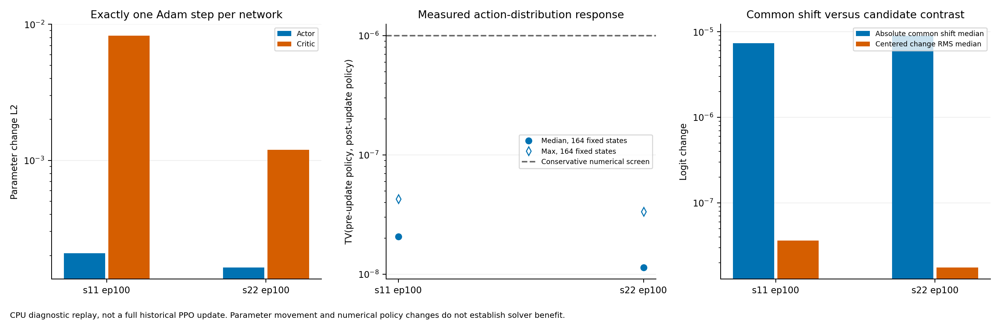

# 原 B0 单步 PPO 更新响应验证

日期：2026-11-02。**本阶段已完成，提交报告后停止，等待验收。** 执行范围见[本轮授权](AUTHORIZATION.md)和[运行前冻结方案](frozen_protocol.json)。总计只执行了两种子各一次 Actor、一次 Critic optimizer.step，共 **4 次**，没有新增 SCIP 求解、完整训练任务或原基线改动。

**核心结果（E1）：同版本轨迹与原 Adam 状态能正常恢复，真实优势非退化，原 PPO 更新确实改变了参数；但这一个逻辑 minibatch 后，动作分布变化只有约 1e-8 量级，仍近均匀。** Actor 梯度未被范数裁剪压小，输出变化以公共 logit 平移为主。它加强了“当前评分链对真实更新的候选偏好响应弱”的证据，不能证明长期训练必然无效，也没有定位到唯一根因。

## 1. 实际执行与边界

本轮用[已提交方案](../tgppo_20261102_ppo_replay_plan/PLAN.md)中的两个 B0 ep100 checkpoint。原代码 Agent、Memory、Actor、Critic 和 modules 逐字节复制到独立 package；直接运行原 `Agent.learn`。仪表仅读取梯度/状态，包装原裁剪和 step 调用，调用原实现后记录结果；原 progress_callback 在第一个逻辑 minibatch 的两个 step 完成后抛出被明确捕获的停止异常，没有重写 PPO 损失或继续下一批。

| 范围 | B0-s11 | B0-s22 |
|---|---:|---:|
| checkpoint / policy_version | ep100 / 25 | ep100 / 25 |
| 同版本 e100–103 完整轨迹 | 4 条、4 个有决策实例 | 4 条、3 个有决策实例 |
| GAE 及优势标准化使用的完整 transition 数 | **3,735** | **5,902** |
| 实际更新的逻辑 minibatch | 256 条 | 256 条 |
| 选中候选数：min / median / max | 13 / 51.5 / 277 | 3 / 9 / 221 |
| 选中 L=1 状态数 | 0 | 0 |
| Actor step / Critic step | 1 / 1 | 1 / 1 |

s22 的 supportcase7 是无决策轨迹，保持为空，不伪造样本。完整 episode 先按保存的 reward/value/done/bootstrap 计算 GAE，再在整个同版本缓冲标准化优势，最后按恢复的 NumPy RNG 取原 Memory 生成器的第一批 256 个索引。没有只截取 256 条后重新定义 GAE，也没有按输出、优势或候选数筛选样本。[轨迹导入记录](trajectory_imports.csv)、[全部 GAE/优势](advantages.csv)、[实际 batch 清单](batch_manifest.csv)、[冻结 batch 索引](frozen_batches/)

微批仍为 16，在逻辑 batch 内按候选长度稳定排序、裁去多余 padding、按微批/逻辑批大小加权累计。原奖励、网络、Adam 学习率、熵权重、PPO clip、梯度范数上限均不变。Actor 保持 eval 并开启 autograd；Critic 保持原 train/dropout。诊断前向之后恢复随机状态，生成器断言索引与事先冻结的 batch 完全相同。

**这不是一个完整历史 PPO update。** 原配置 n_epochs=3，对两份完整缓冲本应执行 45/72 个逻辑 minibatch；本轮各只做第一个，并在 memory.clear、policy_version/update_counter 的完整更新提交前停止。两份源 checkpoint 的 policy_version 都保持 25。更新后的独立状态使用 `diagnostic-single-minibatch-v1` schema，明确 `full_ppo_update_completed=false`，不能作为已经完成历史续训的 checkpoint 使用。

历史训练在 GPU，本轮在 CPU；恢复 CPU 的 Python/NumPy/Torch RNG，明确没有恢复 CUDA RNG，也不初始化 CUDA。尤其 Critic dropout 不宣称跨设备逐位重现。实验只验证当前受控单步更新链条。

## 2. 前置检查和更新链条

| 已测项目（E1） | s11 | s22 |
|---|---:|---:|
| 整批旧/新动作概率：更新前 ratio 最大误差 | 4.77e-7 | 4.77e-7 |
| 原始 GAE 优势标准差 | 2.637 | 1.549 |
| batch 中标准化优势为正的条数 | 68/256 | 81/256 |
| Actor optimizer 参数/状态 tensor 覆盖 | 116/116 | 116/116 |
| Critic optimizer 参数/状态 tensor 覆盖 | 118/118 | 118/118 |
| Actor 和 Critic 各参数 Adam step | 690→691 | 723→724 |
| Actor 实际 PPO 总梯度范数（裁剪前） | 1.02e-7 | 9.03e-8 |
| Critic 总梯度范数（裁剪前→后） | 70.48→0.50 | 16.14→0.50 |
| Actor 参数变化 L2 | 2.08e-4 | 1.63e-4 |
| Critic 参数变化 L2 | 8.24e-3 | 1.19e-3 |

两份 checkpoint 的原 Adam 动量和二阶矩均恢复，没有 fresh Adam 替代；参数集合覆盖检查通过。全批旧概率误差低于原代码 1e-4 门槛，同策略版本检查通过。真实优势具有非零标准差且所选 batch 同时包含正负标准化优势，不能解释成“所有优势都是零”。但这些检查不能证明奖励/优势对分支价值或最终 PDI 的统计质量良好。

**Actor 梯度不是零，且没有被 0.5 的范数上限裁剪。** Actor 六个顶层模块裁剪前后梯度范数逐模块完全一致；记录中总范数比值略大于 1，是原 Torch float32 总范数与仪表 float64 累加的测量精度差异，不是实际梯度被放大。Critic 梯度分别被缩放到约 0.5；两套参数和裁剪调用独立，不能用 Critic 的大梯度解释 Actor 被共同裁掉。

Actor 4,738,895 个参数元素中，s11 有 3,823,985 个、s22 有 3,227,383 个元素发生非零浮点变化。Adam 各参数计数均只增加一次，不能把本轮描述为“没有 optimizer.step”“模型没加载进优化器”或“完全没有参数更新”。梯度小也不等于参数步长为零，Adam 的历史状态与分母会影响实际步长；本轮未做动量贡献的独立因果拆分。

来源：[种子级完整摘要](seed_summaries.json)、[裁剪前后模块梯度](module_gradients.csv)、[裁剪记录](gradient_clipping.csv)、[参数与 Adam 变化](parameter_adam_changes.csv)、[模块参数变化](module_parameter_changes.csv)、[持久 step 台账](optimizer_steps.json)。

## 3. 参数变化几乎没有传成候选偏好

监测集合复用上一阶段的 164 个训练状态、17 个实例，候选数 2–695，仅作更新前后评估；它们来自 e200 以后且不是本轮更新 batch。本次更新轨迹 solver seed 均为 2，监测来源轨迹 solver seed 均为 1；两者仍属于训练分布，不能据此宣称未见实例或跨种子泛化。没有专家动作或行动价值标签。另在实际更新的 256 条状态上评估，二者明确分开。

| 观察集合 / 种子 | 更新前后 TV 中位数 / 最大值 | 更新后距均匀 TV 中位数 / 最大值 |
|---|---:|---:|
| 实际 batch，s11（256） | 2.18e-8 / 3.44e-8 | 1.69e-8 / 2.91e-8 |
| 实际 batch，s22（256） | 6.52e-9 / 2.55e-8 | 0 / 2.68e-8 |
| 固定监测，s11（164） | 2.07e-8 / 4.28e-8 | 1.64e-8 / 2.84e-8 |
| 固定监测，s22（164） | 1.14e-8 / 3.35e-8 | 3.56e-9 / 4.71e-7 |

**必须区分“测到非零变化”和“形成可用偏好”。** 未更新的重复前向 TV 全部为 0；实际 batch 有 256/256、144/256 个状态、监测集合有 163/164、119/164 个状态测到大于零的变化。因此不能写成“输出严格不变”或“变化低于实测重复噪声”。但这些变化只有 1e-8 量级，全部 840 条前后对照均未超过运行前预定的保守数值筛查 `TV>max(10*repeat_TV,1e-6)`。这个 1e-6 是工程筛查，不是实测噪声上界，也不能证明全部变化都是舍入误差。

本轮没有把 TV=0.01 当作单步成功门槛，也不要求一次更新就学好。该阈值只保留为此前“可见非均匀性”的背景：所有更新后分布仍远低于它。更新后未出现可用于评价分支排序的强偏好。

固定监测集合进一步显示：

| logit 变化（164 状态的中位数） | s11 | s22 |
|---|---:|---:|
| 共同平移绝对值 `abs(mean(delta_logits))` | 7.39e-6 | 9.02e-6 |
| 去除共同平移后的候选差异变化 RMS | 3.65e-8 | 1.75e-8 |

**E1/E2：本次输出变化主要是公共平移，softmax 对公共平移不敏感。** 候选相对 logit 的变化远小于共同变化，这解释了为什么“参数确实动了”仍不等于“形成明显候选偏好”；它不将所有参数变化都归因到某个公共偏置。

实际 batch 的更新后动作 ratio 相对保存 old_log_prob 仍极接近 1，最大偏差约 4.77e-7，clip_fraction 仍为 0。PPO surrogate loss：s11 为 −0.02384593→−0.02384593，s22 为 0.08419220→0.08419221，仅末尾浮点量级变化；不能据此声称 surrogate 有实质改善或退化。原 learn 实际累计的 Actor loss 与独立全批前向复算只存在微批浮点求和差异；实际 Critic train loss 为 38.07/27.32，不用它替代 Actor 或求解收益证据。

状态级结果见 [policy_responses.csv](policy_responses.csv)，按实例描述见 [response_by_instance.csv](response_by_instance.csv)，汇总见 [response_summary.csv](response_summary.csv) 和 [summary.json](summary.json)。不将状态数当独立重复，不根据数值 top-1 变化宣称策略改善。

## 4. 对瓶颈判断的影响

| 判断 | 证据等级与本轮结论 |
|---|---|
| 在诊断副本上旧策略/版本不匹配、优化器没覆盖模型或更新未执行 | **E4：本轮两份 ep100 的受控单步未发现。** 全 batch 概率一致、完整参数覆盖、step 和参数差均确认；不能代替所有历史更新审计 |
| Actor 被梯度范数裁剪压成微弱更新 | **E4：本轮不支持。** Actor 梯度未触及阈值；Critic 单独裁剪 |
| 真实 PPO 更新对候选偏好的响应弱 | **E1：得到单步直接证据。** 两种子参数变化但 TV 变化仅约 1e-8，仍近均匀；与前两轮评分链压缩相符 |
| 弱响应唯一来自 LN2、BiMatching 或某个学习率 | **E3：尚未分离。** 本轮没有改任何一项，也未拆分 Adam 历史动量/参数方向 |
| 有限非零优势意味着 H3 与最终 PDI 对齐 | **E3：未验证。** 非退化信号不等于高质量信用分配 |
| 原方法无法长期学会或作者权重同样退化 | **E3：本轮不能证明。** 只测本地 ep100 和两个单步 CPU 更新，不是论文协议或作者训练权重 |
| 应立即扩大 Critic、加入 HSTU 或重跑完整 500 episode | **E4：当前缺乏依据。** 仍应优先处理 Actor 候选响应，不能跳到复杂模型或正式求解效果声明 |

**本轮已满足验收目标：更新链条与弱响应均有可核查证据；无论结果是否为正都停止。** 已到每种子各一次 Actor/Critic 更新上限，不因剩余计算预算继续 epoch 或重放，也不以“还不够明显”为由增加学习率。

## 5. 后续最低成本验证建议（仅方案方向）

当前已不宜继续只用无标签冻结前向寻找“变尖”的输出。若用户验收后继续，建议单列**短学习对照的设计阶段**：预先选定一个评分链改动，与原 B0 用相同初始化规则、数据、奖励、优化器和预算比较更新响应，保持其它部分固定；先说明采用现有权重还是从头初始化及其可比性，不把临时手术后的现有权重与完整重训模型混比。本轮的固定参考 LN2 只是局部算子探针，不直接当作可训练结构。

仍有三个证据缺口：

- **真实 PPO 输出响应的可恢复性**：需要有界的多步或单项结构对照；这是新的训练范围，应先冻结步数、对照与停止条件，不能由本轮自动扩张。
- **候选偏好是否正确**：需要可追溯的专家排序或动作价值标签，或训练后真实求解；当前 saved action 和 GAE 不提供完整候选优劣排序。先审计是否已有可复用标签，缺失则另提最小采集预算。
- **是否带来墙时/PDI 收益**：必须另有同预算、按实例配对、Actor-only 的实际求解证据，并一起计算 CPU 开销；这轮完全没有新增 PDI/证明率。

目前仍不需要为本轮申请 V100。是否进入后续短训练及其资源需求，应在新方案冻结和授权后决定。

## 6. 完整性与预算

40 项原运行源码与划分协议、两份原 checkpoint、18 项来源轨迹/元数据/config 哈希均核验；9 个独立源码副本与原件一致，468 项参数 Adam 计数均只增加一次。完整来源 SHA 见 [frozen_inputs.json](frozen_inputs.json)。原参数只在内存独立副本中更新，两份诊断状态各自存于 [updated](updated/)，没有覆盖原目录。前两轮 102 份封存交付文件哈希不变；监测池更新前策略与上一轮复算结果差异为 0。无 CUDA 初始化、未导入 pyscipopt，无后台后续作业。[计算检查](validation.json)、[最终交付核验](delivery_validation.json)

受控墙时：主重放 **104.02 秒**，汇总 **0.21 秒**，图表 **3.12 秒**，最终核验 **1.97 秒**，**累计 109.32 秒**；加准备/封存保守预留 20 秒为 **129.32 秒 < 600 秒**。精确值在关闭后的[预算账本](compute_budget.json)和交付核验中记录。没有依赖安装或升级，图表复用已有 matplotlib 环境；文本解释时间与实验计算墙时分别说明。

本阶段交付索引与实际命令见 [README](README.md)。**完成后关闭本轮预算和更新台账，不使用剩余预算自动开展下一阶段。**
