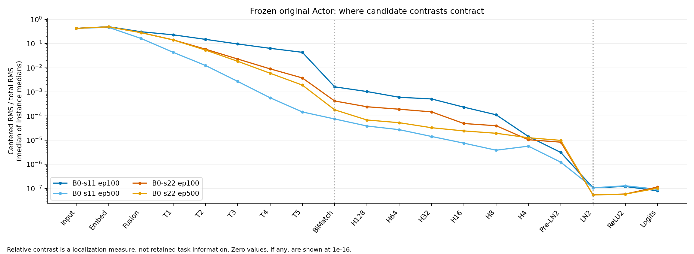
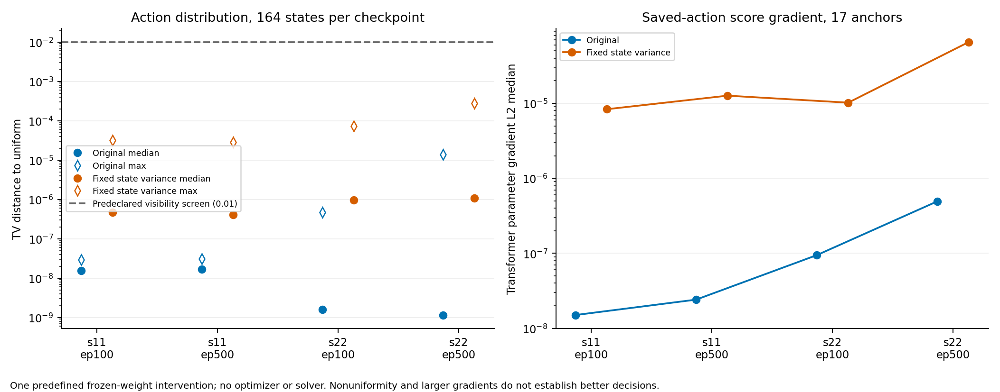

# 候选差异离线定位｜阶段交付

本轮工作完成，**停止并等待验收**。复用 164 状态、17 个训练实例、B0 两种子 ep100/500 的 4 份 checkpoint。独立副本、单 CPU、600 秒计算上限，无训练、新 SCIP 求解或原基线改动。

**结论：候选差异呈多阶段收缩。** Transformer 内逐层弱化；BiMatching 的候选个体通路依赖一个标量；BiMatching→logits 是四份权重一致的共同衰减区间。保持激活尺度的 LN2 单项对照放大了局部 score 梯度，仍未恢复可见候选偏好。float64 复核也没有恢复。不能唯一归因到一个层，更不能由此宣布某个新架构有效。

- [完整报告、证据分级、停止判断和缺口](REPORT.md)
- [用户授权](AUTHORIZATION.md)、[运行前冻结方案](frozen_protocol.json)、[输入及 checkpoint SHA](frozen_inputs.json)
- [逐层汇总](layer_summary.csv)、[逐实例配对收缩](contraction_by_instance.csv)、[收缩汇总](contraction_summary.csv)
- [BiMatching 重构与 β](bimatching_probe.csv)、[有效秩摘要](rank_summary.csv)
- [策略摘要](policy_summary.csv)、[干预配对](paired_intervention.csv)、[梯度摘要](gradient_summary.csv)
- [精度复核](precision_checks.csv)、[扰动摘要](perturbation_summary.csv)、[约束检查](invariance_checks.csv)
- [汇总 JSON](summary.json)、[计算账本](compute_budget.json)、[最终核验](delivery_validation.json)、[交付 SHA](delivery_manifest.json)





图均有同名 SVG/PDF。完整底表另有 layer_metrics.csv、effective_ranks.csv、policy_metrics.csv、score_gradients.csv、input_perturbation.csv；所有数字均可追溯到状态、实例和 checkpoint，不含新的求解性能。

## 本轮实际执行命令

从项目根目录执行。以下是本轮命令记录，**不能直接重跑已关闭的预算**。复用脚本需要新的明确授权和独立新目录/账本，保留原阶段及历史结果。budget_runner.py 固定单逻辑 CPU、BLAS/OMP/Torch 单线程；失败和导入/IO 同样计时。

```bash
python research/docs/diagnostics/tgppo_20261102_signal_localization/scripts/budget_runner.py --tag localization --max-seconds 470 -- /home/duweiyue25/conda/envs/tgppo/bin/python -u research/docs/diagnostics/tgppo_20261102_signal_localization/scripts/localize.py
python research/docs/diagnostics/tgppo_20261102_signal_localization/scripts/budget_runner.py --tag summarize --max-seconds 35 -- /home/duweiyue25/conda/envs/tgppo/bin/python -u research/docs/diagnostics/tgppo_20261102_signal_localization/scripts/summarize.py
python research/docs/diagnostics/tgppo_20261102_signal_localization/scripts/budget_runner.py --tag figures --max-seconds 40 -- /home/duweiyue25/conda/envs/rl4scip/bin/python -u research/docs/diagnostics/tgppo_20261102_signal_localization/scripts/render_figures.py
python research/docs/diagnostics/tgppo_20261102_signal_localization/scripts/budget_runner.py --tag final_checks --max-seconds 30 -- /usr/bin/python -u research/docs/diagnostics/tgppo_20261102_signal_localization/scripts/final_checks.py
python research/docs/diagnostics/tgppo_20261102_signal_localization/scripts/finalize_manifest.py
```

末条只在预算启动器返回、全部检查通过后关闭账本并生成 SHA 清单；不得用它清零或重开预算。没有后台后续作业，未进入下一阶段。
