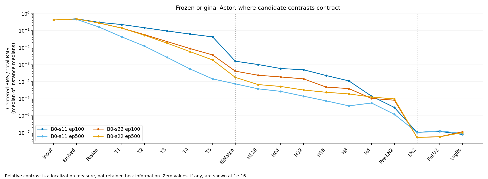
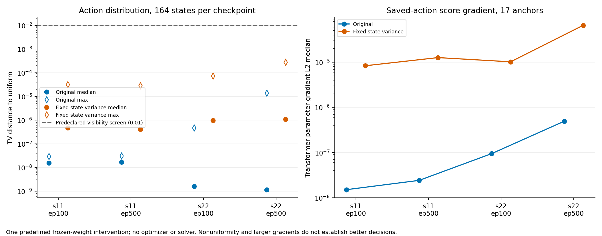

# 冻结 Actor 候选差异定位报告

日期：2026-11-02。

本轮已完成，提交验收后停止。范围依据[用户授权](AUTHORIZATION.md)，方法与停止条件在计算前冻结于 [frozen_protocol.json](frozen_protocol.json)。没有训练、SCIP 新求解或原基线改动。

**回答“候选差异从哪里开始消失”：不是所有 checkpoint 都在同一层突然丢失。输入与 embedding 仍有差异；Transformer 内逐层收缩，BiMatching 将候选个体通路压到一个标量；其后的评分头继续衰减，LN2 的方差归一化又削弱了局部响应。四份模型一致、且满足预定筛查门槛的共同区间是 BiMatching 输出到最终 logits，尚不能把责任唯一归到 BiMatching 或 LN2。**

保持激活尺度的单项 LN2 对照恢复了较强的局部 score 梯度，排除了上轮新增 ReLU 死区这一混杂，但仍没有形成可见的候选偏好。提高计算精度也没有恢复偏好。本轮因此结束冻结权重下的局部修补尝试，不自动进入训练或继续搜索变体。

## 1. 数据、指标与预定关口

完整复用上一轮 **164 状态、17 个训练实例、4 份 B0 checkpoint（s11/s22 × ep100/500）**，没有新增抽样或使用开发/测试状态。候选数 2–695。16 个实例各 10 状态，30n20b8 为 4 状态；comp21-2idx、misc03、supportcase7 无可用非空决策，保持缺失，不补造。来源轨迹 solver seed 均为 1。数据及 checkpoint 的 SHA 在评估前再次冻结，见 [frozen_inputs.json](frozen_inputs.json)、[观测清单](observation_manifest.csv)、[实例覆盖](observation_coverage.csv)。

两条路径共 1,312 条基础分布记录、43,296 条逐层记录。每实例按原清单第一条状态取一个固定 anchor，用于有效秩、score 梯度、输入扰动和 float64 复核，共 68 个 checkpoint–anchor 组合；两条路径共有 136 组约束检查。状态存在实例内依赖，不将 656 个干预配对当独立样本做显著性推断。

对某层候选矩阵 A（L×D），定义：

- 候选中心化矩阵 C=A−mean_candidates(A)。
- centered RMS = sqrt(mean(C²))；total RMS = sqrt(mean(A²))。
- 相对候选差异 r = centered RMS / total RMS。该指标对整体倍数缩放不敏感，但仍受公共偏置、表示基和数值精度影响，**不是保留了多少任务信息**。
- 有效秩使用 participation ratio：trace(CᵀC)² / trace((CᵀC)²)。只用于非零矩阵的描述；低秩不证明无用。

预定“强收缩”筛查为相邻指定位置 r_out/r_in≤0.1，先按实例取比值中位数，再要求每个 checkpoint 至少 80% 实例满足。四份 checkpoint 都满足才能称跨 checkpoint 一致。TV(policy, uniform)≥0.01 是可见非均匀性的工程阈值，**不表示行动正确或求解有效**。没有因结果弱而放宽任何阈值。

## 2. 逐层定位：上游仍有差异，后续连续压缩

下表为**先在每实例取 r 的状态中位数，再对 17 个实例取中位数**。不是原始激活幅度之比，也不能把表中两行中位数相除冒充配对比值中位数。

| 原路径位置 | s11 ep100 | s11 ep500 | s22 ep100 | s22 ep500 |
|---|---:|---:|---:|---:|
| 原始候选特征 | 0.427 | 0.427 | 0.427 | 0.427 |
| 候选 embedding | 0.500 | 0.469 | 0.492 | 0.493 |
| 融合树信息后、Transformer 前 | 0.309 | 0.164 | 0.285 | 0.283 |
| Transformer 五层之后 | 4.34e-2 | 1.47e-4 | 3.77e-3 | 1.90e-3 |
| BiMatching 后 | 1.61e-3 | 7.54e-5 | 4.19e-4 | 1.80e-4 |
| 评分头宽 4 的输出 | 1.42e-5 | 5.63e-6 | 1.04e-5 | 1.26e-5 |
| LN2 前的 Linear 输出 | 3.10e-6 | 1.22e-6 | 8.26e-6 | 9.80e-6 |
| LN2 后、ReLU 前 | 1.07e-7 | 1.06e-7 | 5.42e-8 | 5.37e-8 |
| 最终 logits | 8.00e-8 | 9.22e-8 | 1.15e-7 | 1.02e-7 |

**E1：Transformer 内已有逐层弱化，尤其 s11 ep500。** 五个单层的实例配对 r 比值中位数分别约为 0.306、0.293、0.245、0.233、0.270；这份 checkpoint 的弱化不能只归到后面的 BiMatching。其它权重各层也出现中位数下降，但没有单个 Transformer 层达到预定的跨 checkpoint 强收缩标准。

**E1：BiMatching 的相对幅度收缩程度不一致。** Transformer→BiMatching 的实例配对比值中位数分别是 0.0660、1.643、0.233、0.226；满足十倍收缩的实例数分别是 11/17、1/17、6/17、6/17。特别是 s11 ep500 的反例，否定“BiMatching 在所有权重中都造成十倍相对幅度下降”。原始 RMS 下降不能替代这一尺度核查。

**E1：最稳定的共同衰减区间是 BiMatching→logits。** 四份 checkpoint 的全部 17/17 实例均达到预定强收缩；实例配对比值的中位数分别为 **5.42e-5、1.22e-3、2.78e-4、4.59e-4**。这个范围包含多个门控、线性、归一化和 ReLU，不能据此把整个区间的效果算到某一个层头上。LN2 单层只有 s22 ep100 达到该 checkpoint 的 80% 实例标准，没有跨四份全部通过。

来源：[逐层汇总](layer_summary.csv)、[逐层完整记录](layer_metrics.csv)、[配对收缩汇总](contraction_summary.csv)、[逐实例配对](contraction_by_instance.csv)。

## 3. BiMatching：个体通路确实只有一个标量，但该标量并非总是均匀

**E2：给定该状态的公共上下文，候选 i 的独立通路经过 β_i。** 原代码为 E_c,i=β_i·tree；公共 E_t 由所有候选聚合而来。后续 S_ct,i、匹配门控及 refined_i 都可写为 f(β_i; E_t,tree)，没有原始 z_i 的直接残差。因此，当公共上下文固定且两个候选 β_i 相同，后续无法将它们重新区分。这是条件于状态的结构约束，不是对所有状态的全局一维表示断言。

**E1：从 β_i 和公共上下文重构全部 656 个原路径 BiMatching 输出，float32 最大误差为 0。** 原候选差异没有在输入处全部消失：四份权重 β 对均匀分布的 TV 中位数分别为 **0.0747、0.00758、0.0423、0.0201**。这些是匹配权重的差异，不是最终动作概率，更不是分支质量标签。

| checkpoint | Transformer 有效秩中位数 | BiMatching 有效秩中位数 | BiMatching 第一主成分能量中位数 |
|---|---:|---:|---:|
| s11 ep100 | 1.452 | 1.0014 | 99.929% |
| s11 ep500 | 1.033 | 1.0003 | 99.985% |
| s22 ep100 | 1.467 | 1.0005 | 99.977% |
| s22 ep500 | 1.395 | 1.0006 | 99.971% |

有效秩只覆盖每实例一个 anchor；Transformer 本身也已低秩，不能声称它原有 256 个独立有效方向都由 BiMatching 丢弃。BiMatching 中候选差异近一维与源码机制吻合，但一维非线性流形未必严格线性秩 1，也不能由此证明当前保留的方向与分支价值无关。**“候选个体通路受限”已确认；“因此造成 PDI 损失多少”仍属 E3。**

来源：[匹配重构与 β 记录](bimatching_probe.csv)、[有效秩完整记录](effective_ranks.csv)、[有效秩汇总](rank_summary.csv)、[独立源码副本](model_copy/modules.py)。

## 4. 保持激活尺度的 LN2 对照

唯一干预位置为原末端 LayerNorm(2)。对每状态原路径该层输入 x_i，先计算每候选通道均值 μ_i 和方差 v_i（总体方差，unbiased=False），再固定 s_ref=sqrt(mean_valid_candidates(v_i)+eps)。干预使用：

`y_i = gamma * (x_i - mean_channels(x_i)) / s_ref + beta`

原路径则使用各候选自己的 sqrt(v_i+eps)。本轮保留逐候选中心化、全部原参数及学习到的 gamma/beta；不再像上一轮那样直接使用 x·gamma+beta。s_ref 只由该状态原路径合法候选计算，无标签、无拟合、无超参搜索。它在该状态的反向、扰动及约束检查中保持为常数，**测的是固定参考尺度下的局部响应，不是动态重算分母并反向传播的训练网络**。

**E1：尺度保持检查通过。** 全 656 个干预配对中：LN2 输出 RMS 比值约为 0.99999989–1.00000036，ReLU 输出 RMS 比值约为 0.99999977–1.00000176；ReLU 正/非正模式变化比例全部为 0，没有新增全零 ReLU 状态。这样可以排除上轮 s11 新增死区对该对照的干扰。

| checkpoint | 原 TV 中位数 | 干预 TV 中位数 | 干预 TV 最大值 | Transformer score 梯度 L2 中位数：原→干预 |
|---|---:|---:|---:|---:|
| s11 ep100 | 1.54e-8 | 4.67e-7 | 3.17e-5 | 1.50e-8 → 8.35e-6 |
| s11 ep500 | 1.67e-8 | 4.13e-7 | 2.86e-5 | 2.41e-8 → 1.27e-5 |
| s22 ep100 | 1.59e-9 | 9.68e-7 | 7.35e-5 | 9.46e-8 → 1.02e-5 |
| s22 ep500 | 1.15e-9 | 1.09e-6 | 2.74e-4 | 4.94e-7 → 6.57e-5 |

TV 为每份权重 164 状态的描述统计；梯度为 17 个 anchor 的描述统计，目标是保存动作的 `−log pi(a|s)`。两者覆盖范围不同。梯度中位数约放大 108–556 倍（各组中位数的比值），不代表实际 PPO 参数步长或历史总梯度放大同样倍数。

**E1/E2：LN2 的逐候选方差分母确实影响当前局部评分响应；解除这一响应压缩仍不足以恢复可见的候选偏好。** 全部 656 个干预输出都低于 TV=0.01，最大仅约 2.74e-4。不能据梯度恢复、logit spread 增大或数值 top-1 更换，宣称更好的策略。该结果支持多阶段衰减这一解释，但没有证明还必须增加某一种残差或记忆模块。

来源：[逐状态干预配对](paired_intervention.csv)、[策略分布](policy_metrics.csv)、[score 梯度](score_gradients.csv)、[梯度摘要](gradient_summary.csv)、[汇总 JSON](summary.json)。

## 5. 数值精度、输入响应和基础约束

**E1：仅提高推理精度不能恢复偏好。** 将原参数转为 float64，在每份权重相同的 17 个 anchor 上复算。四份模型 float64 的 TV 中位数分别为 1.19e-11、6.30e-10、5.97e-9、4.16e-8；全部 68 次中最大约 1.39e-5，仍低于观察阈值。s11 的 float32 微小差异中含明显舍入影响，高精度下反而更接近均匀。因此“只是 float32 隐藏了一个强非均匀策略”在这些 anchor 上不受支持；不扩大为所有状态或训练精度的结论。[精度复核](precision_checks.csv)

对输入做固定的 0.1% 候选中心化对比度扰动，即 `x'=x+0.001*(x−mean_candidates(x))`，树状态不变。Transformer 中相对候选差异的扰动响应仍可测；原路径动作概率变化很小，干预路径最大 TV 变化约 1.32e-5。由于 LN2 后原信号已接近 float32 误差，某些“相对变化”可大于 1，这不表示原策略敏感或有用。扰动未必对应可达 SCIP 状态，且没有动作价值标签。[扰动完整记录](input_perturbation.csv)、[扰动摘要](perturbation_summary.csv)

136 组检查中，重复误差为 0；候选乱序逆置最大概率误差约 8.20e-8；追加 7 个 masked padding 的最大误差约 5.22e-8；padding 概率全部为 0，均通过预定 1e-6 门槛。因为分布近均匀，这不能替代对所有非均匀策略的通用正确性证明。[约束检查](invariance_checks.csv)

## 6. 证据分级与停止判断

| 研究判断 | 本轮等级与边界 |
|---|---|
| 原始输入/embedding 仍存在候选差异，Transformer 内逐层弱化 | **E1**：当前状态和现有权重；差异不等于任务价值 |
| BiMatching 个体通路由一个 β_i 和公共上下文决定 | **E2** 源码机制；**E1** 全 656 状态重构误差 0、anchor 近一维 |
| BiMatching 是所有模型中第一次且唯一的崩塌点 | **E4**：s11 ep500 的相对幅度反例、上游已弱化，不支持此绝对说法 |
| BiMatching→logits 为稳定的共同衰减区间 | **E1**：四份权重各 17/17 实例通过预定配对收缩门槛；单层归因不足 |
| LN2 的方差归一化削弱局部 score 响应 | **E1/E2**：固定其他权重和激活尺度的单项对照支持；不是其独立 PDI 因果效应 |
| 只处理 LN2 即足以修好策略 | **E4**：尺度对照仍无一次达到可见偏好阈值 |
| 残差、短训练或历史记忆可提高求解性能 | **E3**：本轮没有专家标签、更新实验或新求解结果 |
| 原作者正式模型也具有相同退化 | **E3**：评估的是本地训练权重，不是作者发布的正式权重；协议差异仍在 |

**停止条件已触发：一个预先固定的尺度对照已完成，仍未恢复可见候选偏好。** 不调节温度/输出倍数来越过阈值，不继续尝试第二个补丁，不以本轮结果自动启动训练或 HSTU。局部响应恢复也不等于没有改善可能；本轮仅结束该范围内的冻结权重对照。

目前定位的瓶颈顺序应表述为：①**评分链整体的候选区分/学习响应弱**，已有输出和局部对照证据；②其内部的**Transformer 逐层弱化、BiMatching 个体通路限制、窄评分头与 LN2 衰减**共同构成具体待分离机制，不编造各自 PDI 损失份额；③上一轮 CPU 成本是独立瓶颈候选，本轮不重复测速，也不改变其硬件限定。

## 7. 尚缺什么、最低成本怎样补

| 证据缺口 | 最低成本的后续验证方案（仅建议，未执行） |
|---|---|
| 有非均匀表示是否真能预测好分支 | 需要可追溯的专家排序或行动价值标签；现有 variance/rank 不能替代。先审计是否有可复用标签，缺失则另提小规模采集预算 |
| 真实优势和 Adam 更新能否改变候选偏好 | 若后续明确允许参数更新，在独立副本对既有轨迹做限定小批次 PPO 重放，记录实际 ratio/KL、优势、梯度、参数差和更新后分布；这是训练性质的操作，需另立范围与预算。不伪称重现历史 optimizer/RNG 状态 |
| 应改 Transformer、BiMatching 还是评分头 | 本轮不能唯一选择。先利用上述更新响应证据收窄；若开展结构对照，原模型与单项改动须同初始化、同数据/奖励/预算，不能直接拿冻结干预与完整训练基线比 |
| 局部信号恢复能否改善求解 | 需训练后的 Actor-only、按实例配对的真实求解，PDI/证明率与成本都记录；不能由本轮无标签 replay 推出 |

本轮不需要 V100。后续若进入参数更新或在线采样阶段，应先提交具体方案，保持本地复现与原论文协议差异可追踪；不把输出变尖包装成研究收益。

## 8. 完整性、预算与交付

40 项原运行代码及划分协议、4 个 checkpoint、34 份来源轨迹前后哈希核验通过；两条路径全部参数值保持不变，副本参数对象互不共享。19,024 个干预上游逐层指标一致性检查通过，原路径 TV 与上一轮逐状态差异最大为 0。无 optimizer step、无 CUDA 初始化、未导入 pyscipopt。上一阶段 51 份交付文件全部哈希不变。[实验检查](validation.json)、[最终交付核验](delivery_validation.json)

受控子进程墙时：主定位 160.06 秒，汇总 1.72 秒，图表 30.09 秒，最终核验 3.77 秒，**累计 195.64 秒**；加准备保守预留 20 秒为 **215.64 秒 < 600 秒**。精确值记录在关闭后的[预算账本](compute_budget.json)和交付核验中。报告写作耗时不计作实验计算墙时。无依赖安装或升级，图表复用已有 matplotlib 环境。

复现入口、图表与原始数据见 [README](README.md)。交付后账本关闭，不使用剩余预算自动续跑；后续工作等待用户验收和授权。
