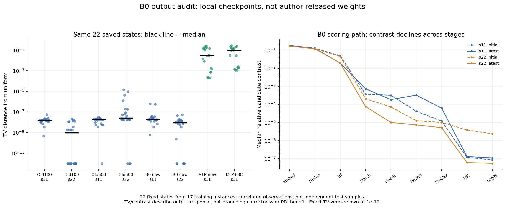

# B0 历史与本轮策略学习核验

日期：2026-11-08，北京时间。日志与输出均为读取时快照。

**结论：clip fraction=0 是重复出现的历史现象。本轮输出复核确认，B0 在被检查的固定状态上仍近乎均匀，数千步参数更新没有形成明显候选采样偏好。已有证据支持候选评分链的多阶段压缩／弱响应，不支持把它仅当普通损失波动，也没有唯一定位到某一个层。**

此前仅写“clip=0值得关注、等100评测看看”没有充分结合已验收的诊断证据。现在这项输出响应问题已可直接由已有权重确认，无需等100或500，也无需新增求解。PDI收益仍属于不同问题，不能由本报告推断。

## 1. 历史上是否出现过

| 运行 | 实际求解上限 | 完成episode（s11/s22） | 有效更新轮数（s11/s22） | clip非零轮数 |
|---|---:|---:|---:|---:|
| candidate-residual中的B0 | 120 s | 100 / 100 | 25 / 25 | 0 / 0 |
| light-actor中的B0 | 120 s | 100 / 100 | 25 / 25 | 0 / 0 |
| server6旧B0 | 120 s | 500 / 500 | 125 / 123 | 0 / 0 |
| 本轮paper-aligned B0 | 3600 s | 87 / 42 | 82 / 40 | 0 / 0 |

用户提到100episode／360秒；本次核验到的两轮100episode配置与记录均为120秒，未识别出对应360秒运行，因此不把120秒结果冒充360秒结果。旧500并非本轮500／3600协议。

本轮B0的AdamW逻辑步数为3966／2130，最新Actor优化器所有116个参数状态的step一致。历史实际更新也有687／714、690／846、3807／3786步。已记录优势标准差均非零，不能解释为“没有optimizer.step”或“优势全零”。明细见 `LOG_COMPARISON.csv/json`。

## 2. 本轮输出直接证据

只使用既有状态：历史定位清单中每训练实例的首个非空anchor（17个），再加入已保存3600秒轨迹的5个固定位置，共22状态，来自17个训练实例。没有专家动作正确性标签，没有独立测试数据；这些相关状态不当作22个独立实验样本。

同一组输入上的TV距离定义为 `0.5 * sum(abs(policy - uniform))`，只测动作分布是否有候选偏好，不测动作是否正确。

| 模型快照 | 距均匀TV中位数 | 最大值 |
|---|---:|---:|
| 本轮B0 s11，ep0 | 1.60e-8 | 1.97e-7 |
| 本轮B0 s11，ep87 | 1.81e-8 | 5.96e-7 |
| 本轮B0 s22，ep0 | 2.65e-7 | 4.19e-4 |
| 本轮B0 s22，ep42 | 8.43e-9 | 5.22e-8 |
| 旧light B0 s11，ep100 | 1.52e-8 | 5.66e-8 |
| 旧light B0 s22，ep100 | 9.02e-10 | 2.11e-8 |
| 旧server B0 s11，ep500 | 1.75e-8 | 3.19e-8 |
| 旧server B0 s22，ep500 | 2.46e-8 | 1.40e-5 |
| 本轮MLP s11，ep87 | 0.02798 | 0.25847 |
| 本轮MLP＋BC s11，ep87 | 0.09463 | 0.27961 |

本轮B0两种子的归一化熵 `H(policy)/log(K)` 中位数都几乎为1。因此图上的原始熵起伏很可能混合了候选数变化，不能当作学习进展。这里的MLP对照仅说明没有同样程度的输出坍缩，不能由非均匀性反推已经学好或PDI更优。

近均匀不等于部署时与随机规则完全等价：若使用argmax，极小logit差异与平局仍可改变分支顺序。不能把这些变化自动当作学到了稳定偏好，也不能仅凭TV大小判定候选排序必无价值或PDI必无收益。

## 3. 已更新参数为何仍clip=0

clip fraction计算的是 `abs(exp(new_log_prob-old_log_prob)-1)>0.16`，不是梯度范数裁剪比例。策略概率几乎不动时，ratio保持接近1，便不会触发该指标。

**参数确实改变。** 相对本轮ep0，Actor参数变化L2为1.788／2.896，不是全零。AdamW在显式零梯度条件下的纯权衰预测变化L2为0.874／0.470；实际参数相对此预测的残差为1.565／2.859，因此也不能把全部变化归为纯权衰。此反事实只用于排除“完全只是衰减”，不分配因果比例。

**主要logit变化却是公共平移。** 在相同22状态上，ep0→最新的公共logit平移绝对值中位数为0.03913／0.00798；去除公共平移后的候选logit变化RMS中位数仅6.84e-8／6.27e-7。softmax对所有候选共同增加一个常数不敏感，参数变化不能直接等同动作偏好改善。

相对初始化的动作概率比最大偏差，在该固定面板分别约3.00e-6／0.00121，均远小于0.16。它不是每次真实minibatch ratio的重放，但与实际GPU日志中每次更新clip=0一致。

本轮另对3个固定状态计算了 `-log pi(已保存动作|s)` 的score梯度：B0总范数约3e-7至3e-5，而同输入MLP／MLP＋BC约0.0067至1.73；没有执行优化器更新。这是固定动作的score梯度，不冒充当前真实PPO梯度。历史[真实PPO重放](../tgppo_20261102_ppo_replay/REPORT.md)已经测到Actor梯度约1e-7、未触及0.5范数裁剪上限，参数变化但TV仅约1e-8。

## 4. 问题定位到哪里

**E1：输出事实。** 当前权重、历史ep100／500权重在相同输入上近乎均匀，当前梯度响应很弱，完整更新确实执行。

**E2：源码机制。** BiMatching的候选个体通路通过一个标量beta_i乘公共树向量进入后续匹配，缺少候选原表示的直接残差；评分头再经过256→128→64→32→16→8→4→2→1及公共树门控。最终2→1层是Linear，不含LayerNorm(1)。

末端LayerNorm(2)对输入两通道差d的归一化部分为 `±d/sqrt(d²+4*eps)`。当同一状态各候选的d同号，且其平方远大于eps时，归一化向近似相同的正负模式饱和，局部幅度差异受到压缩。本轮两份最新B0的22/22状态都处于候选d同号区域，输入方差/eps的状态中位数约2169／1374。

**E1：逐层观测。** 最新s11／s22的相对候选对比度中位数，从embedding约0.183／0.168，经Transformer约0.0195／0.0195、BiMatching约7.34e-4／7.63e-5，最终到logits约1.09e-7／5.49e-8。这是相对幅度指标，不是任务信息保留率或PDI损失份额。

**E3：仍未唯一分离的原因。** 不能把整个问题唯一归到LN2、某个Transformer层、门控或奖励。此前[尺度保持LN2对照](../tgppo_20261102_signal_localization/REPORT.md)、[原头重置](../tgppo_20261102_head_reset/REPORT.md)与[尾部端到端对照](../tgppo_20261102_end2end/REPORT.md)均未恢复稳定的可用学习／求解收益；当前不重开这些已结束的搜索线。

## 5. 是否由本轮实现或运行模式引入

已重新在线获取作者公开[actor.py](https://github.com/benmhamed-a/tgppo-aaai-26/blob/main/code/project/policy/actor.py)与[modules.py](https://github.com/benmhamed-a/tgppo-aaai-26/blob/main/code/project/policy/modules.py)。本地原repo、server、light-actor、paper-aligned四份Actor／modules与作者当前公开文件Git blob逐字节相同（详见 `AUTHOR_SOURCE.json`）。这排除了本轮复制时把这两个结构文件改坏；不等于完整运行配置、特征／优化处理或作者真实实验权重已经逐项相同。

另在cod105、swath1、rmatr100-p10三个固定anchor上作无更新检查：float32 eval、float32 train/dropout（3个固定随机种子）、float64 eval的TV全部小于9.1e-7。在这些状态上，“仅因为eval关闭dropout”或“仅float32误差掩盖了强偏好”都不足以解释当前现象。不能将有限状态检查升级为对所有执行模式和状态的保证。

## 6. 当前训练曲线是否正常

- **执行／数值层面**：未记录NaN／Inf，优化器更新与参数变化存在；Critic跨不同实例的loss波动本身不证明发散。
- **B0策略学习层面**：当前不能称健康。联合输出、梯度、逐层与历史证据，已确认被检查状态上的候选采样偏好近乎坍缩；这比单独clip=0更强。
- **MLP／MLP＋BC**：本次未见同程度输出坍缩，但不能凭损失或非均匀性宣称求解收益，仍需固定权重的求解评测。
- **论文对标层面**：这是作者公开结构在本地复现权重上的问题证据，尚未测试作者正式权重，不能宣判论文模型必然失败。相对当前B0的优势只能先解释为相对这一公开实现对照的增量，不能直接外推为胜过论文健康强基线。

建议先验收本次基线可学性核验，再决定后续投入；不把延长到500当作已经证明可修复候选评分链的方案。正式对标还需核对作者正式权重／实际训练设置。现有作业、500协议、基线源码和权重保持原样，本次没有取消／重提GPU或修改模型。

## 7. 数据与完整性

`OUTPUT_AUDIT.json`记录10份检查点的同字节SHA、实际episode及全部输出摘要；`policies.csv`、`layers.csv`、`score_gradients.csv`、`parameter_changes.csv`、`anchors.csv`保留明细。加载latest时先读取一份字节，再对同一字节计算SHA并反序列化，避免训练原子替换引起hash与权重不一致。

`MODE_PRECISION_CHECK.json`保留模式与精度检查。主输出核验约20.32秒，模式／精度检查另15.50秒；全程CUDA未初始化，optimizer.step=0，新SCIP任务=0，未保存或覆盖任何模型检查点。绘图只读取这批已落盘CSV。
