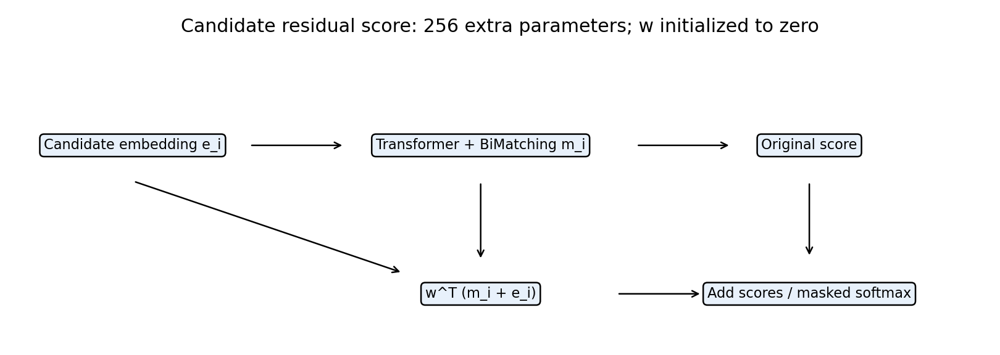
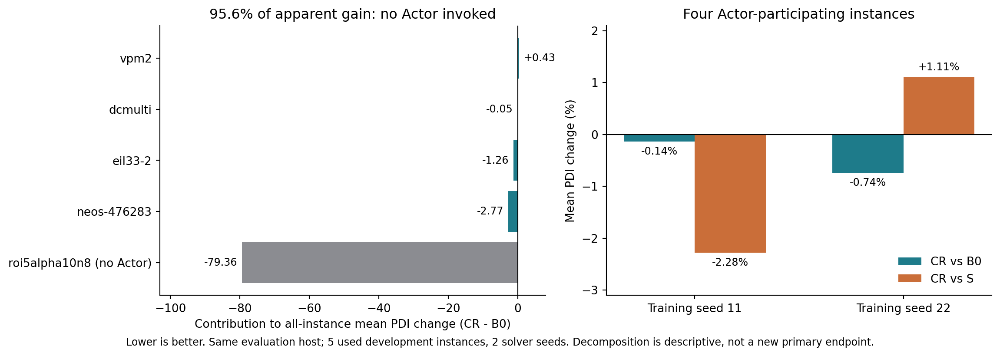
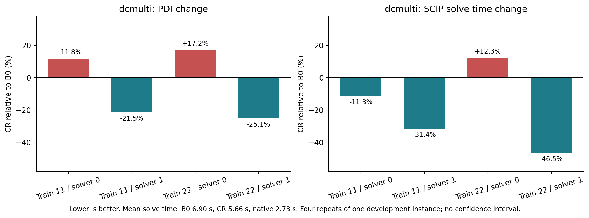

# 11月6日汇报：TGPPO候选信息残差评分

**本周完成一个具体方法及三组×两种子的真实PPO对照。结论是局部收益，整体改进尚未证实。** 下面四页可直接用于汇报；方法工作量为独立残差实现、真实训练与求解评估，先前系统瓶颈核验只用一句话交代动机。

## 第1页：方法——以256个新增参数直接读出候选信息

动机：既有核验提示末端候选偏好较弱，因此检验候选自身表示的直接评分通路能否转化成求解收益。

\[
s_i^{\mathrm{CR}}=s_i^{\mathrm{TGPPO}}+w^\top(m_i+e_i),\qquad w_0=0.
\]

e_i为原Transformer前的256维候选编码，m_i为BiMatching输出。保留原Transformer、TreeGate、Critic、H3和PPO；没有引入历史模块。新增256参数（约0.0054%），零初始化不改变公共起点策略。这是针对TGPPO的增量探索，普通残差本身不作为新的通用架构创新。

| 组 | 原评分之外的增量 | 作用 |
|---|---|---|
| B0 | 无 | 原架构参照 |
| S | wᵀm_i | 等参数评分捷径消融 |
| CR | wᵀ(m_i+e_i) | 完整候选信息残差 |

## 第2页：完整训练与主结果——平均数需要分解

两训练种子11/22，每组100完整episode、25轮PPO批更新；固定episode100。每模型5已使用开发实例×solver seeds0/1，全部60项同机Actor-only评估，另有10项原生参照。120秒受控SCIP，PDI越低越好；solver重复不算独立实例。

| 方法 | 种子11 PDI↓ | 种子22 PDI↓ | 两种子平均PDI↓ | 120秒cutoff证明率 |
|---|---:|---:|---:|---:|
| 原生relpscost | — | — | 3004.56 | 70% |
| B0 | 3032.68 | 3118.35 | 3075.52 | 各40% |
| S | 3108.78 | 3012.33 | 3060.55 | 各40% |
| CR | 2994.52 | 2990.49 | 2992.50 | 各40% |

CR表面上比B0降低2.70%，**但95.6%的均值差来自未调用Actor的 `roi5alpha10n8`，不能解释为残差策略收益**。该实例保留在完整主表，另做参与分解。只有5个开发实例，不能据此宣称整体优于TGPPO或原生SCIP。

四个调用Actor的实例中，CR相对B0为−0.14%/−0.74%；相对S为−2.28%/+1.11%，方向不一致。该子集CR平均PDI为1020.61，仍高于原生920.87约10.83%。

## 第3页：具体任务收益——dcmulti改善，同时报告vpm2退步

| dcmulti，平均4次模型求解 | 原生（2次） | B0 | S | CR | CR相对B0 |
|---|---:|---:|---:|---:|---:|
| PDI↓ | 3.992 | 5.739 | 6.032 | 5.501 | −4.13% |
| 节点数↓ | 11 | 619.0 | 599.5 | 480.5 | −22.37% |
| SCIP时间（秒）↓ | 2.731 | 6.902 | 6.840 | 5.664 | −17.94% |

局限：dcmulti的两个solver0配对PDI均变差，两个solver1均改善，不能说“四次稳定提升”；原生仍强于CR。负例vpm2的PDI增加6.07%、求解时间增加8.92%，四个配对PDI均变差。其余两个Actor参与实例的训练种子方向不一致，完整逐实例结果见[复核报告](RESULTS_REVIEW.md)。

## 第4页：已完成的证据与后续决策

**已测事实（E1）：** 六个模型均有真实PPO更新和完整权重；在17个共同训练状态上的只读比较中，CR相对均匀分布TV中位数为0.052/0.060，明显高于B0/S。它说明产生了候选偏好，训练状态没有候选价值真值，不能说明决策更正确。

**设计机制（E2）：** 候选编码直接接入评分残差，S/CR参数匹配；通路也改变了激活尺度，不能唯一归因成“信息保留”。

**尚未证实（E3/E4）：** 候选残差相对S的稳定任务收益、未见实例泛化、超越原生SCIP。训练CPU已按需求放开：种子11三组同类别硬件；种子22的CR与B0/S训练硬件不同，最终同机评估不能消除训练混杂。当前120秒/Adam协议不等同于原论文3600秒全规模复现。

可直接口述：

> 我们实现了一个只增加256个参数的候选信息残差评分，并完成三组、两训练种子的100-episode PPO对照。残差能够产生候选偏好，在dcmulti上平均减少约22%的节点和18%的求解时间，但重复依赖求解器种子，vpm2上出现退步。完整平均PDI的优势又主要来自没有调用Actor的实例，因此目前只能报告局部收益，不能宣称整体策略改进。下一步优先冻结权重，在本地CPU增加少量求解器种子验证正反例，不扩展GPU训练。

下一阶段提案：经本阶段验收及范围确认后，冻结6个Actor，只在dcmulti/vpm2增加solver seeds2/3，24模型任务+4原生参照，本地单线程累计10分钟到限即停；未复现局部收益则停止扩大CR。**尚未执行，周五汇报以本轮已完成结果为准。**

备用图：[共同预算训练曲线PNG](../../../tgppo/runs/candidate-residual-20261104/results/learning.png) / [PDF](../../../tgppo/runs/candidate-residual-20261104/results/learning.pdf)。它展示训练过程，不作为开发PDI持续改善的证据。全部数字、权重和原始日志索引见[结果复核与交付](RESULTS_REVIEW.md)。
