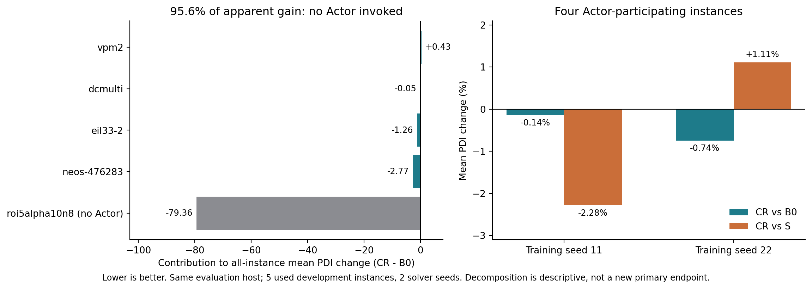
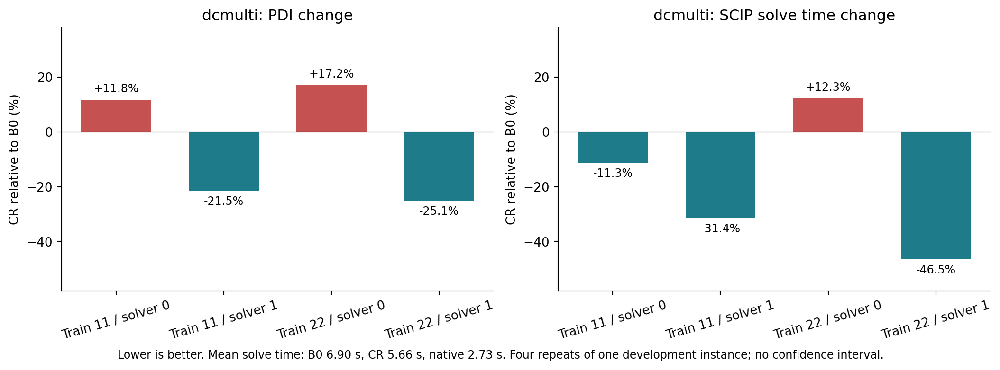

# TGPPO-CR：方法实验结果与阶段交付

日期：2026-11-04；面向11月6日周五汇报。**六组均完成100个完整episode，统一开发评估已完成。本阶段交付，等待验收。**

**结论：候选信息残差评分已完成真实PPO训练和求解对照，得到局部收益，但整体策略提升及候选信息相对评分捷径的稳定收益尚未证实。** `dcmulti` 的平均节点数下降22.4%、SCIP求解时间下降17.9%；`vpm2` 退步。全体平均PDI的表面优势主要来自未调用Actor的实例，不能将其当作残差决策的收益。

## 1. 本轮完成的方法与实验

具体增量是在原logits上增加零初始化的256维读出向量：

\[
\begin{aligned}
e_i&=\operatorname{var\_embedding}(x_i),\quad
m_i=\operatorname{BiMatching}(t,z_{1:L})_i,\\
s_i^{\mathrm{CR}}&=s_i^{\mathrm{TGPPO}}+w^\top(m_i+e_i),\quad w_0=0.
\end{aligned}
\]

e_i来自原global_embedding/Transformer之前的候选编码，m_i为原BiMatching输出。新增256个参数，约占原Actor的0.0054%；不新增观测、Critic信息或历史模块。实现保留原路径，因此不能预先声称减少推理成本。**E2：源码机制**，见[独立实现](../../../tgppo/experiments/candidate-residual-20261104/code/project/policy/candidate_residual.py)。

| 组别 | 评分方式 | 对照作用 |
|---|---|---|
| B0 | 原logits | 当前受控协议下的原架构参照 |
| S：评分捷径 | 原logits + wᵀm_i | 绕过末端评分链的等参数消融 |
| CR：候选信息残差 | 原logits + wᵀ(m_i+e_i) | 检验加入候选自身信息的残差通路 |

三组各用训练种子11/22，均100完整episode、25轮PPO批更新；固定使用episode100，没有按开发表现挑权重。每个种子的公共Actor/Critic初值、RNG及任务日程一致；S/CR参数量相同。原Critic、H3及PPO沿用批准方案，SCIP采样和Actor-only部署在CPU，完整PPO更新在V100。三组轨迹由各自策略产生，因此决策样本数和minibatch数可以不同；公平预算是完整episode数，不能声称更新次数完全相等。**E1：已测事实**，见[训练明细](review/training_summary.csv)。

| 训练硬件 | B0 | S | CR |
|---|---|---|---|
| 种子11 | Gold 6148 / V100-SXM2 | Gold 6148 / V100-SXM2 | Gold 6148 / V100-SXM2 |
| 种子22 | E5-2680 v4 / V100-PCIE | E5-2680 v4 / V100-PCIE | Gold 6148 / V100-SXM2 |

按用户放开CPU限制的要求完成训练；归一化均匹配实际CPU/软件。最终60项模型评估和10项原生参照统一在E5-2680 v4环境执行，120秒、SCIP 6.0.1、同一绑定及外围配置。**训练种子22仍存在硬件与归一化来源差异，同机最终评估不能消除训练阶段的混杂。** 种子11的三组硬件类别一致，但并行作业也不保证瞬时负载相同。详情见[硬件来源记录](../../../tgppo/runs/candidate-residual-20261104/results/TRAINING_ENVIRONMENTS.md)。

## 2. 完整主表：保留全部5个开发实例

PDI单位为百分比·秒，越低越好；先在实例内平均solver seeds0/1，再对实例等权平均。“两种子均值”是两个训练结果的平均，原生没有训练种子。证明率指120秒内完成已知cutoff下的证明，不等同于从零求解原MILP的最优率。

| 方法 | 训练种子11 PDI↓ | 训练种子22 PDI↓ | 两种子均值↓ | cutoff证明率 |
|---|---:|---:|---:|---:|
| 原生relpscost | — | — | 3004.56 | 70%（7/10） |
| B0 | 3032.68 | 3118.35 | 3075.52 | 各40%（4/10） |
| S | 3108.78 | 3012.33 | 3060.55 | 各40%（4/10） |
| CR | 2994.52 | 2990.49 | 2992.50 | 各40%（4/10） |

**E1：全体均值中CR相对B0为−2.70%，但其中95.6%的平均差来自 `roi5alpha10n8`。该实例全部12项学习策略评估均未调用Actor，处理节点数为1。** 其PDI不同并不能由候选评分动作解释，精确来源尚未确认。可能涉及限时内根节点求解进度与运行时波动，现有记录不足以进一步归因。不能把未确认原因写成已定位的计时bug，也不能删除该实例后替换预先规定的主表。

原自动[原始汇总报告](../../../tgppo/runs/candidate-residual-20261104/results/REPORT.md)保留不改；其中“两种子平均差均支持CR”只描述全体数值方向，**方法收益判断以本复核中的Actor参与分解和反例为准**。逐任务数字见[原始评估CSV](../../../tgppo/runs/candidate-residual-20261104/results/evaluation_rows.csv)。

## 3. Actor参与分解：候选信息的独立收益未获确认

以下4实例、每模型8次求解只是描述性分解，不是新增主指标或独立测试集：`vpm2`、`dcmulti`、`eil33-2`、`neos-476283`。

| 训练种子 | B0 PDI↓ | S PDI↓ | CR PDI↓ | CR相对B0 | CR相对S |
|---|---:|---:|---:|---:|---:|
| 11 | 1009.66 | 1031.81 | 1008.27 | −0.14% | −2.28% |
| 22 | 1040.70 | 1021.63 | 1032.96 | −0.74% | +1.11% |
| 两种子均值 | 1025.18 | 1026.72 | 1020.61 | −0.45% | −0.60% |

**E1：CR相对S的方向随训练种子变化，没有达到方案中“两种子均优于S”的继续投入依据。** 此子集原生PDI为920.87，CR仍高10.83%；学习组证明率均50%，原生87.5%。两个求解器种子属于同实例重复，不能当作更多独立实例；不报告统计显著性。

## 4. 逐实例结果：局部收益与反例同时呈现

表中学习组平均覆盖2训练种子×2solver种子；原生覆盖2solver种子。百分比是该实例CR/B0均值之比减1。

| 实例 | 原生PDI↓ | B0 PDI↓ | S PDI↓ | CR PDI↓ | CR相对B0 | 解释范围 |
|---|---:|---:|---:|---:|---:|---|
| vpm2 | 13.89 | 35.18 | 34.93 | 37.31 | +6.07% | 四个配对PDI均退步 |
| dcmulti | 3.99 | 5.74 | 6.03 | 5.50 | −4.13% | 训练种子均值均改善，solver重复方向不同 |
| eil33-2 | 660.56 | 1081.80 | 1084.65 | 1075.49 | −0.58% | 训练种子方向不同，均未完成证明 |
| neos-476283 | 3005.02 | 2978.01 | 2981.29 | 2964.15 | −0.47% | 训练种子方向不同，均未完成证明 |
| roi5alpha10n8 | 11339.34 | 11276.86 | 11195.88 | 10880.07 | −3.52% | 无Actor调用，差异不归因于候选评分 |

**E1：`dcmulti`存在局部平均收益，但不能称作稳定求解改进。**

| dcmulti指标 | 原生 | B0 | S | CR | CR相对B0 |
|---|---:|---:|---:|---:|---:|
| 节点数↓ | 11 | 619.0 | 599.5 | 480.5 | −22.37% |
| SCIP求解时间（秒）↓ | 2.731 | 6.902 | 6.840 | 5.664 | −17.94% |
| worker完整墙时（秒）↓ | 2.807 | 7.070 | 7.000 | 5.849 | −17.26% |
| PDI↓ | 3.992 | 5.739 | 6.032 | 5.501 | −4.13% |

两训练种子的solver0上CR的PDI均变差，solver1均改善：四个配对PDI为2胜2负；求解时间、节点数为3胜1负。原生在该实例仍明显更好。`vpm2`的CR平均求解时间从7.820增至8.518秒（+8.92%），说明局部优势不能外推到全部实例。见[四个配对原始数字](review/dcmulti_paired.csv)。

## 5. 策略确实产生响应，但响应不等于决策正确

**E1：** 在B0-s11前20个训练episode中，按固定规则每实例取首个实际决策，得到17个共同、多候选状态；其余3实例没有决策，未补造。六个已训练Actor在完全相同输入上只读前向。CR两种子的“相对均匀分布TV中位数”为0.0515/0.0596；B0约1.5×10⁻⁸/5.3×10⁻⁹，S约8.7×10⁻⁷/1.1×10⁻⁵。这支持“CR能产生候选偏好”，不支持“偏好更正确”：这些是训练状态，没有候选价值标签，也不代表开发或未见分布。

完整checkpoint与Actor导出张量一致，Adam状态有实际更新步，所有组权重有限、无待更新轨迹。上述只读核查耗时约11秒，不作为方法任务收益。见[策略输出与核查范围](review/policy_probe.json)、[共同预算训练曲线](../../../tgppo/runs/candidate-residual-20261104/results/learning.png)。

## 6. 结论边界与下一阶段建议

| 证据级别 | 可报告的结论 | 不能据此推出 |
|---|---|---|
| E1 已测事实 | 完成三组×两种子真实训练；CR有候选响应及dcmulti局部平均收益，同时有vpm2反例 | CR普遍优于TGPPO或原生SCIP |
| E2 源码机制 | 候选编码有独立残差读出通路；S/CR新增参数相同 | 已唯一确定性能变化来自信息保留，而非尺度/训练随机性 |
| E3 待验证 | dcmulti收益能否在新solver种子重现；vpm2退步是否持续 | 奖励、信用分配或某一模块已经是剩余性能差距的根因 |
| E4 支持不足 | 目前证据不足以扩大CR训练、引入HSTU或宣称候选残差独立有效 | 该残差对所有实例/训练预算永远无效 |

限制：只有5个已多次使用的开发实例、2训练种子、120秒受控求解及Adam协议；训练硬件异构，未做新的外层保留集确认，未访问本轮66实例测试集。PDI上下界来自超时积分测量，**不是运行波动或统计置信区间**；不能因测量区间不重叠就称方法稳定。这里不复述原论文性能结论，也不将本轮当作3600秒全规模复现。

**下一阶段建议只做一次便宜的冻结权重复测，不再申请GPU或延长到500episode。** 经本阶段验收及新求解范围确认后，在本地CPU同机复用6个episode100 Actor，仅对 `dcmulti` 和负例 `vpm2` 增加solver seeds2/3：24项模型任务+4项原生参照，共28项。保留120秒单任务时限，单线程、累计墙时10分钟到限即停；按本轮这两个实例约3—10秒/项估计为分钟级，超预算不自动扩展。固定模型/实例/种子，不挑较好训练种子，不改变方法或奖励。

停止判断：若dcmulti收益不能重现、或vpm2持续退步，则将CR定位为“响应有效、任务收益不足的探索方法”，暂停架构扩展；若新重复支持局部收益，也只能报告实例级证据，后续新实例泛化须另立冻结方案。周五使用当前已完成结果，不依赖下一阶段取得正结果。

## 7. 可复核产物与成本

- [周五汇报稿](MEETING_BRIEF_20261106.md)：四页内容安排、可直接使用的结论与图表。
- [独立复核通过记录](review/verification.json)、[重算结果](review/analysis.json)、[输入哈希](review/input_hashes.json)：6模型、600训练episode、60模型评估、10原生参照，旧基线41文件及冻结包哈希核对通过；原始结果未覆盖。
- [权重与选择清单](../../../tgppo/runs/candidate-residual-20261104/evaluation/episode-0100/frozen_models.json)、[完整主表CSV](review/panel_summary.csv)、[逐实例CSV](review/instance_means.csv)、[配对差CSV](review/paired_panels.csv)。
- [方法图PNG](../../../tgppo/runs/candidate-residual-20261104/results/method.png) / [PDF](../../../tgppo/runs/candidate-residual-20261104/results/method.pdf)，[学习曲线PNG](../../../tgppo/runs/candidate-residual-20261104/results/learning.png) / [PDF](../../../tgppo/runs/candidate-residual-20261104/results/learning.pdf)，[PDI来源分解PDF](review/pdi_attribution.pdf)，[局部重复结果PDF](review/dcmulti_repeats.pdf)。

六GPU入口与自动评估累计记账7.95作业小时（并行任务耗时相加，含旧失败attempt）；另有本地分钟级准备与只读整理。正式矩阵总计600训练求解、75次新CPU归一化、60模型开发评估、10同机原生评估，共745次新SCIP任务；另一类CPU的75项归一化复用历史记录。本次结果整理没有新增训练、优化步或SCIP求解。训练共150轮PPO批更新、4551个逻辑minibatch，不能混称为4551轮episode批更新。

复核复现仅需执行 `python3 review/analyze.py`；策略核查使用原包 `env.sh` 环境运行 `review/policy_probe.py`，绘图用有matplotlib的rl4scip环境运行 `review/plot_review.py`。这些入口不训练、不调用SCIP；不要为查看结果重新提交Custom。

**本阶段到此停止，下一阶段尚未执行。**
