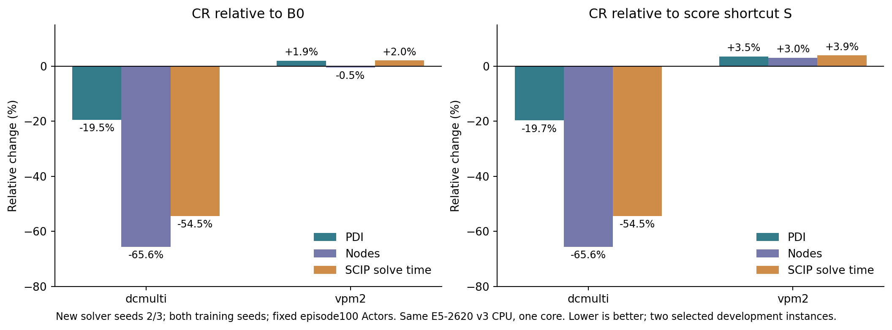

# 冻结Actor的CPU新种子复测

日期：2026-11-04。用户验收上一阶段后授权：冻结6个episode100 Actor，本地CPU、累计10分钟上限，复测正反例，不追加GPU训练。**28/28项已完成，执行累计257.80秒，未训练、未初始化CUDA。本阶段交付后停止，等待验收。**

**结论更新：`dcmulti`的局部收益在新增solver seeds2/3上得到一致配对支持，且优于等参数评分捷径S；`vpm2`的平均PDI退步仍存在。保留CR的局部方法结果，不扩大训练或宣称整体优越。**

## 1. 执行范围与冻结依据

- 固定原B0、评分捷径S、候选残差CR各训练种子11/22，共6个episode100 Actor。CR为原logits + wᵀ(m_i+e_i)，S只增加wᵀm_i，两组各新增256参数。没有重训、重新选模或调整权重。
- 只用原开发实例 `dcmulti`、`vpm2`，增加solver seeds2/3：3组×2训练种子×2实例×2solver种子=24项模型任务，加4项原生relpscost参照。没有访问其余开发实例或66实例集合。
- 每项保留原120秒、已知最优cutoff、受控SCIP外围设置与动作采样规则；变体间同训练种子、同实例/solver种子的采样RNG一致。固定轮转任务顺序，单任务、单CPU核心执行；没有按结果重试或删除负结果。
- 在独立目录复制并冻结Actor，开始/结束均核对副本、原Actor和完整checkpoint哈希。训练代码/配置、旧基线41文件及上一阶段原始结果哈希均通过核对。
- 本地为 **E5-2620 v3、CPU affinity=[0]**，Python3.8 / Torch1.13.1+cu117 / SCIP6.0.1，绑定和SCIP库与上一轮相同。上一轮评估CPU为E5-2680 v4；本轮所有方法同机比较，**旧、新两轮不混合绝对时间，不将变化唯一归因于求解器种子。**

冻结清单、预先列出的28项任务及实际环境见[manifest.json](../../../../tgppo/runs/candidate-residual-20261104/cpu-retest-seeds23/manifest.json)。

## 2. 新种子完整结果（E1：已测事实）

学习组每格为2训练种子×2solver种子的均值，原生每格为2solver种子的均值。PDI单位为百分比·秒，越低越好；节点与时间也越低越好。28项均有效、均完成120秒cutoff证明，因此本轮证明率没有组间提升。

| 实例 | 方法 | PDI↓ | 节点数↓ | SCIP求解秒↓ | worker完整墙时秒↓ |
|---|---|---:|---:|---:|---:|
| dcmulti | 原生relpscost | 4.268 | 8.00 | 3.211 | 3.426 |
| dcmulti | B0 | 5.690 | 602.25 | 6.830 | 7.078 |
| dcmulti | S | 5.706 | 602.25 | 6.829 | 7.072 |
| dcmulti | CR | 4.579 | 207.00 | 3.108 | 3.356 |
| vpm2 | 原生relpscost | 15.651 | 202.00 | 3.391 | 3.544 |
| vpm2 | B0 | 30.572 | 517.25 | 7.532 | 7.776 |
| vpm2 | S | 30.116 | 499.50 | 7.399 | 7.649 |
| vpm2 | CR | 31.158 | 514.50 | 7.685 | 7.926 |

| 实例 | CR相对参照 | PDI变化 | 节点变化 | SCIP时间变化 | worker墙时变化 |
|---|---|---:|---:|---:|---:|
| dcmulti | B0 | −19.52% | −65.63% | −54.49% | −52.59% |
| dcmulti | S | −19.74% | −65.63% | −54.48% | −52.55% |
| vpm2 | B0 | +1.92% | −0.53% | +2.03% | +1.92% |
| vpm2 | S | +3.46% | +3.00% | +3.86% | +3.62% |

相对变化是均值之比减1，不是先计算各次百分比再平均。`dcmulti`上CR平均SCIP时间与原生接近（3.108 vs3.211秒），但PDI仍高7.30%，节点更多；不能说全面超过原生。`vpm2`上原生PDI与求解时间仍明显更低。

## 3. 重复是否一致，而非只看平均

下表为CR相对B0的逐次PDI变化；所有配对完整保留在[paired.csv](paired.csv)。

| 训练种子 / solver种子 | dcmulti PDI变化 | vpm2 PDI变化 |
|---|---:|---:|
| 11 / 2 | −9.24% | +0.04% |
| 11 / 3 | −19.02% | −5.69% |
| 22 / 2 | −21.40% | +0.93% |
| 22 / 3 | −27.67% | +12.81% |

**dcmulti：** CR相对B0和S，在新四个配对的PDI、节点、SCIP时间、worker墙时均为4胜0负；两训练种子的PDI均值相对B0分别改善13.86%/24.54%。这支持该实例上的局部收益，不只是单个较好重复。上一轮solver0/1的PDI为2胜2负，仍作为反例保留，不能改写为“所有solver种子均稳定提高”。

**vpm2：** 新四个配对相对B0的PDI为1胜3负；求解时间为2胜2负。训练种子11平均PDI改善2.91%，种子22变差6.43%，因此“平均退步仍存在”不等于“每次都退步”。上一轮四个PDI配对均退步，本轮结果没有消除该负例。

两实例是根据上一轮正反结果选择的开发实例；新增solver种子不是新的独立MILP实例，也不是新的训练种子。没有统计显著性、未见实例泛化或广泛鲁棒性的结论。训练种子22的历史训练硬件差异仍存在，本轮同机推理不消除该混杂。

## 4. 周五汇报应如何更新

**E1 已测事实：** 方法完成三组×两种子100-episode真实训练；冻结权重后，dcmulti在新增solver2/3的四个配对均优于B0和S，平均节点减少65.6%、SCIP时间减少54.5%、PDI减少19.5%。vpm2相对B0平均PDI仍增加1.9%。

**E2 源码机制：** CR接入候选编码直接残差读出，S/CR参数匹配。信息通路与激活尺度都发生变化，不能唯一解释为某个信息保留机制的贡献。

**E3/E4 证据边界：** 结果支持dcmulti的局部残差收益；跨实例稳定收益仍未证实。上一轮完整5实例主表保留，95.6%的表面均值优势来自无Actor实例的判断不变；本轮不产生替代完整主表的新“总体提升率”。

可直接汇报：

> 我们实现了只增加256个参数的候选信息残差评分，并完成三组、两训练种子的真实PPO对照。为检验初步正反例，进一步冻结模型，在本地CPU增加两个求解器种子。dcmulti上四个新增配对均优于原架构和评分捷径消融，平均PDI降低19.5%、节点减少65.6%、求解时间减少54.5%；但vpm2平均PDI仍增加1.9%。因此候选残差已获得局部任务收益证据，尚不能宣称跨实例整体改进。

本页[新图PDF](new_seed_results.pdf)与上述表格可替换上一版汇报稿的第3页；第2页完整5实例主表及其归因限制继续保留。上一版方法说明及训练曲线见[四页汇报稿](../MEETING_BRIEF_20261106.md)。

## 5. 停止、成本与交付

执行累计 **257.800秒（4分17.8秒）**，包含冻结/哈希核查、启动与全部28项求解，以及首项完成后一次结果字段核查错误造成的11.445秒尝试。该错误已修正并记录；首项原生结果复用，未重复求解，预算未清零，原始失败状态保存在运行目录的`attempts/`。统计与出图为秒级操作，未再新增求解。新SCIP任务恰好28项，训练/优化步为0，所有学习部署均Critic调用0、fallback0、CUDA未初始化。

所有任务均在预算内完成，无失败或未完成的求解，不因剩余预算继续追加种子。已停止本阶段，不启动500-episode训练、GPU作业或新架构。

下一步建议：周五按“局部有效、跨实例不稳定”交付方法结果；保留固定模型与完整正反例，暂停扩大CR训练。如果后续要检验泛化，应先另行冻结未参与方法选择的新实例与预算；不能仅增加旧实例重复就宣称泛化。奖励/信用分配等方向仍是候选假设，本次复测没有定位其因果作用。

可复核材料：[通过记录](verification.json)、[重算结果](analysis.json)、[逐任务CSV](evaluation_rows.csv)、[分训练种子均值](model_means.csv)、[实例均值与配对胜负](instance_means.csv)、[输入哈希](input_hashes.json)、[运行状态](../../../../tgppo/runs/candidate-residual-20261104/cpu-retest-seeds23/status.json)。入口为本目录`run.py`，已完成目录会拒绝重新求解；只读重算使用`analyze.py`，绘图使用`plot.py`。本次修订保留`run_attempt0.py`作初始入口归档，不作为新实验入口。

**本阶段等待验收。**
