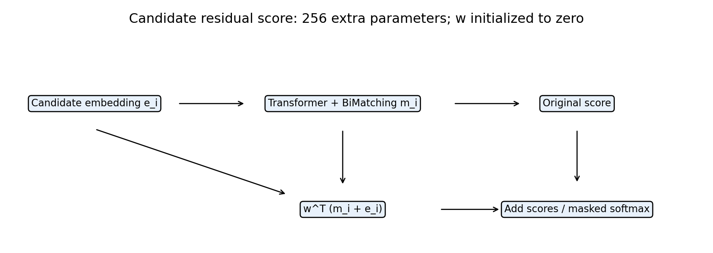
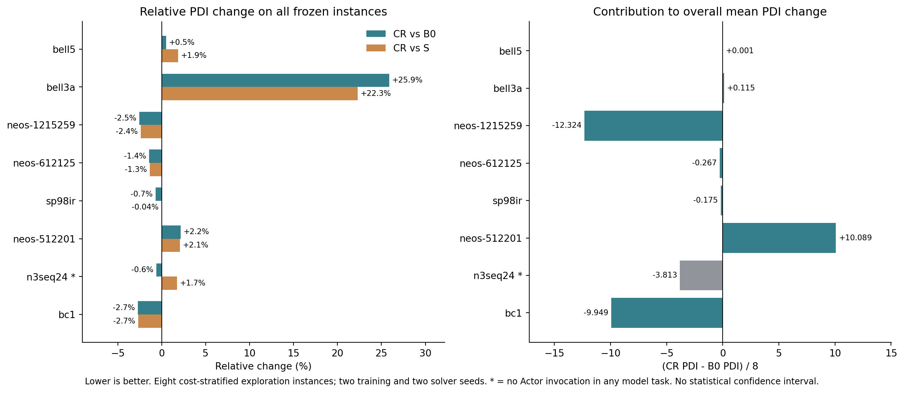

# 周五汇报简稿：TGPPO候选信息残差评分

本轮成果是一个具体评分方法、三组两种子的真实PPO训练，以及开发/训练外实例的实际求解对照。**目前得到局部可重复收益和跨实例弱正信号，整体稳定提升尚未证实。** 原系统瓶颈核验只说明设计动机，不计作本轮方法实验成果。

## 第1页：方法与消融

\[
s_i^{\mathrm{CR}}=s_i^{\mathrm{TGPPO}}+w^\top(m_i+e_i),\qquad w_0=0.
\]

e_i是原Transformer前的256维候选编码，m_i是BiMatching输出。增加一个256维读出向量（约0.0054%参数），保留原Transformer、TreeGate、Critic、H3与PPO；训练整个Actor和Critic，评估冻结Actor。

| 组 | logits | 作用 |
|---|---|---|
| B0 | 原评分 | 当前协议的原架构参照 |
| S | 原评分 + wᵀm_i | 等参数评分捷径消融 |
| CR | 原评分 + wᵀ(m_i+e_i) | 完整候选信息残差 |

## 第2页：实际训练与评估范围

- 20训练实例，3组×训练种子11/22，每模型100完整episode、25轮PPO批更新，固定episode100。六组均完成，未按结果选较好种子或权重。
- 5开发实例×solver0/1：60模型任务+10原生参照。全体CR相对B0均值PDI−2.70%，95.6%的差值来自无Actor实例，因此不作为策略增益结论。
- 冻结模型复测开发正反例dcmulti/vpm2的solver2/3：28项，本地4分18秒；dcmulti改善、vpm2仍有平均退步。
- **本轮训练外跨实例探索：** 依据旧原生成本固定分层抽取8实例，六模型×solver0/1共96任务，加16原生，共112，CPU约40分钟全部完成。这8个不在训练/开发集合，但历史66集合已被分析，不能称全新独立保留集。

沿用120秒受控SCIP与Actor-only部署。当前协议不等同于原论文3600秒全规模复现；训练种子22的硬件混杂仍需披露。新跨实例结果与旧开发结果分别报告。

## 第3页：跨实例主表与反例

| 方法 | 8实例两训练种子平均PDI↓ | 120秒cutoff证明率 |
|---|---:|---:|
| 原生relpscost | 1369.26 | 75.0% |
| B0 | 1987.13 | 两种子各37.5% |
| S | 1972.10 | 两种子各37.5% |
| CR | 1970.80 | 两种子各37.5% |

CR相对B0平均−0.82%，相对S仅−0.07%。相对S，训练种子11为+0.30%、种子22为−0.43%，主表方向不一致。去掉无Actor的n3seq24作参与分解后，7实例上CR相对B0为−0.26%/−1.57%，相对S为−0.14%/−1.59%；这是弱正信号，不能替换完整主表。

7个Actor参与实例中，两种子平均PDI为4例改善、3例退步；本轮总体求解时间基本不变，证明率不增加。

## 第4页：局部收益、局限与后续决策

| 实验 / 实例 | CR相对B0的PDI | 节点 | SCIP时间 | 重复范围 |
|---|---:|---:|---:|---|
| 开发复测 dcmulti | −19.52% | −65.63% | −54.49% | 新solver2/3四配对均优于B0/S，旧solver仍有反例 |
| 跨实例 neos-612125 | −1.45% | −18.73% | −5.64% | 两训练种子均值均优于B0/S；逐solver相对S为2胜2负 |
| 跨实例 bc1 | −2.72% | −8.34% | 约不变 | 两训练种子均值均改善，但均未完成证明 |
| 跨实例反例 bell3a | +25.90% | +25.37% | +30.25% | 两训练种子均值均退步 |

不同实验条件下的数字分别呈现，不合并成一个总体收益。普通残差本身不包装为新通用架构创新；这里检验的是它在TGPPO中的效果。

可口述：

> 我们实现了一个仅增加256参数的候选信息残差评分，完成三组、两训练种子的真实PPO对照，并冻结模型评估8个训练外实例。除开发实例dcmulti外，neos-612125和bc1也出现重复的局部收益。整体平均PDI相对原架构改善约0.82%，但相对等参数捷径仅改善0.07%，证明率未提高，且bell3a等实例明显退步。因此当前支持方法具有局部价值与跨实例弱正信号，尚不支持稳定整体改进。后续先补独立确认数据及同硬件训练重复，暂不增加模块或延长训练。

完整数字与限制见[跨实例报告](REPORT.md)。备用图：[共同预算训练曲线](../../../../tgppo/runs/candidate-residual-20261104/results/learning.png)。后续工作为提案，本阶段已停止，等待验收。
