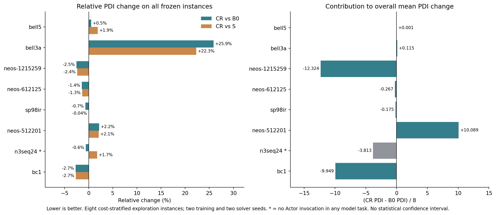

# TGPPO-CR：冻结模型的8实例跨实例探索结果

日期：2026-11-04。**112/112项有效完成，执行39分41.8秒；没有新增训练、修改权重或申请Custom/GPU。本阶段交付，等待验收。**

**结论更新：跨实例评估出现小幅正信号，局部收益已不限于dcmulti；但完整主表相对同参数评分捷径S的平均优势仅0.07%，训练种子方向不一致，证明率不变，尚不能称作稳定的整体方法提升。** 原生relpscost在本集合的平均PDI和证明率仍明显更好。

## 1. 这轮检验了什么

冻结原B0、评分捷径S、候选残差CR各训练种子11/22的episode100 Actor。三组此前均完成100完整episode、25轮PPO批更新。本轮只加载Actor推理，没有Critic调用或优化步骤。方法与结构见[原方法方案](../PLAN.md)。

当前评估是**8个训练外实例的探索评估，不是完整66实例测试或全新保留集确认**。它们与20训练/5开发实例无重合，但来自历史上已分析过的66实例集合。在本轮模型结果产生前，依据历史原生求解成本分四层，每层按固定盐SHA256排名选2个；不根据当前CR表现选择或更换。只排除需要特殊内存协议的mspp16。

| 冻结层次（历史原生成本） | 实例 |
|---|---|
| 全证明、平均≤10秒 | bell5、bell3a |
| 全证明、平均10—60秒 | neos-1215259、neos-612125 |
| 全证明、平均>60秒 | sp98ir、neos-512201 |
| 未全部在120秒内证明 | n3seq24、bc1 |

96项模型任务=8实例×2solver种子（0/1）×6模型；同机原生参照16项，共112。统一E5-2620 v3、4个单线程CPU worker、32GiB配额；SCIP6.0.1/定制绑定、120秒、已知cutoff及外围配置沿用原协议。模型按预先固定的轮转顺序交错执行，变体间配对动作采样RNG相同。

选择规则、完整候选池及哈希见[cohort.json](../../../../tgppo/runs/candidate-residual-20261104/cross-instance-8/cohort.json)，全部模型/任务/硬件见[manifest.json](../../../../tgppo/runs/candidate-residual-20261104/cross-instance-8/manifest.json)。分层比例并非原66集合比例，以下均值只描述这8个实例。

## 2. 完整主表：8实例均保留（E1）

PDI为百分比·秒，越低越好。先在实例内平均solver种子，再对8实例等权平均；学习组“两种子均值”再平均两个训练种子。cutoff证明率为120秒内完成已知cutoff下的证明，不等同于从零求解原MILP的最优率。

| 方法 | 种子11 PDI↓ | 种子22 PDI↓ | 两种子均值↓ | 120秒cutoff证明率 |
|---|---:|---:|---:|---:|
| 原生relpscost | — | — | 1369.26 | 75.0%（12/16） |
| B0 | 1982.56 | 1991.70 | 1987.13 | 两种子各37.5%（6/16） |
| S | 1971.34 | 1972.86 | 1972.10 | 两种子各37.5%（6/16） |
| CR | 1977.16 | 1964.45 | 1970.80 | 两种子各37.5%（6/16） |

| 训练种子 | CR相对B0的PDI | CR相对S的PDI |
|---|---:|---:|
| 11 | −0.27% | +0.30% |
| 22 | −1.37% | −0.43% |
| 两种子均值之比 | −0.82% | −0.07% |

**E1：CR相对B0的全体PDI在两个训练种子上均改善；相对S的方向仍不一致。** CR均值比原生高43.93%，三个学习组没有增加cutoff证明数。因此不能将0.82%写成已确认的跨实例稳定改进，更不能说整体超过原生SCIP。

总体SCIP求解时间：B0 83.224秒、S 83.282秒、CR 83.165秒、原生56.175秒。CR相对B0仅−0.071%；worker完整墙时约−0.078%，节点均值反而+4.31%。**本轮没有显示整体求解加速。** 超时任务被限制在约120秒，不能凭相近均值推断未限时的求解效率相同。

## 3. Actor参与分解：正信号存在，但不能替换主表（E1）

`n3seq24`的12项模型任务均没有调用Actor，节点数均为1；其PDI差异不能归因于候选评分决策。它贡献了全体CR−B0均值改善的23.36%。相对S时，它反而使CR均值变差，影响了主表的种子方向。该实例保留在完整主表，不事后删掉来宣布主指标获胜。

其余7个Actor参与实例的描述性分解如下：

| 训练种子 | B0 PDI↓ | S PDI↓ | CR PDI↓ | CR相对B0 | CR相对S |
|---|---:|---:|---:|---:|---:|
| 11 | 1556.92 | 1555.06 | 1552.93 | −0.26% | −0.14% |
| 22 | 1563.65 | 1563.88 | 1539.05 | −1.57% | −1.59% |
| 两种子均值 | 1560.28 | 1559.47 | 1545.99 | −0.92% | −0.86% |

**E1：该子集上两个训练种子相对B0和S均有小幅平均改善，支持继续保留“候选残差有跨实例正信号”的观察。** 但原生PDI为855.98，CR仍高80.61%。该子集是Actor参与情况的分解，不是新的主指标或独立数据集；发生Actor调用也不意味着已经唯一确定性能差异的因果来源。

## 4. 逐实例：两个新正例，同时存在明显反例

| 实例 | B0 PDI↓ | S PDI↓ | CR PDI↓ | CR相对B0 | CR相对S | 两训练种子方向 |
|---|---:|---:|---:|---:|---:|---|
| bell5 | 1.705 | 1.682 | 1.714 | +0.51% | +1.86% | 方向不同，绝对差小 |
| bell3a | 3.552 | 3.657 | 4.472 | +25.90% | +22.29% | 两种子均退步 |
| neos-1215259 | 3892.371 | 3886.315 | 3793.780 | −2.53% | −2.38% | 方向不同 |
| neos-612125 | 147.728 | 147.559 | 145.591 | −1.45% | −1.33% | 两种子均改善 |
| sp98ir | 199.654 | 198.330 | 198.250 | −0.70% | −0.04% | 方向不同，部分差值测量范围跨零 |
| neos-512201 | 3751.127 | 3754.131 | 3831.840 | +2.15% | +2.07% | 方向不同 |
| n3seq24 | 4975.043 | 4860.522 | 4944.536 | −0.61% | +1.73% | 无Actor，不归因于评分 |
| bc1 | 2925.851 | 2924.618 | 2846.257 | −2.72% | −2.68% | 两种子均改善 |

学习组实例均值覆盖2训练种子×2solver种子。7个Actor参与实例中，CR相对B0/S的两种子平均PDI均为4例改善、3例退步；分别看训练种子则为3/7、5/7改善。不能称作大多数实例在所有重复上稳定提高。

- **新正例 `neos-612125`：** 两训练种子的PDI均值相对B0分别−2.01%/−0.83%，相对S为−2.13%/−0.46%。合计节点减少18.73%、SCIP时间减少5.64%、worker时间减少5.56%；四个逐solver配对相对B0的PDI均改善，相对S为2胜2负。支持该实例上的局部收益，同时保留消融重复的不一致。
- **新正例 `bc1`：** 两训练种子的PDI均值相对B0为−4.32%/−1.13%，相对S为−4.42%/−0.94%；四个逐solver配对相对B0/S均3胜1负。所有方法在该实例均超时，不能把PDI改善说成已减少求解终止时间。
- **反例 `bell3a`：** 两训练种子PDI均值相对B0分别+28.00%/+23.65%。节点均值+25.37%、SCIP时间+30.25%，说明候选残差也可能明显损害搜索。
- **均值抵消：** `neos-1215259`和`bc1`带来较多绝对PDI收益，`neos-512201`抵消其中一部分；`n3seq24`还有无Actor差异。不能只选两个赢家来替代完整结果。

## 5. 证据支持到哪一步

| 级别 | 当前可说的结论 | 尚不能说的结论 |
|---|---|---|
| E1 已测事实 | dcmulti之外新增neos-612125、bc1的局部收益；7个Actor参与实例均值有弱正信号；反例和种子差异仍在 | CR跨实例稳定优于B0/S，或整体优于原生SCIP |
| E2 源码机制 | 候选编码直接残差读出，S/CR参数量相同，原路径及训练目标保留 | 已唯一证明收益来自信息保留，而非通路尺度及学习随机性等因素 |
| E3 待验证 | 更独立数据及同硬件训练重复下，弱正信号能否持续 | 奖励、信用分配或某模块已确定是剩余差距的根因 |
| E4 支持不足 | 当前不足以直接扩大到500episode或追加复杂模块 | 该残差在所有任务和预算下都无效 |

两训练种子中，种子22的CR与B0/S来自不同训练硬件及对应归一化来源；本轮同机推理没有消除训练混杂。种子11硬件类别一致，但Actor参与子集收益也只有约0.1%—0.3%。统计单位是实例，solver重复不能当作更多实例；只有2个训练种子。积分上下界属于超时过冲的测量范围，不是运行波动/统计置信区间；不宣称显著性。

这里仍是120秒、Adam、100-episode受控协议；不等同于原论文3600秒全规模复现，也没有验证默认生产SCIP设置。旧开发评估、局部复测与本轮实例/并发设置不同，分别报告，不拼成统一测试均值。

## 6. 交付与下一阶段建议

本轮完成了授权的小规模跨实例检验。**保持方法和权重冻结，暂停扩大CR训练与结构。** 周五可以汇报“具体方法、真实训练、局部可重复收益、跨实例弱正信号及明确反例”，不能汇报“已稳定提升TGPPO”。

如果后续继续投入，应先明确新的确认性数据集合与同硬件训练重复预算，验证这不到1%的平均正信号能否重现；优先补证据，不在这8个已看到结果的实例上调残差倍率、奖励或选权重。任何新训练、完整66矩阵或新结构另立阶段。本次不自动执行。

- [周五汇报简稿](MEETING_BRIEF_20261106.md)：合并方法、开发与跨实例结果，保留正反例。
- [主表CSV](panel_summary.csv)、[逐实例完整均值](instance_summary.csv)、[分训练种子配对](paired_instances.csv)、[主表配对差](paired_panels.csv)、[逐任务CSV](evaluation_rows.csv)。
- [冻结方案](PLAN.md)、[通过记录](verification.json)、[完整重算结果](analysis.json)、[输入哈希](input_hashes.json)、[图PDF](cross_instance_pdi.pdf)、[运行状态](../../../../tgppo/runs/candidate-residual-20261104/cross-instance-8/status.json)。

执行累计2381.799秒（39分41.8秒），各worker墙时相加8978.304秒（2.494 worker小时），两者口径不同，均保留。旧成本估计为4worker约38.5分钟，仅用作资源判断；实际本地完成，无需Custom。原Actor/完整checkpoint、训练包及旧基线哈希检查通过；112项均有效、CUDA未初始化、所有模型部署Critic调用0/fallback0。没有新增训练、重复求解、临时换例或超预算。

**本阶段已停止，等待验收。**
