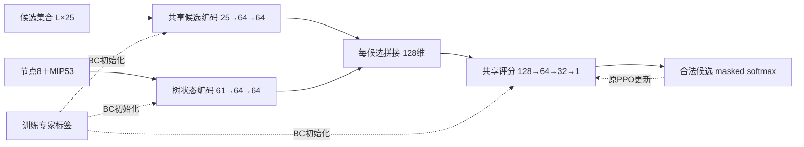

# 周五可直接使用的汇报稿：轻量树条件化Actor与专家初始化

本稿复用已完成实验，**不依赖排队中的持续专家监督训练完成**。只读整理，没有新增训练、GPU申请或SCIP求解。源数据与时间快照见[EVIDENCE.json](EVIDENCE.json)，可复制到表格工具的完整主表见[main_results.csv](main_results.csv)。

## 第1页：研究问题与当前方法

问题：TGPPO的Actor部署开销较高，廉价特征是否需要原有较重的编码／交互／评分网络？在保留原输入、Critic与PPO路径的前提下，轻量模型能否改善计算成本及求解表现？

当前实际方法：**共享候选MLP＋树条件化评分＋合法专家BC初始化＋原PPO**。这包含两个已经做过独立对照的设计因素：Actor整体结构替换、专家预训练初始化。PPO是继承的训练框架，其相对BC-only的额外收益另作消融，不把它自动算成新方法贡献。

MLP、Deep Sets、ISAB、BC本身均已有工作；当前贡献是针对既有廉价特征和在线分支路径的具体适配、成本与求解对照，而不是声称发明了这些通用模型。相关定位见[已有方法调研](../../tgppo_light_actor_survey_20261105/REPORT.md)。

## 第2页：网络怎么改

候选编码和评分共享参数，输出随候选置换相同地置换；支持动态候选数和padding，保留候选自身表示到评分。节点与MIP组成61维上下文，不重新构建完整二部图。编码器含输入LayerNorm与GELU。部署仅Actor，Critic不进求解回调。

| 模型 | 参数量 | 相对B0减少 | 角色 |
|---|---:|---:|---|
| B0原架构参照 | 4,738,895 | — | 控制 |
| 树条件化MLP | 24,493 | 99.48% | 开发筛选后的候选 |
| Deep Sets式集合Actor | 32,749 | 99.31% | 已完成结构对照 |
| 单ISAB Actor | 92,205 | 98.05% | 已完成结构对照 |

三种轻量结构均已训练和评估，不是只做了MLP或放弃了其他结构。详见[网络与对照说明](../continuation/METHOD.md)。

## 第3页：专家数据与独立增量

专家数据复用已有relpscost轨迹，12个合法训练实例1468状态拟合、3个训练内部留出实例288状态选初始化，不拿开发/测试标签做梯度。正式BC预算1000步，MLP两个种子均选第100步，再以全新PPO优化器完成100 episode。专家数据存在既有SCIP8→6与状态分布迁移边界。

主对照：B0／MLP／SET／ISAB×无／有BC×训练种子11／22＝16组，全部完成100 episode。开发：5实例×solver0／1，共160模型＋10本轮新原生；按预定规则选MLP＋BC。随后固定B0／MLP×无／有BC的8份权重，在8个探索实例上完成128模型＋16新原生。

| 研究问题 | 对照 |
|---|---|
| 结构增量 | 相同BC条件的MLP与B0 |
| 专家初始化增量 | 同一MLP的有BC与无BC |
| 完整方法 | MLP＋BC与B0，均有同预算PPO |
| PPO的附加贡献 | 同一BC初始化与其PPO20／100检查点 |
| 真实求解价值 | 各组与同机新原生relpscost，分别看PDI、证明率、墙时 |

## 第4页：已完成的主结果

PDI越低越好，固定120秒。两个训练种子等权，各solver重复在实例内平均；开发和跨实例分开报告，不混合均值。以下“＋BC”均仍经过100episode PPO。

| 方法 | 开发PDI | 开发证明率 | 8实例PDI | 8实例证明率 |
|---|---:|---:|---:|---:|
| 原生relpscost | 3058.71 | 70% | 1277.97 | 75% |
| B0 | 3192.67 | 40% | 1963.06 | 37.5% |
| B0＋BC | 3186.27 | 40% | 1941.50 | 37.5% |
| MLP | 3107.75 | 60% | 1881.19 | 37.5% |
| MLP＋BC | 3016.98 | 60% | 1840.27 | 37.5% |

8实例探索复核中：

- 无BC结构替换：MLP对B0平均PDI−4.17%，训练种子11／22分别−5.35%／−2.99%。
- BC初始化：MLP＋BC对MLP平均PDI−2.18%，两种子−2.21%／−2.14%。
- 完整方案：MLP＋BC对B0平均PDI−6.25%，两种子−7.44%／−5.07%。
- 实际Actor调用均摊耗时26.36→1.80 ms，下降93.17%；整个optimize墙时82.98→79.89秒，下降3.72%。不能把Actor加速倍数当成整体求解加速倍数。

这些是现有方法的正向证据，不依赖新增持续监督是否成功。跨实例证明率没有提高；相对原生PDI仍高44%，不能宣称全面胜过relpscost。

## 第5页：PPO消融及解释边界

复用BC初始化、PPO20、PPO100，在原5开发实例完成70项CPU评估：

| 条件 | 全5实例PDI | 共同Actor四实例PDI | 证明率 |
|---|---:|---:|---:|
| BC-only | 3030.041 | 909.725 | 60% |
| BC＋PPO20 | 3037.678 | 905.857 | 60% |
| BC＋PPO100 | 3035.018 | 905.586 | 60% |

共同Actor子集PPO100相对BC仅平均改善0.45%，两个种子分别退步0.57%／改善1.47%。无Actor的roi5alpha10n8影响全体均值，不能把其变化归因于神经动作。因此PPO的额外求解收益未得到跨种子稳定支持，暂不扩大episode；这不推翻“结构替换”和“BC初始化”的既有对照收益。

两个阶段原生和绝对时间不同，不能把本页曲线与上一页开发主表拼成同一批次的性能改善。MLP的内部专家NLL在PPO后仍改善，也没有证明整体遗忘。详见[曲线结果解读](../dev_curve_20261105/RESULTS_REVIEW.md)。

## 第6页：下一轮在做什么，当前能说到哪里

持续专家监督是**第三项可选增强**：在MLP＋BC基础上，PPO期间每个逻辑小批次加入16个训练专家状态，以0.01×CE/log(K)约束Actor更新。四个新Custom只比较control/expert×两种子，仍100episode，并保留BC-only参照。它不是取代MLP／BC，也不是因已证明遗忘而修错；目前只是待验证假设。

“下一轮只验证一个增量”表示仅改变上述监督项以清楚归因；并非整个方法只剩一项，也不表示对比学习、其他轻量结构、历史或树信用分配已经被否定。后者暂不混入当前截止前的对照。

汇报边界：已有结果来自两训练种子、5开发／8探索实例、120秒／100episode协议；8实例过去已查看，非新保留测试集。结构间CUDA初始流未完全一致，是原探索比较的局限，新四作业在独立副本修复并检查。无Actor实例计时差不作为模型收益；不能宣称统计显著、普遍泛化或全66测试完成。

明天可交付的内容是方法设计、16组结构／BC对照、5开发与8实例结果、部署成本和PPO必要性消融。持续监督的真实求解结果只有四训练及110项开发评估实际完成后才补入；没有完成时诚实标“进行中”，不会使已完成材料失效。

## 可并行工作与资源选择

1. 本稿与[完整CSV](main_results.csv)、[增量CSV](independent_effects.csv)已经基于旧证据整理，可现在做PPT与讲稿，不用等GPU。
2. 如果CPU配额容易申请，建议给**现有冻结方法**补16个训练外实例的评估，而不是继续增加GPU新结构。已准备[具体实例/权重/预算提案](CPU_EVAL_PROPOSAL.json)，详见[资源与交付安排](QUEUE_AND_DELIVERY.md)。它尚未授权或执行，没有新求解数值，不能当成已完成结果。
3. 已排队的持续监督作业不改代码、系数或预算，不重复申请同一个任务；实际启动情况以新RUN持久记录为准，当前没有队列API实时查询。

旧结果、源码和冻结协议保持原样。本次只整理材料与可审阅方案，不新增训练或求解。
