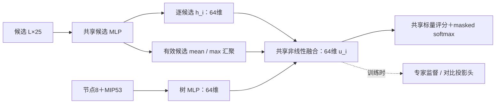

# TGPPO 轻量 Actor：文献调研与方法选择

日期：2026-11-05（北京时间；UTC 2026-11-04）。状态：调研与设计交付，等待验收。**本轮没有实现新网络、训练、GPU 作业或新增 SCIP 求解。**

用户已确定：专家预训练作初步验证，主线为“轻量 Actor＋有监督约束的表示学习＋PPO”；分别检验结构和训练信号的增量。CR 线暂时终止；树信用分配后置，先解决全局 PDI 目标适配和未完成子树问题。保留现有 25/8/53 维特征。

## 1. 建议先选什么

**轻量化不等于缩小 Transformer。当前优先研究无注意力的、树状态条件化的候选集合网络；以少量诱导点注意力为第二候选。** 这两个模型都能替换整条 Actor 编码—交互—评分链，直接输出当前候选分布。

| 顺序 | 模型路线 | 本项目角色 | 主要收益假设 | 必须验证的风险 |
|---|---|---|---|---|
| 必需对照 | 共享候选 MLP＋树条件化评分 | TreeGate 类廉价基线 | 最少计算即可学习有效排序 | 没有显式候选间交互；已有工作重合多 |
| **首选** | **Deep Sets 式局部候选表示＋mean/max 集合上下文＋树条件化评分** | 主方法第一候选 | 避开重自注意力，同时保留候选比较和候选身份 | 固定宽度汇聚可能不足；实际求解质量待测 |
| **第二候选** | **1 个 ISAB，少量诱导点＋共享评分头** | 汇聚表示不足时的升级 | 用内容相关的多通道交互代替单一集合摘要 | 两次交叉注意力有常数开销，小候选集合未必划算 |
| 公平容量参照 | 1 层、64 维小 Transformer＋相同读出 | 排除“只因原网络过宽过深” | 测清是否真需要改交互形式 | 也可能成为实测最合适的模型，不能预先排除 |
| 条件备选 | 非因果线性注意力 / Performer | 大候选数尾部明显拖慢时 | 避免构造 L×L 注意力矩阵 | 核特征维度和归一化开销；短集合未必快 |
| 条件备选 | 小型表格 ResNet / TabM | MLP 表示不足或方差过大时 | 更强特征学习或共享权重集成 | 参数少不等于计算少；TabM 不直接建模候选集合 |
| 后置 | 集合编码＋GRU/Mamba 历史模块 | 先证实历史信息有增量再考虑 | 利用有时间顺序的搜索事件 | CPU 内核、缓存一致性、循环 PPO 与历史归因增加实现成本 |
| 其他研究路线 | 符号表达式 / 传统学习排序 | CPU 强参照或后续解释性研究 | 部署可极轻 | 离散程序搜索不是当前可微 Actor＋PPO 的直接替换 |

排序是**适配程度与验证成本判断（E3）**，不是已测速度或 PDI 排名。以下来源和机制说明支撑此选择。

## 2. 我们到底需要怎样的网络

输入为候选集合 (X\in\mathbb R^{L\times25})，以及节点和 MIP 状态 (c\in\mathbb R^{61})。输出是 L 个候选的概率。对候选置换矩阵 P，要求：

\[
\pi(PX,c)=P\pi(X,c).
\]

这是**排列等变**：换候选顺序，概率跟着相同候选移动。集合整体分类的“不变”输出还不够；不能把候选全汇聚后只产生一个全局标量。动态 L、padding、合法动作映射都必须支持。[Deep Sets §2–3](https://arxiv.org/html/1703.06114v3)、[Set Transformer §3](https://proceedings.mlr.press/v97/lee19d/lee19d.pdf)提供了可用机制。

候选的枚举轴没有必须使用的时间顺序；求解器历次决策才有时间顺序，而且访问序列不一定等于一条根到叶路径。因此“用序列模型建模历史”和“把当前候选串成序列”应分开评价。双向扫描或训练时打乱顺序，通常也不自动获得对所有排列的严格等变性；这是从递推计算图得出的适配判断。

本地已有证据及其边界：

- **E1 已测**：原 Actor 为 4,738,895 参数；固定 50 状态、17 实例探针的 L 为 2–695，中位数 40.5。该分布不是完整部署分布。[原始汇总](../../diagnostics/tgppo_20261030/actor_offline_summary.json)
- **E1 已测**：历史 Actor 路径均值 20.863 ms/分支，约占 optimize 21.38%；完整回调 33.21% 包含 Actor，不能相加。Actor 路径包含输入转换、分布与采样，不能拿纯前向时间直接替代。[成本核验](../../diagnostics/tgppo_20261030/03_runtime_and_solver_diagnostics.md)
- **E2 源码**：5 层、宽度 256、8 heads、FFN 宽度 1024 的 Transformer，之后还有 BiMatching 与逐级压缩至标量的 TreeGate。[Actor](../../../tgppo/experiments/server-20261022/code/project/policy/actor.py)
- **E1 局部核验**：评分链弱响应和低维归一化问题有固定状态证据，但末端修正没有稳定传导为求解收益。[端到端核验](../../diagnostics/tgppo_20261102_end2end/REPORT.md)、[CR 跨实例结果](../tgppo_candidate_residual_20261104/cross_instance/REPORT.md)。不能把“轻量模型必然改善求解”视为已确认。

因此，目标是 **CPU 上单个 SCIP 状态的低延迟、可靠候选排序和可训练性**。一次前向应向量化处理全部候选；batch=1 指一个状态，不是每个候选单独调用网络。

## 3. 文献依据：哪些是真正不同的模型

### 3.1 共享 MLP、树条件化模型：本来就可以不使用 Transformer

[TreeGate，AAAI 2021](https://arxiv.org/html/2002.05120v3)，§3.1–3.3：候选共享 MLP、树状态条件化门控、relpscost 专家监督；使用候选及树的廉价特征。这说明**神经分支本身不必很重**。单纯去掉 Transformer、训练 MLP，与 TreeGate 已有设计高度重合，应作为必要基线，不能只改名字就算新贡献。

[Hybrid Models for Learning to Branch，NeurIPS 2020](https://arxiv.org/html/2006.15212v3)，§4.1–4.2：只在根节点使用较重的 GNN，之后用廉价候选 MLP；研究 CONCAT、FiLM、HyperSVM 等条件化方式。可借鉴“昂贵信息与便宜逐候选评分分开”的原则，**本轮不移植其根节点二部图**。树状态生成缩放参数或候选评分权重，也是一种低成本交互，不必每层做全候选注意力。

迁移判断（E3）：先比较简单共享 MLP 与集合上下文模型。如果二者质量相当，使用更便宜者。不要蒸馏当前近均匀 B0 的分布作为高质量教师；教师应是已有专家标签或另经验证的有效策略。

### 3.2 Deep Sets：最符合当前成本约束的无注意力集合 Actor

[Deep Sets，NeurIPS 2017](https://papers.neurips.cc/paper_files/paper/2017/hash/f22e4747da1aa27e363d86d40ff442fe-Abstract.html)，§2–3：共享编码＋交换不变的 sum/max 汇聚，可构造集合不变或逐元素等变网络。应用包括点云、集合异常检测；不是 MILP 求解结果。

本项目适配（E3）：每个候选保留自己的 (h_i)，集合摘要 z 只补充“其他候选是什么样”，再与树表示 t 一起进入共享的非线性评分器 (\ell_i=f(h_i,t,z))。无需构建 L×L 交互矩阵。比完全独立的 MLP 多了候选相对上下文；比完整自注意力少了候选两两匹配。

不能把汇聚定理当成“小宽度必然足够”的保证。[Wagstaff 等，ICML 2019](https://proceedings.mlr.press/v97/wagstaff19a.html)，Theorem 4.1/Discussion，说明连续 sum-decomposition 的通用表示能力受到集合规模与隐空间维度限制。其理论条件不能直接推出“我们的 64 维一定失败”，也不能证明特定分支策略必须有 L 维隐表示。实际检查大 L 状态上的专家拟合与泛化，必要时升级交互。

### 3.3 Deep Sets++ / Set Transformer++：归一化与信息路径也需要设计

[Set Norm and Equivariant Skip Connections，ICML 2022](https://proceedings.mlr.press/v162/zhang22ac.html)，§3.3、§4：分析逐元素 LayerNorm 可能去掉实值集合中有用的幅值信息，给出二维退化例子，提出 clean-path 等变残差和 SetNorm；实验含血细胞集合、点云等。

这与本地低维归一化现象相呼应，**不是该论文已经验证了 TGPPO 根因**。新设计保留较宽的逐候选表示直达评分前；不要重建 8→4→2→1 且在二维上归一化的链。这里指新 Actor 内的表示路径，不恢复已终止的 CR 外接评分捷径。

SetNorm 用每个集合整体的统计量进行标准化，仍会丢掉某些信息；padding 必须排除，零方差需要稳定项。首轮浅网络不必为了使用 DS++ 而增加深度或默认追加 SetNorm。只有拟合/稳定性证据需要时，单独比较归一化方案。[方法原文 §4.2–4.4](https://arxiv.org/html/2206.11925v2)

### 3.4 少量诱导点注意力：比单一汇聚更灵活的第二候选

[Set Transformer，ICML 2019](https://proceedings.mlr.press/v97/lee19d.html)，§3.1–3.4：ISAB 先让 m 个可学习诱导点读取 L 个输入，再让 L 个输入读取这 m 个摘要，输出仍有 L 个表示。编码器保持等变，交互由 L² 变为 Lm；PMA 则用于固定数量集合输出。

本项目适配（E3）：宽度 64、**1 个 ISAB、m=8** 为首个设计点，保留当前候选表示与树条件化共享评分。用 ISAB 编码器输出逐候选概率；不能直接拿一个 PMA 全局输出代替 L 个动作。m=8 不是论文对本任务验证过的最优值。

它允许不同诱导点学习不同的候选信息，可能比 mean/max 更能表达竞争关系，但仍有有限摘要容量。CPU 上两个交叉注意力加投影/FFN 的常数成本不可忽略，L 较小时可能不如一个小型完整注意力块。

[Perceiver，ICML 2021](https://arxiv.org/html/2103.03206v2)，§3.1，是“输入→少量潜变量→潜空间处理”的相关路线。其原模型主要产生整体预测；用于分支还需候选查询读回或局部表示结合摘要。当前没有必要另开一套深潜变量网络，优先采用接口更直接的 ISAB。

### 3.5 线性注意力：可选，但线性复杂度不意味着当前 CPU 更快

[Linear Transformer，ICML 2020](https://proceedings.mlr.press/v119/katharopoulos20a.html)，§3.2–3.4：将注意力改写为先累加核特征与 value 的统计量，再逐 query 读取；因果版本可写成递推。[Performer，ICLR 2021](https://arxiv.org/html/2009.14794v4)，§2.2–2.4、§4.1：用正交正随机特征近似 softmax 注意力。

本项目需使用**非因果全候选读取**，无候选索引位置编码；共享核映射与汇聚能保持候选等变。不能把按前缀递推的因果版本直接用在无序候选轴。核特征数 r、投影和分母稳定化都增加成本；L 小于 r 时，线性方案未必比小型 dense attention 便宜。

Performer 的随机映射若在 rollout 和 PPO 重算之间更换，会引入额外概率变化；未来实现应冻结或一致恢复随机映射。当前只作大候选数状态的备选，不先为其迁移环境。

### 3.6 现代表格网络：轻量模型并不局限于普通 MLP

[Revisiting Deep Learning Models for Tabular Data，NeurIPS 2021](https://arxiv.org/html/2106.11959v3)，§3：系统比较 MLP、表格 ResNet 与 FT-Transformer。这里 FT-Transformer 的注意力主要作用在一行数据的特征字段上，和候选之间的注意力是两条不同轴。

迁移判断（E3）：候选 25 维及树 61 维是数值表格特征，共享小 ResNet 值得作为低成本表示增强。不要把 FT-Transformer 默认复制到每个候选，再误以为已经处理候选竞争。其独立行模型仍需集合上下文才能产生显式跨候选交互。

[TabM，ICLR 2025](https://arxiv.org/html/2410.24210v3)，§3.3–3.5、§4.3：以共享权重的隐式 MLP 集成改善表格学习，TabM-mini 只保留首个适配器。其 46 个表格数据集结果支持 MLP 家族应被认真比较，**不直接证明 MILP 排序或 CPU 单状态延迟优势**。

论文默认 k=32；参数开销小仍需计算多个子模型。我们的第一轮不复制 32 路集成。若单 MLP 明显过拟合或多种子方差很大，再考虑小 k 版本，并实际计时；小 k 的收益属于本项目待测假设。

### 3.7 Mamba、Mamba-2、Mamba-3：优先用于有价值的历史，而不是按名称替换

[Mamba，COLM 2024](https://arxiv.org/html/2312.00752v2)，§3、§4.5：输入相关的选择性状态递推及硬件感知扫描；其优势证据主要来自长序列任务。[Mamba-2，ICML 2024](https://proceedings.mlr.press/v235/dao24a.html)，§6–7、§9.3：SSD 重写利用矩阵乘法和 GPU tensor cores，核心层速度结论有硬件与序列长度条件。[Mamba-3，ICLR 2026](https://proceedings.iclr.cc/paper_files/paper/2026/hash/8abd2043b71a074278d5f687947bff9c-Abstract-Conference.html)，§3、§4.4、附录 G：更丰富递推、复状态更新及 MIMO；其单步延迟实验为 1.5B 模型、d=2048、batch=128、H100。[实验条件](https://arxiv.org/html/2603.15569v1)

这些工作说明 SSM 值得考虑，**没有给出我们单线程 CPU、窄模型、短候选集合的胜出证据**。从 Mamba-1 换成 2/3 也涉及内核、维度及版本兼容，不能只凭代数复杂度判断。

[Mamba-Branching，ICLR 2026](https://proceedings.iclr.cc/paper_files/paper/2026/file/b2f56a345fe0ce337df3bdfb31e2b350-Paper-Conference.pdf)，§4、§5.4、附录 E/F/H：TreeGate 候选嵌入 hidden=64、输出 d=8，之后用 Mamba；专家约束的对比预训练后进行自回归模仿学习。评估使用最近 24 步＋当前状态。每步含多个候选，序列不是只有 25 个 token。表 16 的 0.93 ms 是 GPU 设置下的跨实例几何均值；不是 CPU 单状态 p50，也不是对我们原 TGPPO 的匹配消融。

适配判断（E3）：若后续证明历史有价值，先考虑“当前集合轻量编码＋一次历史摘要更新”，避免每次重新扫描全部历史候选。GRU 也是应保留的廉价历史对照。普通 Mamba/GRU 沿候选顺序递推没有严格等变保证；论文共享状态位置编码本身也不能消除这一性质。此处未复现顺序敏感实验，不给出其数值或性能影响。

跨时刻隐状态还要求 episode 重置、策略更新后状态一致性、连续序列训练/必要的 burn-in。当前随机 transition 的 PPO minibatch 不能原样套用；这是历史路线的额外成本，不能混进首轮纯 Actor 对照。

### 3.8 符号策略：部署可以更轻，但会改变研究路径

[Symb4CO，ICLR 2024](https://proceedings.iclr.cc/paper_files/paper/2024/hash/da669dfd3c36c93905a17ddba01eef06-Abstract-Conference.html)探索用较大生成网络搜索小符号表达式，再编译部署；[GS4CO，ICML 2024](https://proceedings.mlr.press/v235/kuang24a.html)进一步面向二部图输入生成符号策略。**训练用 Transformer 不代表部署的分支 Actor 也用 Transformer。**

两者可支持轻量分支的研究动机；当前只筛读官方摘要/可访问部分，GS4CO 正文未成功取得，不能据此比较预算和宣称对本项目更好。符号搜索不直接沿用当前可微 Actor 的 PPO 更新，GS4CO 还引入图输入；因此后置。传统树模型/学习排序也可作廉价监督参照，但不自动拥有当前神经 Actor 的 PPO 路径。

MLP-Mixer 的固定 token 混合不直接适配动态候选数和任意候选置换；KAN 的参数效率也不能代替 CPU 延迟验证。二者仅作筛选记录，不作为当前优先候选，见[文献台账](LITERATURE.csv)。

## 4. 推荐的第一个具体 Actor 草案（E3，尚未实现）

保留原输入归一化：候选 LN(25)、树 LN(61)；先用浅网络，不增加历史、不换特征或奖励。以下层数/宽度是验证起点，不是搜索得到的最优配置。

\[
\begin{aligned}
h_i&=\phi(x_i), &\phi &:25\to64\to64,\\
t&=\psi(c), &\psi &:61\to64\to64,\\
z&=[\operatorname{mean}_{j\in valid}h_j,\operatorname{max}_{j\in valid}h_j,\log(1+L)],\\
u_i&=\sigma(W[h_i,t,z]+b),&W&:257\to64,\\
\ell_i&=g(u_i), &g&:64\to32\to1,\\
\pi_i&=\operatorname{masked\_softmax}(\ell)_i.
\end{aligned}
\]

log(1+L) 从已有候选数计算，不增加求解器特征提取；用于补充 mean 汇聚缺失的规模信息。mask 必须用于汇聚和最终 softmax，不能让 padding 污染上下文。无候选时不调用 Actor；L=1 的合法输出为概率 1。

按上述带 bias 的 Linear 计：候选编码 5,824、树编码 8,128、融合与评分 18,625，共 **32,577**；再加输入两个 LayerNorm 的 172 参数，合计 **32,749**。这是**公式静态估计**，不是实装或训练结果；预训练投影头另计，推理时移除。参数约为原 Actor 的 1/145，不能解释成延迟加速 145 倍。

关键设计条件：

1. **保留候选自己的表示到最后。** 全局 z 只补充上下文；这是新 Actor 的完整输出链，不在旧 B0 logits 上加残差。
2. **树/集合信息必须与候选发生交互。** 若只写 (\ell_i=a(h_i)+b(t,z))，公共偏置 b 会被 softmax 抵消。采用拼接后的非线性映射；FiLM/双线性条件化可作后续同预算对照，首轮不一起加入。
3. **监督高维表示与动作。** CL 接 32/64 维表示或其投影，不在单个标量 logit 上做余弦对比；一维余弦会退化。专家动作只进训练标签，不进 Actor 输入。
4. **先使用单个集合摘要层。** 若大 L 的拟合确实较差，再比较 1 个 ISAB；不无依据叠多层 DS++ 或潜变量注意力。

复杂度判断，d 为宽度，m 为诱导点数，r 为核特征数：

| 结构 | 粗略前向主项（固定小深度） | 当前成本含义 |
|---|---|---|
| 原 K 层 Transformer | (O(K(Ld^2+L^2d))) | 不能只盯 L²；宽 256 的投影/FFN 也昂贵 |
| 共享 MLP / 上述集合模型 | (O(Ld^2))，汇聚 (O(Ld)) | 原生矩阵运算易实现；仍需同机实测 |
| ISAB | (O(Ld^2+md^2+Lmd)) | 固定 m 对 L 线性，但有两次交叉注意力 |
| 非因果核注意力 | (O(Ld^2+Lrd))，另计核映射 | r 与归一化决定实际收益 |
| 历史序列 Mamba | 随真实序列长度 S 线性，另计宽度/状态项 | 序列化全部历史候选时 (S\approx\sum_t L_t+\text{动作数})，不是只有历史步数 |

这些是算法主项而非计时；共享权重、量化或剪枝也不能保证低延迟。先得到 FP32 的有效轻量策略，再判断是否值得做部署压缩。

## 5. 训练信号怎么分开，而不是把所有变化一起加上

**先 BC 验证可学性，再比较 CL 是否在相同标签和预算下额外有效，之后用原 PPO 微调。** 原 Critic、H3、GAE、采样和评价设置首轮保持同一协议，不混入树信用分配或奖励新目标。

- BC：同一状态合法候选上的专家动作交叉熵。它训练的是模仿专家，不是直接优化全局 PDI。
- CL：借鉴 Mamba-Branching 的**状态内、专家动作约束**思想，对宽表示做辅助约束，再接相同 BC。专家未选候选不等于反事实一定差；没有完整分数时不虚构排序/并列标签，也不把所有候选彼此拉远。不能把不同实例的“第 i 个变量”当同一语义类别。
- PPO：从各自初始权重开始真实 on-policy 采样；专家轨迹只用于预训练或明确独立的监督损失，不能冒充新策略采样的 PPO 轨迹。首轮预训练后不额外混入 BC 正则；如出现遗忘，再将持续监督/KL 约束设为独立因素。

最小方法主表是下面 **2×2**。此处是设计，不是已提交的 8 个训练作业：

| 组别 | Actor | 训练流程 | 比较回答的问题 |
|---|---|---|---|
| A | 原 B0 架构 | PPO | 当前参照 |
| B | 原 B0 架构 | BC→PPO | 原结构下专家预训练的增量 |
| C | 选定轻量 Actor | PPO | 无专家预训练时结构改动的增量 |
| D | 同一个轻量 Actor | BC→PPO | 轻量化后专家预训练的增量；与 B 比同训练流程的结构收益 |

先在本地离线阶段选择一个轻量结构，再固定 C/D。MLP、集合汇聚、ISAB、小 Transformer 的离线对照用于解释是否需要候选交互，**不把每个候选都展开成完整 GPU 矩阵**。旧 A 的结果仅在协议、预算、训练硬件和选择规则可匹配时复用；不能拿过去异构硬件作业直接拼成公平主表。

D 有效后，才增加 **E：同结构 CL+BC→PPO**，并给 D 一个额外 BC 更新数/计算预算匹配对照，避免把多训练几步的收益全算作 CL。若要声称纯监督标签的价值，还需明确额外数据/离线计算因素；上述 2×2 的“预训练增量”包含这部分成本，不能隐去。

专家 top-1/NLL、表示敏感性和策略熵是中间指标；最终主张仍依据配对 PDI、证明率、完整求解墙时及回调成本。训练种子与 solver 重复分层报告；两训练种子只构成初步重复。

## 6. 节省试错成本的执行入口与停止条件（下一阶段提案）

**第一个可执行阶段限于现有数据适配＋离线筛选；建议本地单线程累计计算上限 600 秒。此预算是提案，本轮未执行。** 到限提交已完成结果，不把 CPU 小试转交用户申请 GPU。

| 顺序 | 工作与成本控制 | 通过才继续 | 停止/收缩条件 |
|---|---|---|---|
| 1 | 审计 Mamba 已有轨迹的 feature/action schema、SCIP 版本与实例归属；少量合法样本读取 | 特征语义、缩放、候选映射一致或有可解释转换 | 标签/顺序不可靠则不训练、不直接重新采集全部数据 |
| 2 | 独立实现共享 MLP、集合 Actor，必要时仅加 ISAB 与小 Transformer 的固定配置 | padding、等变、动态 L、梯度/概率合法 | 任一正确性问题先修复，不进入真实 PPO |
| 3 | 同机同线程 FP32 eval 微基准，固定已有训练状态；先少量重复估计耗时再分配剩余预算 | 质量候选同时有可测成本优势 | 新候选成本无优势或被更简单模型同时在质量/成本上压倒，则淘汰 |
| 4 | 相同合法专家样本、固定小步数做 BC 可学性和按实例隔离的验证；先 MLP/集合两组 | 能拟合训练标签且有跨实例验证信号 | 只能记忆训练实例、分布仍近均匀，或到 600 秒即停止，不盲目扩训练 |

微基准同时记纯 forward 与“输入转换→分布/动作”路径，记录冷/热调用、逐调用 p50/p95，区分模型加载；L 分层并保留真实状态频率。使用相同 PyTorch/CPU/线程设置。不得把跨实例均值的分位数当逐调用 p95，也不从固定 50 状态探针外推完整部署尾部。

为避免筛选时临时放宽标准，建议预先采用两个初步门槛（E3，工程目标，非论文预期效果）：热调用 Actor 路径的 p50/p95 均不高于同机 B0 的 50%；按实例平均的留出集 (\mathrm{NLL}/\log L\) 在 L>1 状态上不高于 0.90（均匀分布为 1）。同时披露各实例、候选数层和拟合集表现；门槛只用于排除没有成本或学习信号的方案，不代表通过后就有求解收益。若原 B0 的小步 BC 仍无响应，不据此否定轻量 Actor 的 BC；两者结构条件不同。

已有 Mamba 数据是省成本入口，不是即用数据：19 个训练实例中仅 **15 个**属于 TGPPO train；dcmulti、eil33-2、neos-476283、vpm2 属于 TGPPO development，不能混入预训练拟合或归一化统计。475 条提交记录及原始 HDF5 存在，尚未验证可转换；SCIP 8.0.4/无 cutoff 与当前 6.0.1/cutoff 的分布差异必须披露。[此前清单核对](../tgppo_post_cr_20261105/TREE_CREDIT_CLARIFICATION_20261105.md)、[Mamba 划分](../../../mamba-branching/configs/milp-s-instances.json)、[TGPPO 划分](../../stage1/protocol_draft.json)

数据划分以实例为单位；不能从同一条轨迹随机切状态，就称跨实例验证。先在合法训练实例内固定拟合/留出划分，开发集作模型选择，已反复查看的 66/8 实例保持探索身份。预训练标签 relpscost 也不代表全局 PDI 最优。

上述离线关口通过后，才按实际吞吐给出真实 PPO 的固定预算和 Custom 配置。先保证 BC 初验及一个主结构的最小对照，不同时投入历史、TabM、符号搜索等支线。周五只汇报实际完成的结果；新结构目前只能作为有文献支持的方法设计，不能将本调研或既有瓶颈诊断计作新增求解性能成果。

## 7. 方法贡献能声称到哪里

Deep Sets、ISAB、FiLM、专家 BC 和对比预训练都已有先例。**“把这些接到 TGPPO”本身不足以宣称新算法或最先进模型。** 当前值得验证的问题是：在既有廉价特征和 CPU 部署约束下，候选集合交互能否用很小成本保留决策质量，监督表征是否使这种轻量策略更容易经 PPO 优化。

可形成的证据链应为：

1. 相比原 TGPPO，完整 Actor 路径的成本降低，并且最终求解质量有可接受或更好的表现。
2. 相比同训练流程的独立 MLP/TreeGate 类对照，集合上下文或诱导交互确有增量；小 Transformer 解释不了全部收益。
3. 相比同结构纯 PPO，专家预训练改善可学性/样本效率；相比普通 BC，CL 还需证明其独立增量。
4. 所有增量都以真实求解而非仅准确率/表示图支撑，负例和原生 relpscost 强基线完整保留。

若只有加速而质量保持，应按效率结果汇报；若只有 BC 有效，先汇报初步学习收益；若 CL 没有额外收益，不为了方法复杂度强行保留。树信用分配仍按[前次目标与截断风险说明](../tgppo_post_cr_20261105/TREE_CREDIT_CLARIFICATION_20261105.md)后置。

## 8. 调研范围与交付索引

本轮为针对本项目的系统比较，不声称穷尽全部文献。检索轴为：廉价 MILP branching、集合等变模型、线性/诱导注意力、表格 MLP、SSM/历史模型、符号策略；覆盖相关顶会基础工作与 2024–2026 代表工作，优先官方 proceedings、作者论文与官方代码。只收录已核实来源；不因新模型名称或 LLM/GPU 排名提升就判断适合 CPU branching。

- [LITERATURE.csv](LITERATURE.csv)：19 项来源，逐项记录会议、阅读章节/程度、CPU 证据边界、开源入口和取舍。15 项核读相关方法/条件，1 项部分阅读，3 项仅筛读；均不表示全文逐段精读。
- [MEETING_BRIEF_20261106.md](MEETING_BRIEF_20261106.md)：面向方法选择的一页摘要，无新增实验成绩。
- [verification.json](verification.json)：静态参数计算、链接和受保护源码检查结果；不是网络运行或训练验证。

本阶段完成后停止，等待验收；下一阶段建议先执行第 6 节的本地离线关口。
