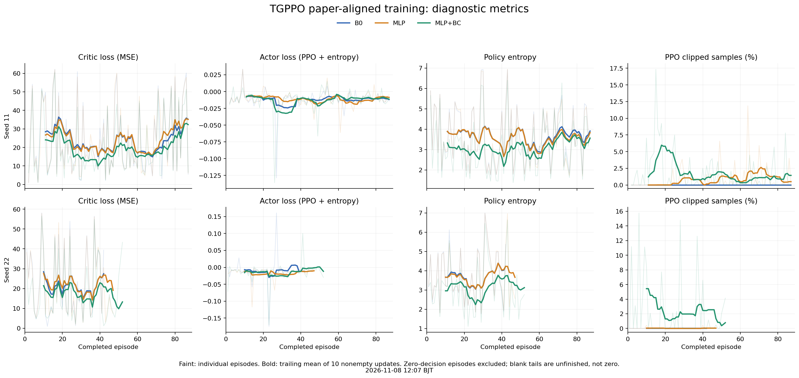
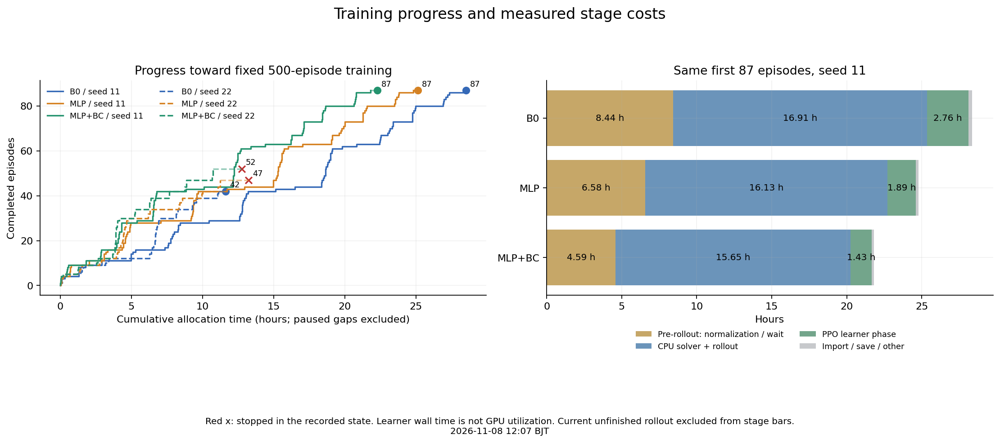

# 训练曲线与下一步建议

**后续核验补充（2026-11-08）：** B0的clip=0现已联合固定状态输出、梯度和逐层记录确认存在候选评分链弱响应；不能再只把它当作一般提醒或等待100求解才检查。此前曲线数值正常不代表B0策略学习健康。详见[最新B0学习核验](../../../diagnostics/tgppo_20261108_b0_learning_audit/REPORT.md)。下文100监控仍只能用于求解表现观察，其新增执行尚未启动。

数据读取时间以 `SNAPSHOT.json` 和图底部北京时间为准。本次仅读取现有训练 JSON／文件时间绘图；训练、模型、检查点、预算与正式评测入口保持原样，没有新增求解。

## 建议：固定100做训练内监控，固定500做正式评测

建议在三组 seed=11 都生成 `actor-0100.pt` 后，额外做一次小规模 CPU 训练内监控。当前三组均87，不宜把种子22的42／47／52与种子11的87混成同预算模型排名，也不宜让评测直接追着不断变化的 `latest.pt` 读取。

这一监控回答：原Actor和MLP在真实求解上是否有响应，PPO相对各自初始化是否改善，以及BC信号是否在PPO后保留。它不能证明跨实例／跨种子稳定泛化，也不承担独立开发集选模功能。全部25实例已经用于训练，原来的5个开发实例也不再是独立开发集。

建议的小面板（仅提案，本次未启动）：

- 训练实例固定为 `dcmulti`、`l152lav`、`comp21-2idx`，覆盖不同候选规模／求解成本；这些已见实例只用于训练监控，不冒充未见测试集。
- B0、MLP、MLP＋BC，先用训练种子11，分别评估0和100的固定Actor；其中MLP＋BC的0是BC初始化后、PPO之前。
- solver seed固定0，Actor-only部署，SCIP仍为3600秒；节点、PDI、证明状态及Actor实际调用成本都记录。原生relpscost与模型同机配对；仅当既有3600原生记录的主机和完整求解身份都匹配时复用，否则补测。
- 最多18个模型任务＋3个原生，共21项；4个单线程CPU worker时，所有任务触顶的纯搜索排程约6小时，另计准备、保存和过冲。若3个原生都可复用，则只新增18项。不能把它当作分钟级离线任务。
- 先看seed11的训练信号；seed22恢复并到100后，再按同面板核对。只测一个训练种子不能声称跨种子收益。
- 监控使用独立入口／结果目录，保持当前正式入口“六组500齐全才评66”的门槛。正式主对照依旧固定500；不根据中途结果在66测试集挑权重。若后续根据监控改变方法或训练设置，应单独登记为新实验。

眼下先恢复seed22的MLP和MLP＋BC，它们在快照中仍为stopped。这里没有自动提交Custom或更改平台调度。

## 如何看损失图



上排seed11，下排seed22；蓝色B0、橙色MLP、绿色MLP＋BC。横轴是完成的episode。淡线为每次非空更新，粗线为最近10次非空更新的均值；空episode没有伪造零损失，未训练到的右侧保持空白。

1. **Critic loss**：当前先下降、随后波动／回升，没有持续下降的收敛证据。seed11三条曲线在相近位置一起起伏，与共同实例序列造成的目标变化相符；这不是已经分离出实例难度因果影响的证明。不同策略访问的状态和回报目标也会变化。
2. **Actor loss**：含PPO策略项与熵正则项，不能按监督学习的固定目标误差解释。“更负”不直接等于求解更快，也不要求跨episode单调下降。
3. **Policy entropy**：反映动作分布的分散程度，同时受候选数影响；不能直接用不同实例上的原始熵判定探索是否足够。MLP＋BC较低的熵也不等于更好的求解策略。
4. **Clip fraction**：反映PPO更新中触发概率比截断的样本比例。当前B0所有已记录更新为0，MLP／MLP＋BC有非零值；B0更新幅度值得后续关注，但0不能单独证明梯度为0、参数不变或没有学习。

所有已读取的完整更新没有发现非有限指标。数值正常仅表示目前未记录NaN／Inf，不代表方法效果已经验证。损失图是训练诊断图，不是固定求解面板上的学习效果曲线。

## 如何看进度与耗时图



左图：横轴累计作业执行时间，扣除了两次申请之间的停机间隔；实线为seed11，虚线为seed22。红叉表示读取时状态记录为stopped。横线表示这段经过时间尚未提交下一个episode，不代表其间没有执行求解。该图不代替平台进程存活检查。

右图：三种方法使用相同的前87个episode。蓝色为CPU求解与采样；绿色为PPO更新墙时；黄色为采样前间隔，包括原生归一化、等缓存锁和部分I/O，当前记录不能将其完全分离；灰色是剩余导入／保存等开销。PPO阶段墙时不等于GPU内核活跃时间。

CPU阶段和串行采样主导耗时，增加GPU算力能覆盖的部分有限。三方法总时间还受到原生缓存建立先后和等待的影响，不能把进度图中的全部时间差都归因于Actor结构或BC。

## 文件与复画

- `01_training_metrics.{png,pdf,svg}`：六组损失、熵与截断比例。
- `02_progress_and_cost.{png,pdf,svg}`：累计进度和相同episode前缀的阶段耗时。
- `metrics.csv`、`windows.csv`：逐episode数据与20-episode窗口均值。
- `SNAPSHOT.json`：读时状态、预算、阶段统计和数值检查。
- `plot_curves.py`：只读绘图脚本，不导入模型或求解器。

可在本地刷新图，不需要GPU或Custom：

```bash
env CUDA_VISIBLE_DEVICES='' MPLCONFIGDIR=/tmp/tgppo-paper-curves-mpl OMP_NUM_THREADS=1 OPENBLAS_NUM_THREADS=1 PYTHONDONTWRITEBYTECODE=1 \
  /home/duweiyue25/conda/envs/rl4scip/bin/python \
  /home/duweiyue25/tgppo-transfer/research/docs/methods/tgppo_paper_aligned_20261106/training_curves_20261108/plot_curves.py
```
