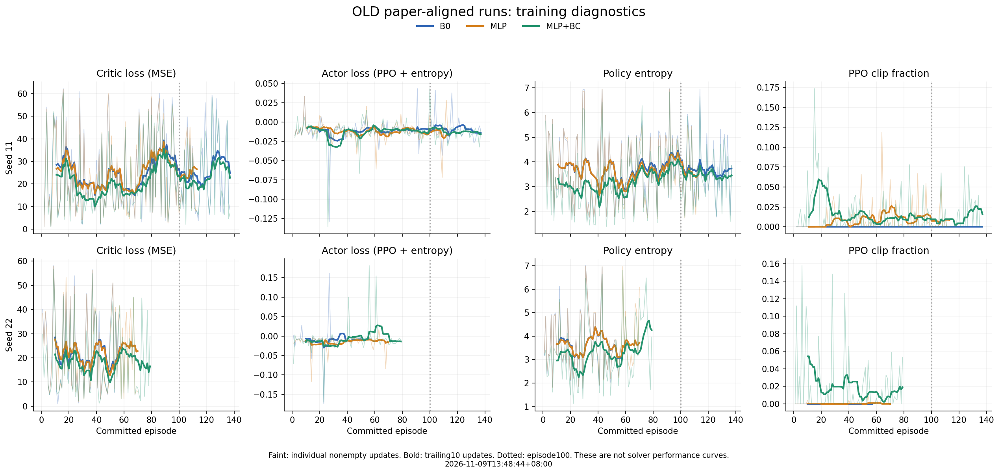
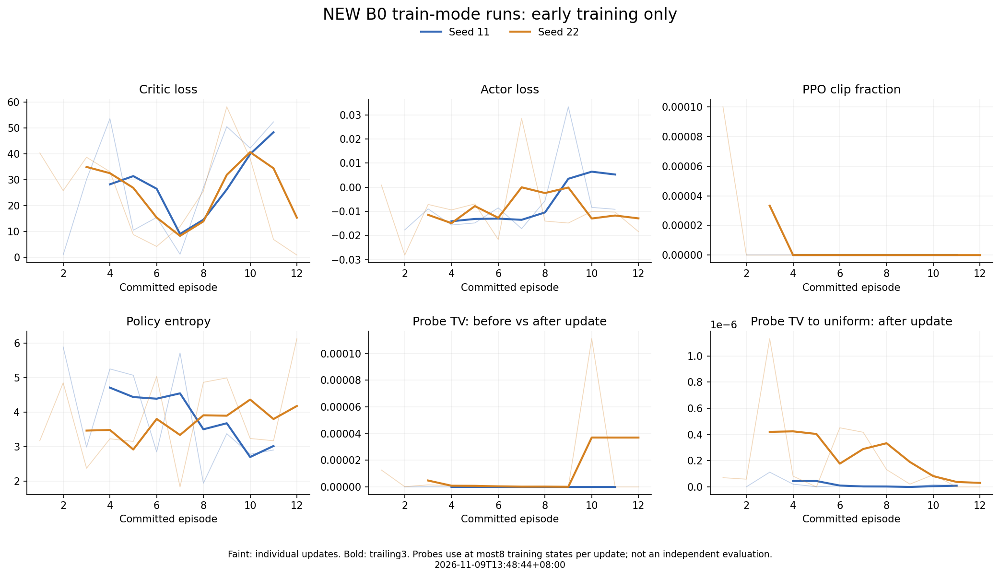

# 当前进度、训练曲线与100检查点监控建议

读取时间：2026-11-09 13:48（北京时间），详见 SNAPSHOT.json。
本次只读提交记录和固定Actor文件，绘图未导入模型／求解器，没有训练或新增SCIP。
原11月8日图保持为历史快照，本目录保存新的PNG／PDF／SVG、CSV与复画脚本。

## seed22 新B0的CPU续训命令

申请4CPU／64GiB／0GPU Custom，执行：

```bash
bash /home/duweiyue25/tgppo-transfer/research/tgppo/experiments/paper-recovery-20261109/custom_recover.sh run --experiment trainmode --variant b0 --seed 22 --device cpu --resume --no-total-wall-limit
```

该CPU分支已经建立且停在12，重复命令恢复自己的latest，不从头初始化。
原CUDA分支与CPU续训副本分开保存。seed11的新B0可把22改为11。
快照中两个新B0的CPU分支均收到SIGTERM后停止，不能再把早先normalization状态称为仍运行。
新B0-seed11原GPU分支又出现episode12缓存身份错误；统一恢复入口处理CPU型号迁移。

## 哪几组已经超过100

| 实验与方法 | seed11完整episode | 有效PPO更新轮 | 固定actor-0100.pt |
|---|---:|---:|---|
| 11/06 paper-aligned B0（Actor更新eval） | 137 | 132 | 有 |
| 11/06 paper-aligned MLP | 113 | 108 | 有 |
| 11/06 paper-aligned MLP＋BC | 137 | 132 | 有 |
| 11/08 trainmode 新B0（Actor更新train） | 11 | 10 | 无 |

新B0-seed22为12次完整episode／12次有效更新，也没有100检查点。
CPU分支当时尚未提交新增episode；其updates目录为空不等于从零训练，历史曲线保存在父实验。
全部训练的正式目标仍是500；完成100不等于已经收敛或完成正式训练。

## 曲线结论



上排seed11，下排seed22；粗线为最近10次非空更新均值，虚竖线为100。
没有达到的episode不补零。图中的旧实验是11月6日500／3600协议，不是11月5日100／120实验。

- 已读取提交记录未发现NaN／Inf指标，但这不等于策略学习或求解收益已经验证。
- Critic loss明显起伏，未呈持续下降；seed11前20次／最近20次非空更新均值，
  B0为27.82／28.85，MLP26.47／25.15，MLP＋BC23.58／25.80。
  不同episode来自不同实例／solver，目标与访问状态在变，不能把这几项均值当固定分布上的收敛检验。
- 旧B0-seed11的132次有效更新clip均0；MLP有39/108次非零，MLP＋BC62/132次非零。
  后两者表明存在概率比变化并触发截断，不能由此推导PDI或证明率改善。
- Actor loss含PPO和熵项，不能按监督训练“越低越好”解释。



新B0单独作图，粗线只取最近3次非空更新。
seed11的10次有效更新clip均0，seed22的12次中仅1次微小非零；
每次至多8个训练探针上的更新后距均匀分布TV中位数分别5.41e-9／7.66e-8，
10/10和11/12次低于1e-6。当前尚未看到这些探针上稳定的强候选偏好；
不是新模式已经修复候选弱响应的证据，也不足以凭11／12个episode判定长期训练最终失败。
探针仅来自部分训练状态，不能代替固定实例求解评测。

## 现在是否评测

可以先对旧三组固定100做训练内监控；不能拿旧B0的100当作新trainmode B0的100。
旧三组100权重位于原 `paper-aligned-20261106/training/<variant>-s11/actor-0100.pt`，
CPU续训副本没有复制历史里程碑，监控读取原固定文件，不读取变化中的latest。

沿用此前提案：dcmulti、l152lav、comp21-2idx，solver0，三方法各0／100权重，
18模型＋3个同机原生＝21任务，保持3600秒，观察PDI、证明完成、节点与实际部署开销。
4个单线程CPU worker若所有任务跑满，纯搜索排程约6小时，另需准备／保存／过冲裕量；不需GPU。
六份固定Actor的路径与SHA已读取核实，见 MONITOR100_PROPOSAL.json。
**这仍是未执行的提案，本次没有启动21项求解或写入训练目录。**

该小面板用于检查PPO相对初始化的真实响应，是已见训练实例监控。
全部25实例已进入训练，原5开发实例也不能当独立选模集。
新B0到100后可加入相同面板做中途对照；正式主对照继续固定500，
不根据这些曲线或66测试集挑中途权重。当前3600秒检查点尚无本轮中途求解结果，
不能借用此前120秒测试表来回答其性能。
