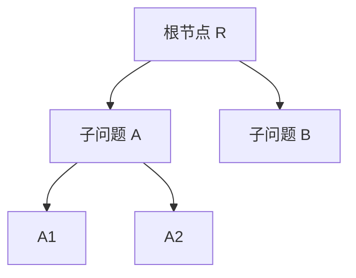

# 树信用分配答疑与方法优先级修订

日期：2026-11-05（北京时间）。用户反馈后的补充说明；只读核对源码、数据清单和论文，没有训练、求解、权重修改或重新启动 CR。[原调研报告](REPORT.md)及其核验记录保留，本说明更新方向判断。

## 1. 先修订前两条建议

专家预训练适合作为低成本学习验证，单独接到原 TGPPO 上不足以形成强方法贡献。建议后续设计围绕**轻量候选集合 Actor＋有决策标签约束的预训练＋PPO**展开；这是一条待验证路线，不预设它已经有效或新颖。

当前输入已经是 TreeGate 体系的候选 25 维、节点 8 维、MIP 53 维特征。后续优先压缩模型计算，保留该输入；完整二部图缓存不是当前瓶颈的直接对应方案。神经/原生切换分类器降为备选：当前神经策略缺稳定质量优势，另训练调用分类器会增加标签与归因难度。

原 [Actor](../../../tgppo/experiments/server-20261022/code/project/policy/actor.py) 有 5 层、宽度 256 的 Transformer，再接 BiMatching 和 TreeGate，约 474 万参数。可研究以共享候选编码、廉价集合上下文、树条件化评分替代整条重编码链；这是整体 Actor 结构对照，不能以新名称恢复已终止的 CR 捷径。已有去 Transformer 实验两组均近均匀，只能说明资源差异，不能证明轻量模型保持了决策质量。

[Mamba-Branching，ICLR 2026，§4.1/§5.4](https://proceedings.iclr.cc/paper_files/paper/2026/file/b2f56a345fe0ce337df3bdfb31e2b350-Paper-Conference.pdf)可借鉴的是用专家动作约束候选表示并对照普通监督预训练。其正例是专家选中候选，不是任意把所有候选拉开；对比学习、模仿学习已有先例，不能直接计作新的方法贡献，也不需要因此移植整个 Mamba。

一个可节省采样的事实：按[现有 Mamba 划分](../../../mamba-branching/configs/milp-s-instances.json)与[TGPPO 冻结划分](../../stage1/protocol_draft.json)对照，Mamba 的 19 个训练实例中，15 个属于 TGPPO train；另外 dcmulti、eil33-2、neos-476283、vpm2 属于 TGPPO development，不能混入预训练。已有 475 条轨迹的提交完整性记录存在，且原始 HDF5 在盘。这里仅确认清单交集与文件存在，**尚未验证转换可用性**。SCIP 8.0.4 与 6.0.1、无 cutoff 与 cutoff 采集状态的差异，要求先核对特征含义、缩放、候选顺序和动作标签；旧数据可作 BC/对比预训练候选，不能作为当前版本的 on-policy PPO 回放。优先检查复用可行性，再决定是否需要新增专家采集。

## 2. 树信用分配具体改变什么

TreeGate 用树状态影响当前动作；树信用分配决定训练时把哪些后果用于评价该动作。二者可以独立存在。原 TGPPO 已有树条件化 Actor，训练目标仍由时间顺序的 GAE 产生。

[当前 Agent 的 `_compute_gae`](../../../tgppo/experiments/server-20261022/code/project/agent/agent.py)实际采用：

\[
\delta_t=r_t+\gamma(1-d_t)V(s_{t+1})-V(s_t),\qquad
\hat A_t=\delta_t+\gamma\lambda(1-d_t)\hat A_{t+1}.
\]

这里的下一状态是下次实际访问的分支状态，可能来自另一子树。时间顺序 GAE 本身不是错误；研究问题是这种顺序在当前观测和奖励下，是否带来较难估计的长期信用。

节点选择器可能按 `R → A → B → A1 → A2` 访问。假设一个简化情形：A、B 的后续搜索相互独立，A 的某次分支使后代只需 6 个节点，而 B 仍需 1000 个节点。时间顺序的后续总成本会把 B 的成本也带入 A 的样本回报；树回报则主要用 A 的后代成本评价它。在独立条件下，B 的这部分对 A 的动作评价可形成噪声。实际求解器中的独立性需要核查，不能直接删除所有其他子树的回报。

对于完整、可按节点加总的树大小目标，可以概念性地写成 \(G_v^{tree}=-|Desc(v)|\)，再用 \(A_v^{tree}=G_v^{tree}-b(s_v)\) 学习候选选择。后代不含当前节点；加入当前节点的单位成本不影响同一状态下的动作比较。实际只观察所选动作的子树结果，不知道未选候选的反事实子树大小，仍需要统计学习。

这个例子**没有给出当前 H3/PDI 下可直接运行的 Tree-GAE**。当前 H3 是两次回调之间的全局进展混合量，不能仅按节点身份重新分组，就声称得到了局部子树奖励。

## 3. 文献依据及原结论的范围

| 工作 | 支持的机制 | 迁移时要保留的边界 |
|---|---|---|
| [Tree MDPs，NeurIPS 2022，§4/§5](https://arxiv.org/html/2205.11107v3) | 在树 Markov 与可分解奖励等条件下，推导以后代回报加权的策略梯度 | 实验为 GNN＋REINFORCE、主要优化树节点；不是全局 PDI 下 PPO 的保证 |
| [Retro Branching，AAAI 2023，§4–6](https://arxiv.org/html/2205.14345v3) | 将搜索树事后拆成同子树内较短路径，再训练 DQN | 属于改变转移/辅助目标的另一条路线，不能把重排后的旧轨迹直接当原 PPO 的新鲜轨迹 |
| [SORREL，AAAI 2025，Method](https://arxiv.org/html/2412.15534v2) | 在树上以随机子节点路径定义回报，再结合示范及 PPO/SIL | 其局部双界改进目标是代理目标，不等于我们的最终墙时 PDI；整体结果也不能单归因于树信用 |

Tree MDPs 表 1 的同规模测试节点几何均值中，MDP→tMDP+ObjLim 在 Facility Location 为 393.2→325.4（约−17.2%），在 Combinatorial Auctions 为 86.7→87.0（约+0.35%）。该表限于共同成功求完的运行，指标是节点而非 PDI。文献说明这个机制可能有价值，也说明终态收益依赖任务，不能搬用其百分比作为本项目预期。

## 4. 在原 TGPPO 上要改哪些部分

| 部分 | 必需变化 |
|---|---|
| 训练采集器 | 记录稳定 node/parent/child 身份、分支动作、节点完成/剪枝状态；终止子节点未必触发 Actor 回调，需要事件信息 |
| Memory | 由单纯时间 transition 列表扩展到能重建树的数据；保存策略版本、未完成标志和相应训练状态索引 |
| 回报与优势 | 明确选用子树节点目标或局部界目标，按该定义产生 targets/advantages；不能直接把两子节点 V 相加替代原 GAE |
| Critic | 网络结构可以不变，但需重新学习新定义的价值目标；原 H3 的 value 不等于剩余子树成本 |
| PPO | ratio、clip 形式可以作为待验证实现保留，优势改为所选树目标；树策略梯度定理不自动保证这个 clipped surrogate 更好 |
| 部署 | 如采集关闭、Actor 输入与结构不变，则不增加 Actor 前向/参数；也不会减少原 Actor 延迟 |

这属于训练算法与轨迹建模的变化，可以与 Actor 轻量化分开消融。只把已有 Tree MDP/Retro 方法移植到 TGPPO，也不能自动宣称新算法。

## 5. 风险排序

1. **PDI 与子树代理目标错位。** PDI 由全局上下界和墙时共同决定。更小的子树未必更早推进全局界，不同节点的 LP 成本也不同。把回报换为子树节点成本，就是改变训练目标，不能承诺目标等价。
2. **树 Markov 条件未完整确认。** 本地固定最优 cutoff、关闭 primal heuristics，与 Tree MDPs 的 ObjLim 场景有相近之处，减少了 incumbent 更新的耦合。但本地保留 local separation，论文实验关闭根节点以后的 cuts；共享求解统计等也需核对。固定 cutoff 不能证明其余条件成立。
3. **时限导致子树未完成。** 120 秒常出现开放节点。若把当前已观察的后代数当最终成本，昂贵但未搜完的子树反而可能显得便宜；未访问不等于终止，不能将剩余 V 填零。只选已完成子树又会偏向容易样本。
4. **结构记录与归因容易出错。** 创建、访问、剪枝、LP 求解和 Actor 决策不是同一个事件；需要防止漏节点、重复归属和把兄弟串成父子。训练日志新增开销要记账，评估应关闭。
5. **当前 Actor 仍可能限制学习。** 更合理的 targets 不保证原评分链能形成可靠候选偏好；已有弱响应证据不能被新训练目标忽略。

如坚持全局 PDI 主目标，更稳妥的研究姿态是先保留时间顺序全局回报，将树信号作为需单独论证和消融的辅助目标。它也有权重冲突和代理偏差，当前还不是可直接定稿的主方法。

## 6. 收益预期与下一步定位

树信用分配最有依据的收益预期是**提高训练样本效率、减少部分信用噪声**；节点、PDI、证明率的增量都待测。它没有直接推理加速，训练侧采集和 target 计算反而多了工作，当前无法给出可信的本地 PDI 改善百分比。

相比之下，Actor 轻量化有可量化的成本机会：[历史计时](../../diagnostics/tgppo_20261030/03_runtime_and_solver_diagnostics.md)中 Actor 路径占 optimize 约 21.38%。在访问轨迹和其余成本完全固定的模型下，若**整个 Actor 路径**耗时减半，optimize 墙时约减少 10.69%；这是条件成本估算，不是实测加速或 PDI 预测，也不能把纯网络前向加速 2 倍当作整个路径加速 2 倍。

更新后的建议：先用可复用专家数据完成原 Actor 小试，再以**轻量 Actor 和监督/对比预训练的独立增量**作为主要方法设计；切换分类器不优先。树信用分配保留为后续算法方向，先明确 PDI 兼容目标与截断处理，再决定是否值得采集新树数据。三项不要在同一个首轮对照里一起更改。

本轮已完成解释和方案修订。新实验仍未执行，不自动提交 Custom、训练或求解。
