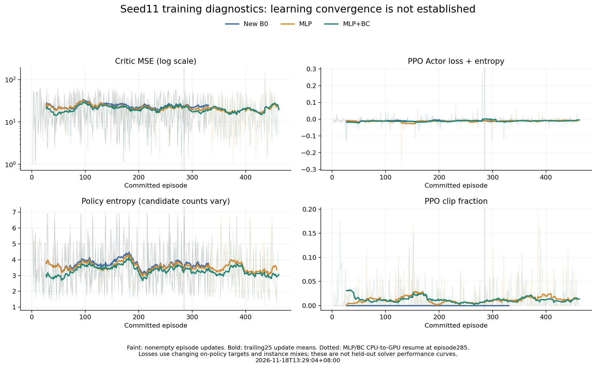
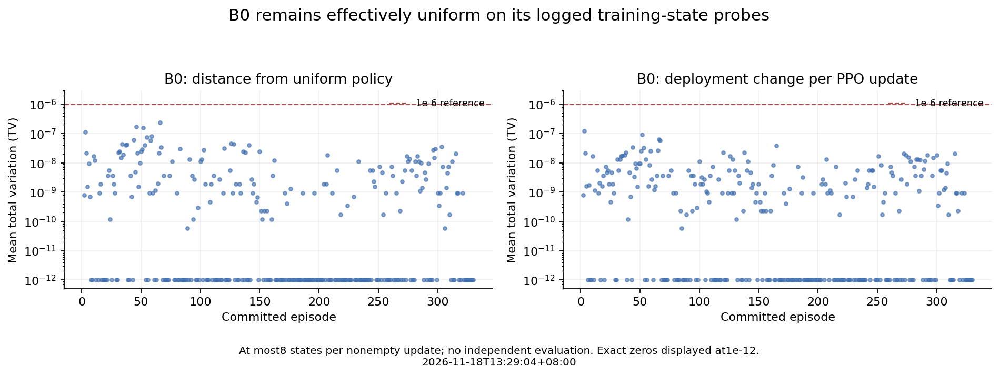

# seed11三模型：训练进度、曲线与收敛判断

检查时间：2026-11-18北京时间13:24的完整检查点快照；曲线严格截到该快照。三个执行锁均活动，状态为采样，近期持续提交新episode。未停止或修改训练，未新增训练、CUDA操作或SCIP求解。

**当前不能宣布三者均已收敛。MLP与MLP＋BC仍有策略学习、未见数值发散；新B0的Actor近均匀输出问题仍然存在，不能把曲线平稳称作有效策略已经学好。最新权重的实际求解效果尚未评测。**

## 1. 当前进度

| 模型 | 已提交episode | 真正执行PPO的episode数 | 零决策episode数 | 还有多少到500 |
|---|---:|---:|---:|---:|
| 新B0 · seed11 | 330/500 | 318 | 12 | 170 |
| MLP · seed11 | 458/500 | 440 | 18 | 42 |
| MLP＋BC · seed11 | 462/500 | 443 | 19 | 38 |

三份实际latest均已在CPU只读加载：配置含CUDA learner，Actor/Critic参数有限，内存无未提交轨迹，policy/update版本与完整日志的非空更新数吻合。V100目标设备合成桥接记录均passed。B0参数4738895，MLP两份24493；Critic三组均4804687。`state.json`与远端执行锁表明作业运行，但本地不能据此保证平台此后不会回收。

新B0已有200/300里程碑；两轻量模型已有300/400，历史200保留在来源及冻结评测副本。没有500检查点。

按最近50轮的经过墙时粗估：新B0约4.21轮/小时，还需约40小时；MLP约6.11轮/小时，还需约7小时；BC约6.66轮/小时，还需约6小时。只是吞吐外推，实例难度、归一化缓存、平台中断会改变时间，不是完成承诺。

## 2. 曲线怎么判断

浅色为每次非空episode更新，实线为最近25次非空更新的均值，横轴是已提交episode；虚线285标出两个轻量模型从CPU迁回GPU。原GPU→CPU→新GPU的各段按迁移游标接续，只计已提交前缀，不把祖先目录中未提交的更新JSON计入曲线。三组训练任务顺序逐项核对一致，差别来自策略与执行历史。

最近50个episode内的非空更新均值：

| 模型 | Critic MSE | Actor loss（含熵） | clip fraction | 策略熵 |
|---|---:|---:|---:|---:|
| 新B0（281—330） | 24.19 | −0.01174 | 0% | 3.657 |
| MLP（409—458） | 20.94 | −0.00812 | 1.23% | 3.322 |
| MLP＋BC（413—462） | 21.17 | −0.00724 | 1.20% | 2.962 |

窗口结束点及任务构成不同，不能拿这张loss表给三种模型排实际求解性能。PPO目标/优势和值函数标签随当前策略和实例变化；loss不会像固定标签分类任务那样必然单调下降。候选个数也变化，绝对熵的升降不能直接解释为变好、变坏或收敛。

**MLP：** 前三个完整125轮周期的Critic MSE均值为24.63→21.51→20.23，有价值拟合改善迹象；最近仍有明显任务波动。440次非空更新中202次clip fraction非零，最近50轮均值1.23%，不属于B0那种始终没有候选概率响应的模式。仍不能由此断言测试PDI已到平台。

**MLP＋BC：** 三个完整周期Critic MSE为21.28→21.08→19.71，整体改善后波动；443次非空更新中207次clip fraction非零，最近50轮均值1.20%。存在策略更新，不支持“BC初始化后完全没有再学习”的说法；没有同协议BC-only和最新固定权重评测，不能分离PPO的独立收益，也不能判定BC优势持续扩大。

## 3. 新B0为什么不能称作正常收敛

截至330，318次非空更新的clip fraction全部为0；这些更新的初始dropout clip fraction也全部为0。单独clip=0不足以证明没有学习，但现有部署模式探针还提供了另一条证据：

- 更新后概率与均匀概率的平均TV距离，318次全部小于1e−6，最大约2.44e−7。
- 一轮PPO前后部署概率的平均TV变化，318次全部小于1e−6，最大约1.22e−7。
- 最近多次记录两种TV都精确为0。这里的“精确为0”指记录的浮点结果，不是数学证明。

TV=0表示两个分布相同；这些数值表明**在日志覆盖的状态上，B0的候选概率几乎均匀，PPO更新前后几乎不变**。这是当前复现设置下的Actor响应不足信号，不是证明学到了好的排序。Critic仍可更新，Actor参数摘要也会变化；“参数在变”与“候选决策分布有意义地变化”是两件事。

探针每次最多8个状态，来自第一PPO minibatch的第一微批，且原微批会按候选长度排序；不能冒充全体状态或独立验证集。当前证据不能把根因直接归为论文网络必然有缺陷，仍保留既有复现/训练流程与作者权重未核验的边界。基线应继续按已冻结500协议记录，不因本次看图临时改变网络、学习率、GAE或solver时限。

## 4. 实际求解效果已经证明了什么

当前330/458/462权重尚未做独立的完整66实例评测。已有完整结果仍是固定200轮、solver seed0、3600秒CPU评测；seed11有MLP与MLP＋BC配对：

| 固定200轮、seed11 | 平均PDI↓ | 证明完成↑ |
|---|---:|---:|
| MLP | 29459.59 | 33/66（50.00%） |
| MLP＋BC | 26222.10 | 41/66（62.12%） |

BC对MLP的平均PDI下降10.99%，证明净增8例（＋12.12个百分点）。这是已确认的有限预算正结果；探索性实例bootstrap的PDI变化区间包含0，不能说均值收益已充分稳健。seed11 B0当时未到200，对应测试缺失；另有seed22 B0结果，但不能混成seed11三模型完整对照。

已有200结果不能证明当前最新权重会进一步改善。不能把100与200轮不同CPU/评测cohort的绝对PDI直接连成学习曲线；也不能把训练loss曲线当测试PDI曲线。

## 5. 接下来

建议保留正在运行的作业和原500终点。两轻量模型已接近500，完成后冻结其固定500权重；B0继续完成对照。随后在同实例、solver种子和CPU环境下做正式配对评测，补齐结构增量和BC增量。若B0仍需较久，可先准备评测任务和校验两份轻量500权重，不因进度差异把300/400冒充500或按测试结果挑检查点。

此次交付仅更新只读分析与图表，没有启动新评测、提交/停止Custom、调整训练参数或修改权重。

证据：[完整检查点快照](CHECKPOINT_SNAPSHOT.json)、[分析与窗口统计](ANALYSIS.json)、[逐episode指标及来源SHA](metrics.csv)、[分析脚本](analyze_curves.py)、[固定200结果复核](../tgppo_paper200_test66_20261113/RESULTS_REVIEW.md)。图表另有PDF/SVG版本。
