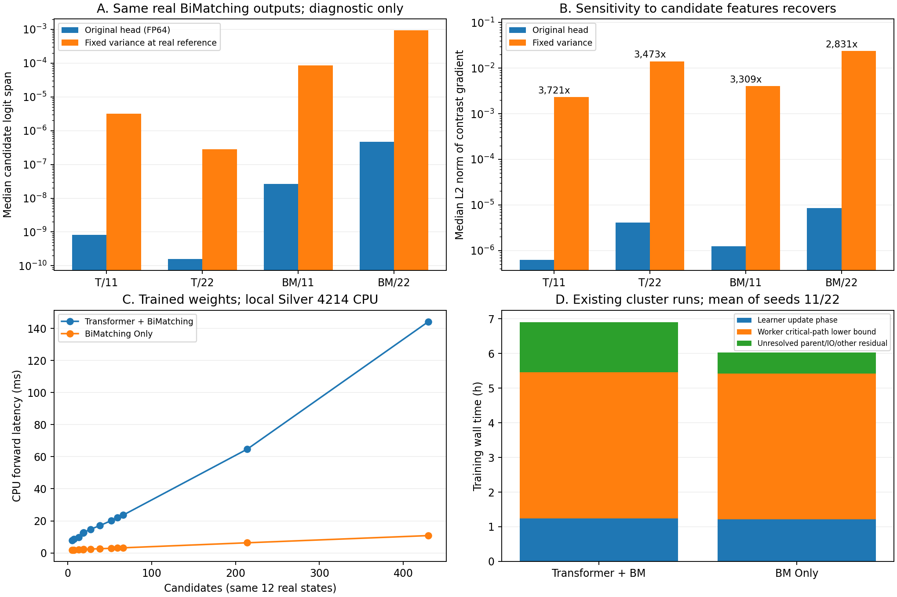

# 共同 Actor 输出头的因果诊断与受限性能归因（2026-10-28）

**已验证一个共同的关键退化机制：Tree-Gated Actor 头末端的 `Linear(4,2) → LayerNorm(2) → ReLU → gate → Linear(2,1)`，把候选之间的连续差异压成几乎相同的正负模式。** 对真实特征做局部干预，四个模型的候选 logit 差梯度中位数恢复2,831–3,721倍。该结构来自原始仓库，退化在初始化探针中就已存在。

随后完成了成本核算和小规模均匀策略对照。四个训练模型在本轮16组在线比较中，与均匀策略的候选特征哈希、候选数、动作序列及最终Gap完全相同。因此，目前能确认计算收益，仍不能判断Transformer的独立策略贡献。**本轮干预只用于诊断；尚未验证某个共同头修复能让PPO学成。**

## 1. 样本、保护与代码位置

- 对四个最终checkpoint，分别使用各自最后20个训练episode中的48/48/48/49个真实状态，共193个状态，候选4–511个；不截断候选。每个模型每隔4个状态检查梯度，共49个状态，所有干预使用完全相同的BiMatching输出和树特征。
- 对相同12个真实训练状态，重建两个种子、两种架构的初始化，并检查100/200/300/400/500里程碑，共24个模型时间点、288次前向。初始化摘要与原日志逐个匹配。
- 36项因果诊断检查、24项初始化/里程碑保护检查及6个新增单元测试全部通过。原始头在捕获特征上重放，与实际Actor输出逐位相同；原权重与checkpoint SHA256前后保持一致。
- 训练源码和冻结配置未改动。本轮文件位于本目录，另更新根README入口；未启动训练、选模或66实例正式测试。

真实实现位置：[Actor组装及前向](../../code/project/policy/actor.py)、[TreeGateBranchingNet及BiMatching](../../code/project/policy/modules.py)。共同模块文件在原始repo、server-20261022和本实验中SHA256均为 `959605658df62563d6d8145eda28838c61eb0c592188a85caa275450b55344aa`。

候选编码 `[B,L,256]` 与树编码 `[B,256]` 经原global_embedding连接后，Transformer保持 `[L,B,256] → [L,B,256]`；转回 `[B,L,256]` 交给BiMatching。BiMatching输出 `[B,L,256]`，头逐层压到128/64/32/16/8/4/2/1。候选mask最终在logits上置负无穷。本轮诊断固定BiMatching输出，单独改变头内算子，因此定位不依赖Transformer是否开启。

## 2. 为什么两维LayerNorm会丢失候选差异

设其输入两通道为 `x1,x2`，`d=x1-x2`。忽略可学习仿射项时：

```text
LN2(x) = [f(d), -f(d)]
f(d)   = d / sqrt(d² + 4ε)
f'(d)  = 4ε / (d² + 4ε)^(3/2)
ε      = 1e-5（真实代码的默认值）
```

当同一个状态下所有候选的d同号，且绝对值明显大于sqrt(ε)，输出趋近于同一组±1。随后的ReLU保留相同的正通道；tree gate在同一状态下对所有候选共用，最终线性层很难再区分候选。

193/193个末期状态均满足候选通道排序一致；各模型最小 `|d|` 分别为0.3687、0.05709、0.3446、0.1022。解析输出与PyTorch双精度结果最大误差5.56e-16，解析Jacobian与autograd最大误差1.57e-14。数学机制与实际输入、真实算子吻合。

初始化与所有里程碑的288次共享状态前向也全部保持同一状态内的通道排序一致。初始化与均匀分布的最大TV距离约1.26e-4，说明候选偏好从训练起点就很弱；并非只有训练结束后才出现。

## 3. 局部干预验证及边界

主干预保留原头的全部权重、均值中心化及gamma/beta，仅把LN2的方差分母固定为**该状态候选均值向量的方差分母**。在参考向量处，它与原LayerNorm输出一致，最大误差6.67e-16；因此保留参考激活区间，同时去除动态方差对两通道差值幅度的抵消。它是使用真实状态锚点的离线诊断算子，没有部署或训练。

下表的梯度为 `∂(logit_i-logit_j)/∂BiMatching输出` 的L2范数。i固定为第一个候选，j为与其特征距离最大的候选；各干预比较同一对候选。表中均为状态间中位数，倍率为两个中位数之比。

| 模型/种子 | 原头梯度FP64 | 固定LN2方差后 | 倍率 | 原logits跨度FP64 | 干预后logits跨度 |
|---|---:|---:|---:|---:|---:|
| Transformer/11 | 6.227e-7 | 2.317e-3 | 3,721× | 8.212e-10 | 3.194e-6 |
| Transformer/22 | 4.067e-6 | 1.413e-2 | 3,473× | 1.603e-10 | 2.784e-7 |
| BiMatching/11 | 1.222e-6 | 4.043e-3 | 3,309× | 2.677e-8 | 8.652e-5 |
| BiMatching/22 | 8.476e-6 | 2.400e-2 | 2,831× | 4.628e-7 | 9.269e-4 |

49个梯度样本还使用四个步长做中心有限差分核对，主干预每模型的最佳步长最大绝对误差均小于1e-7。额外控制如下：

- **FP32→FP64**：原头仍几乎均匀，单纯提高数值精度无法消除退化；部分FP32 logit差已主要落在舍入尺度。
- **只旁路4维LN**：四个模型没有一致恢复，不能解释为任意删除归一化都有效。
- **只增大2维LN的ε**：保持其余权重时，ε从1e-5增至1e-3/1e-2能恢复部分敏感性，符合解析导数；这些数值只作机制控制，没有用于调参选优。
- **直接旁路2维LN或替成原gamma/beta仿射**：两个seed11模型在48/48个状态中均得到完全相同的候选logits、零对比梯度，因为已有两通道进入ReLU前均为负。直接删除后处理旧权重，不能验证修复成功。

可确认LN2是这些状态上的严重信息/梯度瓶颈。**还不能断言它是全部PPO退化的唯一原因。** 干预后尤其Transformer模型的绝对logit差仍小，前面的逐层压缩、已训练特征和BiMatching自身的标量权重融合也可能限制区分度；本轮没有通过改BiMatching来补偿。

## 4. 在线均匀策略对照

保持原特征提取、SCIP分支回调、ActorPolicy和Categorical采样，读取四个已训练最终Actor；对照Actor输出严格均匀概率。五个策略共享动作随机数种子，在两个已有开发实例vpm2/dcmulti、SCIP种子0/1上各运行一次，共20次。节点上限200、保护时间30s，全部先达到节点上限。

四个已训练模型×四个案例，共16组比较：

- 完整候选数、候选特征字节哈希、动作索引序列：**16/16完全相同**，合计1,996个模型决策与均匀对照一致。
- 终点Nodes、Gap：16/16相同。Nodes=200本身由预算指定，不能作为策略质量相同的证据；完整动作与特征轨迹匹配提供了额外证据。
- Critic调用及fallback均为0，权重SHA256未变。

旧PySCIPOpt绑定将NODELIMIT映射为 `unknown`，冻结的生产指标又只接受proof/time终止。因此原始结果的 `status=unknown, valid=false` 原样保留；本诊断另外记录 `diagnostic_node_budget_reached`，结合达到节点上限、未超时且无回调错误核验。不修改绑定或生产有效性规则，也不把这些行冒充正常完成的正式求解。第一次探针因此中止的原始记录亦保留在独立attempt目录。

有限预算工程对照的平均端到端耗时为：Transformer 4.058s、BiMatching Only 2.706s、均匀对照2.385s，前两者相差-33.32%。这些是本机单次节点预算诊断，包含特征、动作和求解器开销；**不是求到最优的时间，也不是正式测试收益。**

## 5. 计算成本归因

### 5.1 同输入推理开销

使用真实最终权重、相同12个真实状态，候选数为5/7/13/18/19/27/38/52/59/66/214/430。FP32、batch=1、每模型每状态预热3次、重复20次；轮换四模型顺序，单Torch线程。每架构480次计时，仅统计forward，排除特征提取、采样和SCIP。

本机为 **Xeon Silver 4214、CPU配额4.01、32GiB容器、Torch1.13.1**；原正式训练平台为Gold6148/V100。因此下面CPU数值不能替代集群目标CPU测量。P50/P95是这12个状态的混合分位数，包含候选数差异。

| Metric | Transformer + BiMatching | BiMatching Only | Relative Change |
|---|---:|---:|---:|
| Parameters（部署Actor） | 4,738,895 | 790,095 | -83.33% |
| Parameters（Actor+Critic） | 9,543,582 | 1,645,982 | -82.75% |
| Inference Latency mean（ms，同输入CPU） | 29.818 | 3.473 | -88.35% |
| Inference Latency P50（ms） | 16.553 | 2.547 | -84.61% |
| Inference Latency P95（ms） | 143.328 | 10.824 | -92.45% |
| Solve Time（s，正式测试） | 未测量 | 未测量 | 未测量 |
| Nodes（正式测试） | 未测量 | 未测量 | 未测量 |
| Fair Nodes（正式测试） | 未测量 | 未测量 | 未测量 |
| Primal-Dual Integral（正式测试） | 未测量 | 未测量 | 未测量 |
| Final Gap（正式测试） | 未测量 | 未测量 | 未测量 |
| Solved Instances（正式测试） | 未测量 | 未测量 | 未测量 |

### 5.2 为什么累计更新只快2.1%，训练总墙钟快12.6%

重新核算四个运行的2,000个真实训练episode。以下为种子11/22的均值，全部超时episode保留：

| 观测量 | Transformer + BiMatching | BiMatching Only | 相对变化 |
|---|---:|---:|---:|
| 训练总墙钟h | 6.903 | 6.030 | -12.64% |
| 更新阶段累计墙钟h | 1.242 | 1.215 | -2.11% |
| 转移数 | 305,633.5 | 448,603 | +46.78% |
| 更新阶段s/千条转移 | 14.636 | 9.753 | -33.37% |
| 更新阶段s/优化器步 | 1.186 | 0.804 | -32.20% |
| 采集关键路径下界h | 4.211 | 4.205 | -0.14% |
| 未细分父进程/IO等残差h | 1.451 | 0.610 | -57.97% |
| 峰值GPU allocated GiB | 3.961 | 0.192 | -95.16% |

转移量增加，抵消了单位转移的更新成本收益。正式采集还运行Critic，不等于部署时Actor-only推理；候选集合、轨迹、超时截断点不同。观察到训练采集Actor forward均值18.234→3.323ms，只能作为原平台负载下的成本记录，不能作为严格同输入加速比。

采集关键路径下界定义为每个四任务批次中最大的worker墙钟之和。`总墙钟 - 更新墙钟 - 关键路径下界` 是未细分残差，包含父进程工作、进程启动/等待、指纹计算、JSON/轨迹读写、checkpoint保存等，**不是纯checkpoint耗时**。两个架构平均总耗时差3,142.36s，其中残差差额3,027.51s占96.35%；现有日志不足以把它继续分给具体操作。不能把训练总墙钟的12.64%降幅全部解释成神经网络计算优化。今后的独立修复实验需要给这些阶段补计时，但本轮保留旧生产源码和指纹。



## 6. 研究判断与后续顺序

1. **性能贡献**：已确认共同输出头压低候选敏感性，现有模型在本轮在线探针中复现均匀策略轨迹。旧四个训练作业完整、loss有限，并不能证明学到了分支偏好；不能利用它们回答Transformer对策略质量的贡献。
2. **计算收益**：移除Transformer确实大幅降低参数、同输入forward耗时与峰值训练显存。完整MILP最优求解时间及正式Nodes/PDI收益仍未测量；小规模节点预算对照只说明当前退化策略的执行开销。
3. **BiMatching是否足够**：尚无有效证据。当前两组接近均匀的共同瓶颈会掩盖前面交互模块的贡献，不能据此推进“BiMatching已足够”或“Transformer必须保留”的结论。

后续应在独立实验目录验证**仅针对低维归一化的共同头修复**，两组应用完全相同的修改。先通过候选区分、log-prob敏感性、mask/置换及真实短程PPO检查，再从头独立训练；固定方差锚点是诊断工具，不直接成为新的在线模块。修复涉及新的共同实验变量，当前prepare、旧checkpoint和当前正式训练不能当作修复后训练证据。短程及正式训练仍交给用户的GPU Custom作业。

修复后训练探针应同时报告与均匀策略的TV距离、归一化熵及候选输入梯度，并配合开发集实际求解质量；不能只检查非零梯度，也不能为了“通过门槛”强迫策略远离均匀。两个种子的现有正式协议及三种子冻结要求保留，缺失种子33不记为完成。

## 7. 文件与复现命令

所有命令都不会运行优化器训练。在线诊断使用已用开发集，不访问66实例正式测试集。

```bash
cd /home/duweiyue25/tgppo-transfer/research/tgppo/experiments/transformer-ablation-20261027
source env.sh
"$TGPPO_PYTHON" -m unittest discover -s docs/actor-head-cause-20261028 -p 'test_cause.py' -v
"$TGPPO_PYTHON" docs/actor-head-cause-20261028/diagnose_cause.py
"$TGPPO_PYTHON" docs/actor-head-cause-20261028/probe_timeline.py
"$TGPPO_PYTHON" docs/actor-head-cause-20261028/uniform_control.py --nodes 200 --seconds 30
"$TGPPO_PYTHON" docs/actor-head-cause-20261028/attribute_costs.py
# 独立计时：等上述诊断退出后执行，减少负载干扰。
"$TGPPO_PYTHON" docs/actor-head-cause-20261028/benchmark_trained.py --device cpu --repeats 20 --warmup 3
/home/duweiyue25/conda/envs/rl4scip/bin/python docs/actor-head-cause-20261028/plot_diagnosis.py
"$TGPPO_PYTHON" docs/actor-head-cause-20261028/verify_outputs.py
```

在目标Gold6148 CPU Custom作业上可直接执行同样的benchmark命令；它是只读模型计时，不需要GPU。若单独测CUDA，可改为 `--device cuda`；脚本在计时前后同步CUDA，本轮CUDA计时未执行。

| 文件 | 内容 |
|---|---|
| [causal-results.json](causal-results.json)、[diagnosis.log](diagnosis.log) | 每状态、每干预结果及36项检查；含checkpoint哈希 |
| [timeline.json](timeline.json)、[timeline.log](timeline.log) | 初始化重建、五个里程碑及24项保护检查 |
| [uniform-control.json](uniform-control.json)、[uniform-control.log](uniform-control.log) | 20次在线原始指标、16组动作比较；逐次原始文件在uniform-control/attempt-* |
| [cost-attribution.json](cost-attribution.json)、[cost-attribution.log](cost-attribution.log) | 2,000个训练episode的成本核算与来源哈希 |
| [trained-benchmark-cpu.json](trained-benchmark-cpu.json) | 同输入延迟、完整计时样本、硬件及参数量 |
| [tests.log](tests.log)、[test_cause.py](test_cause.py) | 6项新增测试与结果 |
| [diagnosis-and-costs.pdf](diagnosis-and-costs.pdf) | 可导出的独立诊断图 |
| [verification.json](verification.json)、[verify_outputs.py](verify_outputs.py) | 16项交付复核，重新计算24份checkpoint哈希并确认生产源码/配置不变 |

上表同名Python脚本提供全部生成逻辑。旧训练日志与权重仍在 `research/tgppo/runs/transformer-ablation-20261027/{transformer,bimatching}/training/B0-s{11,22}/`，上一轮完整性审计与训练曲线在 [training-review-20261028](../training-review-20261028/REPORT.md)。
