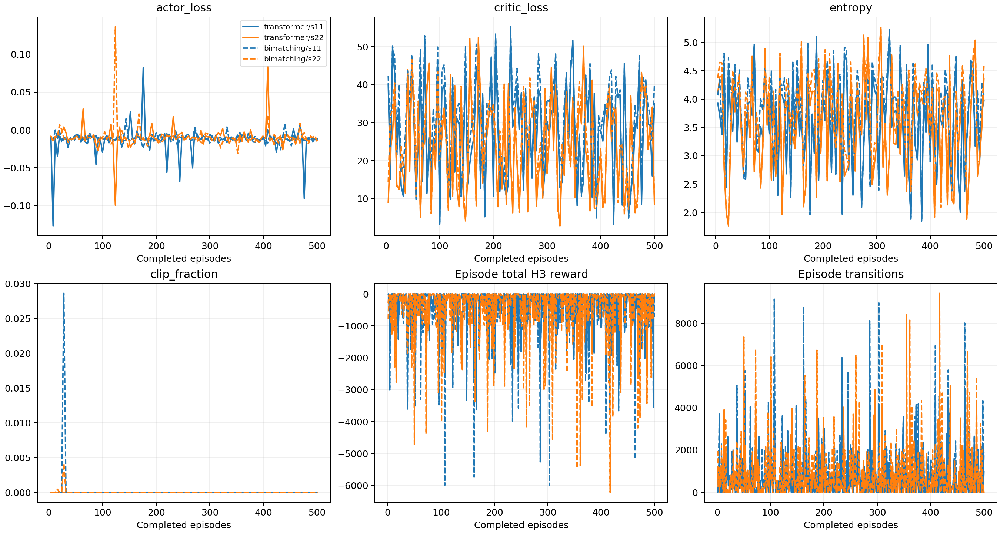
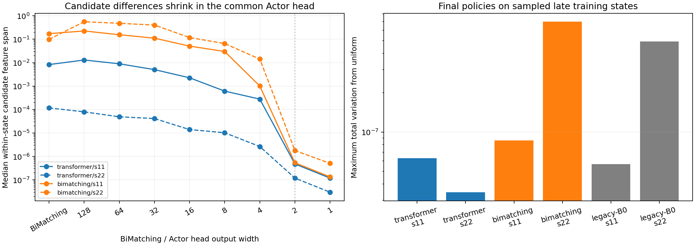

# 两种子训练检查报告（2026-10-28）

**结论：四个正式训练作业均完整结束，但发现严重的候选区分退化。** 本轮不能仅凭作业成功、loss有限就宣布策略有效学成，也不能据此回答Transformer是否有独立的策略质量贡献。现有训练成本、资源占用是真实结果；训练后的统一MILP测试尚未执行。

## 1. 训练完整性

实际完成 Transformer/BiMatching Only × 种子11/22，共四个运行。每运行500完整episode，20个训练实例各出现25次，四任务采集批次125个；五个100/200/300/400/500里程碑均可读取。配置、归一化及目标环境匹配，最终权重/优化器均有限，哈希匹配，最终无待更新轨迹。检查点、原始日志与code/configs未改动。

四个运行各22项完整性检查通过。逐批重建了策略版本、轨迹数、PPO更新和缓冲区流转；不是只读取summary的completed标志。目标均为Gold6148 / V100-SXM2-32GB，同一求解器/绑定/Torch。

| 模型 | 种子 | 完整episode | 有效PPO更新 | 转移数 | 训练墙钟h | GPU更新墙钟h | GPU峰值allocated GiB |
|---|---:|---:|---:|---:|---:|---:|---:|
| transformer | 11 | 500 | 125 | 307,947 | 6.75 | 1.11 | 3.960 |
| transformer | 22 | 500 | 123 | 303,320 | 7.06 | 1.37 | 3.961 |
| bimatching | 11 | 500 | 125 | 445,830 | 5.99 | 1.20 | 0.192 |
| bimatching | 22 | 500 | 123 | 451,376 | 6.07 | 1.24 | 0.192 |

种子22的两组均在episode244/396因累计转移不足batch256暂不更新：分别为14条，以及197/198条。轨迹保留到下一批共同更新，最终全部消耗；因此123次有效更新不是训练失败。种子11均为125次。更新前importance ratio误差最大8.29e-6，低于框架1e-4门槛。

种子33确有两次启动日志，但两次均在 `baseline_bundle` 的CPU/软件/协议来源检查处被拒，未产生训练检查点。日志未打印具体哪项指纹不同，因此只记录“环境来源不匹配”，不猜测具体CPU。四个正常运行与这两次未启动的作业分别记账。

## 2. 训练资源与耗时（两个训练种子的均值）

| 指标 | Transformer + BiMatching | BiMatching Only | 相对变化 |
|---|---:|---:|---:|
| 训练墙钟h | 6.903 ± 0.22 | 6.03 ± 0.0612 | -12.64% |
| GPU更新墙钟h | 1.242 ± 0.187 | 1.215 ± 0.0286 | -2.11% |
| 转移数 | 3.056e+05 ± 3.27e+03 | 4.486e+05 ± 3.92e+03 | +46.78% |
| GPU峰值allocated GiB | 3.961 ± 0.000237 | 0.1918 ± 0.000248 | -95.16% |

±为两个训练种子的样本标准差，不能据此宣称统计显著。移除Transformer后训练总墙钟平均减少12.6%、峰值allocated显存减少95.2%；累计GPU更新时间只减少2.1%，而非准备pilot中的31.9%。原因之一是转移数增加46.8%、优化步数也更多。轨迹/候选集合不同，不能将累计更新时间作为同输入的单次推理加速比。此处不包含排队、开发选模和最终测试。

## 3. 关键问题：权重更新，但策略几乎均匀

前40个共享早期真实状态检查中，四个Actor的权重确实变化；相同种子初始化摘要也与训练起点匹配。随后对每个模型各自最后20个episode抽样，共193个真实状态、16–17个实例/模型、4–511个候选，未截断候选；四个最终策略在全部这些探针上几乎等于 `p(a|s)=1/L`。

| 模型 | 种子 | 末期探针数 | 与均匀分布的最大TV距离 | 最小归一化熵 H/log(L) |
|---|---:|---:|---:|---:|
| transformer | 11 | 48 | 6.310e-08 | 0.999999896 |
| transformer | 22 | 48 | 3.462e-08 | 0.999999947 |
| bimatching | 11 | 48 | 8.626e-08 | 0.999999857 |
| bimatching | 22 | 49 | 6.982e-07 | 0.999999800 |

TV定义为 `0.5*sum(abs(p-1/L))`，0表示均匀分布。这是离线实际状态探针，覆盖范围有限，不能推断所有可能状态；但与uniform的差异只有约1e-8至7e-7，已足以说明目前没有看到有意义的候选偏好。动作部署采用Categorical采样，所以这些状态上的策略实质上接近均匀随机选择。

旧server6的B0-s11/s22开发集选模权重，在同一组48个末期状态上同样近均匀。两组共用的BiMatching/TreeGate源码与旧版相同；该现象不是本次旁路Transformer独有。

逐层追踪显示：BiMatching输出仍有候选差异；共同Tree-Gated Actor头按256→128→64→32→16→8→4→2→1缩减，接近2维LayerNorm时差异急剧缩小。以本轮Transformer/s11为例，候选特征差的中位数从BiMatching处约8.29e-3、4维头处2.79e-4，降至2维头处4.77e-7，最终logits约1.19e-7。BiMatching Only/s11也在同一位置出现明显压缩。

**这是输出头的候选区分退化证据和具体定位线索，还不是已经验证的修复方案。** 2维LayerNorm在两维差值同号、远离其eps尺度时会趋于相近的正负归一化模式，可能使连续差别难以传到最终logits。尚未用新头重训，不能把上述相关追踪直接等同于全部因果归因。

之前的放行验证覆盖了有限非零梯度、权重实际更新及恢复一致性，未覆盖训练后是否形成候选偏好；本轮补上了该检查，不能继续用“优化器成功更新”代替“学到了有效策略”。

## 4. 损失、奖励与曲线

四个运行的loss均有限，没有触发非有限梯度异常；Critic MSE有较强的实例间波动，不能仅凭有限loss称为收敛。归一化熵探针接近1，与训练日志中几乎没有PPO clipping的现象相符，单看原始entropy曲线会被候选数变化掩盖。

累计H3奖励没有显示清晰持续的上升；该奖励按决策累计，两组决策数和候选数不同，不能把总奖励更负直接等同于MILP质量更差。原始训练指标及episode奖励已导出CSV，曲线实际读取全部日志，没有填补不存在的结果。





## 5. 下一步判断

1. 四份训练产物完整，可保留用于复查和工程成本分析；无需因123/125次更新差别认定训练损坏。
2. 目前不宜将“去掉Transformer效果接近”解释为BiMatching已经足够；两组接近均匀策略会掩盖Transformer的独立策略贡献。
3. 优先针对共同Actor头建立候选区分和梯度敏感性诊断，验证退化原因；如果需要修复，必须单列为新实验，两组同改、从头独立训练，保留当前历史。不能直接给现有权重换头后冒充公平性能结果。
4. 尚未进行正式开发选模/测试，Nodes、Fair Nodes、PDI、Final Gap和完整MILP求解收益仍未测量。不要从训练采样轨迹中填充最终效果表。
5. 原协议和freeze/evaluate入口仍要求三个训练种子。若最终只采用11/22，应建立独立的两种子评估清单/入口，同时验证原训练协议；不能修改已训练配置来绕过哈希，也不能把缺失33记为完成。本轮没有启动种子33或评测任务。

## 6. 证据与复查命令

- [训练审计JSON](training-audit.json)：四个运行各22项检查、里程碑哈希、配置/环境和成本。
- [最终判断JSON](verdict.json)、[早期状态探针](policy-probe.json)、[末期及旧B0探针](late-policy-probe.json)。
- [训练更新CSV](updates.csv)、[2000个episode的CSV](episodes.csv)。
- [训练曲线PDF](training-curves.pdf)、[训练曲线SVG](training-curves.svg)、[策略诊断PDF](policy-head-diagnostic.pdf)。
- 审计脚本 `audit_training.py`、`probe_policy.py`、`probe_late_states.py` 只读原模型和日志，写本复核目录；没有运行优化器、SCIP求解或更改checkpoint。

```bash
cd /home/duweiyue25/tgppo-transfer/research/tgppo/experiments/transformer-ablation-20261027
source env.sh
"$TGPPO_PYTHON" docs/training-review-20261028/audit_training.py
"$TGPPO_PYTHON" docs/training-review-20261028/probe_policy.py
"$TGPPO_PYTHON" docs/training-review-20261028/probe_late_states.py
/home/duweiyue25/conda/envs/rl4scip/bin/python plot_results.py --output docs/training-review-20261028/training-curves
/home/duweiyue25/conda/envs/rl4scip/bin/python docs/training-review-20261028/plot_policy_probe.py
```
