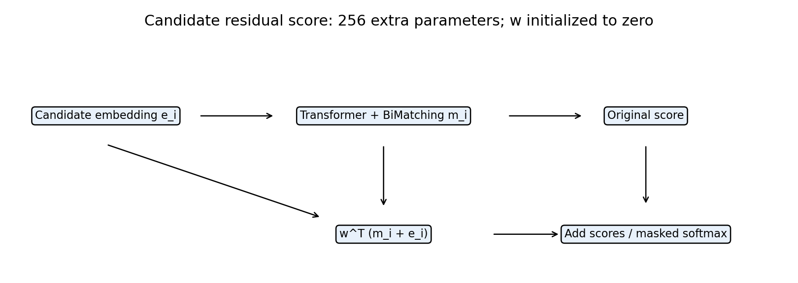
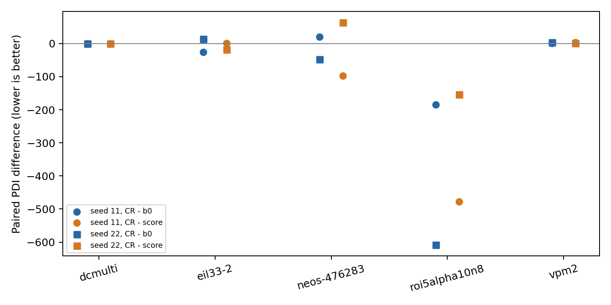
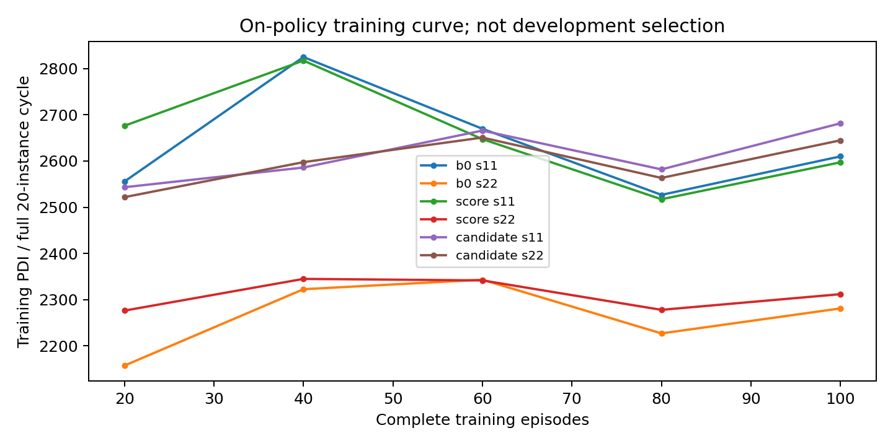
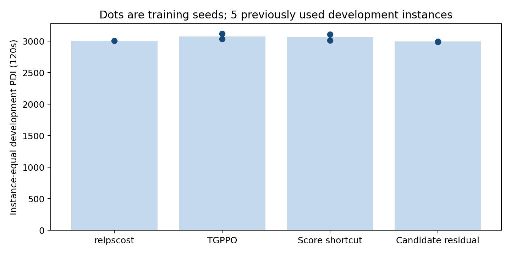

# TGPPO 候选信息残差评分：方法与开发实验

共同训练预算：每模型100完整episode；训练种子11/22，全部5开发实例×2求解器种子，120秒。
固定共同里程碑，不按开发输赢选择权重；原生参照同时展示。

方法：原logits + wᵀ(m_i+e_i)，w为零初始化256维向量；评分捷径消融仅用wᵀm_i。

| 方法 | 训练种子 | PDI↓ | cutoff证明率 | 无Actor任务/10 | Actor调用ms/分支 |
|---|---:|---:|---:|---:|---:|
| native | — | 3004.5596 | 70.0% | 10 | — |
| b0 | 11 | 3032.6794 | 40.0% | 2 | 10.763 |
| b0 | 22 | 3118.3525 | 40.0% | 2 | 10.520 |
| score | 11 | 3108.7797 | 40.0% | 2 | 10.425 |
| score | 22 | 3012.3269 | 40.0% | 2 | 11.358 |
| candidate | 11 | 2994.5174 | 40.0% | 2 | 11.044 |
| candidate | 22 | 2990.4899 | 40.0% | 2 | 10.911 |

候选残差相对参照的实例等权PDI差（负数更好）：

| 训练种子 | CR−B0 | CR−评分捷径 |
|---|---:|---:|
| 11 | -38.16204 | -114.26232 |
| 22 | -127.86258 | -21.83699 |

两个训练种子的平均差均支持CR；仍需逐实例测量区间与更大独立评估，不能宣称显著性或普遍泛化。

PDI上下界是超时过冲的测量边界，不是统计置信区间。不把solver重复当独立实例。Actor未参与的任务保留在主表，其差异不归因于神经决策。

当前为120秒/Adam的探索协议，未完成原论文3600秒规模复现。系统核验不计入本轮方法成果。

